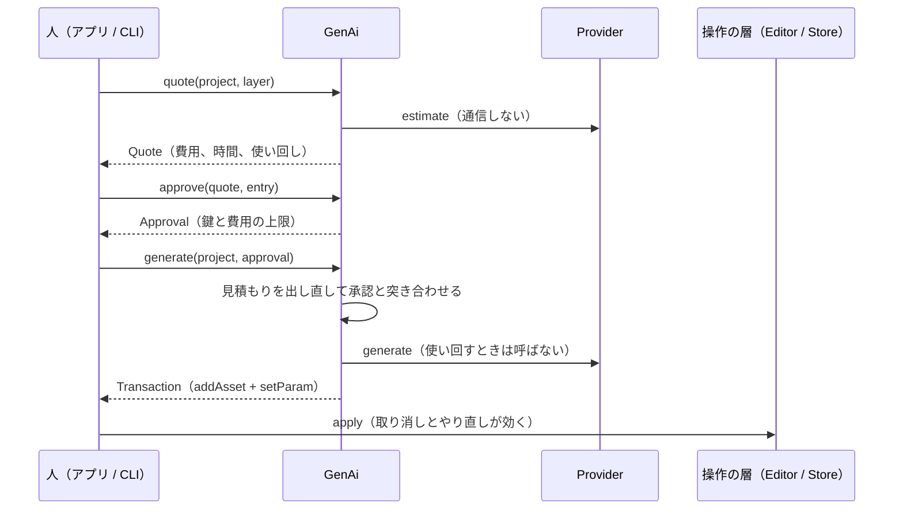

# mm-nodes-genai

`gen.ai` のノードの種類。プロンプトと設定から画像・動画・音を生成 AI に作らせ、プロジェクトの素材として保存して描く（[04-nodes.md](../../docs/design/04-nodes.md) の `gen.ai`）。
この版は提供元を差し替える層（`Provider`）と偽の提供元（`FakeProvider`）だけを持ち、実際のサービスは呼ばない。どのサービスを使うかは下の「提供元の候補」を見て人が決める。

## パラメータ

| 名前 | 型 | 既定 | 意味 |
|---|---|---|---|
| `provider` | 文字 | `fake` | 提供元の名前（`Provider::id`） |
| `media` | 選択 | `image` | `image`、`video`、`audio` |
| `prompt` | 文字 | 空 | プロンプト |
| `width`、`height` | 数（1 以上の整数） | 1920、1080 | 画素。音では使わない |
| `duration` | 数（秒） | 5 | 動画と音の長さ。画像では使わない |
| `seed` | 数（0 以上の整数） | 0 | シード |
| `asset` | 素材 | 空 | 生成した素材。生成が書き、利用者は書かない |

描くのは `asset` の素材だけで、毎フレーム生成しない。レンダラーは撮影素材と同じくデコーダー（FFmpeg）で素材を開いて渡すので、画像・動画・音の違いはデコーダーが吸収する。`asset` が空の間は透明で無音。

## 生成の流れ

- 頼みの鍵は、パラメータ（`asset` と種類に関係しない値を除く）と提供元の版（`Provider::revision`）の BLAKE3。同じ鍵の素材は `<project>/media/genai/<鍵>.<拡張子>` と素材の JSON（`<鍵>.json`）に残り、取り消した後も提供元を呼ばずに置き直せる。
- 承認（`Approval`）は `GenAi::approve` だけが作る。MCP の経路（`Entry::Mcp`）からは作れない（提案の承認と同じ。[RFC 0078](../../docs/rfcs/0078-review-proposals.md)）。
- `generate` は見積もりを出し直し、承認の後にパラメータが変わっていれば `NotApproved`、費用が承認した上限を超えれば `OverBudget` で断る。
- 自動の改善の回の中（環境変数 `MM_IMPROVE_RUN` がある。`mm-improve` が回の `claude -p` に渡し、子の `mm` が受け継ぐ）では、`approve` と `generate` を `Forbidden` で断る。`GenAi::in_round` は印を足せるだけで外せない。

## 提供元を足すとき

`Provider` を実装したクレートを足し、操作経路が `Providers::with` で表に入れる。契約は 3 つ。

- `estimate` は通信せず、自分の料金表から費用と時間を出す（見積もりは何度でも呼ばれる）。
- `generate` だけが費用のかかる呼び出しをする。非同期の API（ジョブを投げて待つ形）は、この中で完了まで待つ。
- 同じ `revision` と頼みには、できるだけ同じ中身を返す（シードを渡す）。モデルを変えたら `revision` を変える。

API の鍵は環境変数で渡し、プロジェクトのデータとログに残さない。

## 提供元の候補

2026 年前半の公開情報の目安。料金と規約は変わるので、決める前に各社の価格表と利用規約で確かめる。

### 画像

| 候補 | 費用の目安 | 品質と特徴 | API の形 | 規約の要点 |
|---|---|---|---|---|
| ローカルの ComfyUI（FLUX.1 schnell など） | 0（電気代。RTX 5090 で 1024² が数秒） | 中〜高。シードで再現できる | HTTP でワークフローを投げ、WebSocket で完了を待つ | FLUX.1 schnell は Apache 2.0。dev は非商用 |
| OpenAI（gpt-image-1 系） | 1 枚 0.01〜0.2 ドル（画質と大きさで変わる） | 高。文字の描き込みと指示への従い方が強い | 同期の REST | 出力の権利は利用者。内容の方針あり |
| Google（Imagen 4、Gemini の画像） | 1 枚 0.02〜0.06 ドル | 高。写実が強い | 同期の REST（Gemini API / Vertex AI） | SynthID の透かしが入る |
| fal.ai / Replicate（FLUX 1.1 pro ほか多数） | 1 枚 0.03〜0.06 ドル | モデルを選べる | ジョブを投げて待つ（Webhook かポーリング）。1 つの形で多くのモデル | モデルごとの規約に従う |

### 動画

| 候補 | 費用の目安 | 品質と特徴 | API の形 | 規約の要点 |
|---|---|---|---|---|
| ローカルの ComfyUI（Wan 2.x） | 0（RTX 5090 で 720p の 5 秒に数分） | 中。動きの破綻が出やすい | 画像と同じ | Apache 2.0 |
| Google Veo 3 系 | 1 秒 0.15〜0.75 ドル（Fast と音の有無で変わる） | 最上位。音も一緒に作れる | 長時間の操作（投げて完了を待つ） | SynthID の透かし |
| OpenAI Sora 2 | 1 秒 0.1〜0.5 ドル（pro と解像度で変わる） | 最上位 | ジョブを投げて待つ | 実在の人物の扱いに制限 |
| Runway（Gen-4 系）、Kling、Luma（fal / Replicate 経由も可） | 1 秒 0.05〜0.15 ドル | 高。画像からの動画が得意 | ジョブを投げて待つ | サービスごと |

### 音

| 候補 | 費用の目安 | 品質と特徴 | API の形 | 規約の要点 |
|---|---|---|---|---|
| ElevenLabs（読み上げ、効果音、音楽） | 文字数か秒の従量（月額の枠つき） | 読み上げと効果音は最上位 | 同期の REST | 商用は有料の枠で可 |
| Stability AI（Stable Audio 2.x） / Stable Audio Open をローカルで | API は 1 曲数セント / ローカルは 0 | 効果音と短い BGM 向き | 同期の REST / ComfyUI | Open はコミュニティの許諾（年商の上限あり） |
| Google Lyria 2 | 30 秒で数セント | 器楽の BGM | 同期の REST（Vertex AI） | SynthID の透かし |

Suno と Udio は公式の公開 API が無いので候補から外す。MusicGen の重みは非商用（CC-BY-NC）なので vlog の公開には使えない。

### 推奨

| 案 | 自信度 | 理由 |
|---|---|---|
| まずローカルの ComfyUI（画像は FLUX.1 schnell、動画は Wan 2.x、音は Stable Audio Open）を 1 つ目の提供元にする | 55% | RTX 5090 があり、費用 0 で試行回数を気にせず回せる。シードで再現でき、使い回しの鍵とも合う。1 つの HTTP の形で 3 種類をまかなえる |
| fal.ai か Replicate を 1 つ目にする | 35% | 1 つの API の形で FLUX、Kling、Veo などを選べ、品質の上限が高い。費用は見積もりの関門で抑えられる |
| 種類ごとに直接の提供元（画像は OpenAI、動画は Veo、音は ElevenLabs）にする | 25% | 各分野の最上位。ただし API の形が 3 つになり、鍵と規約の管理が増える |
| その他 | 15% | 用途（字幕の挿絵だけ、BGM だけなど）が絞れれば、もっと安い専用のサービスが合う |
