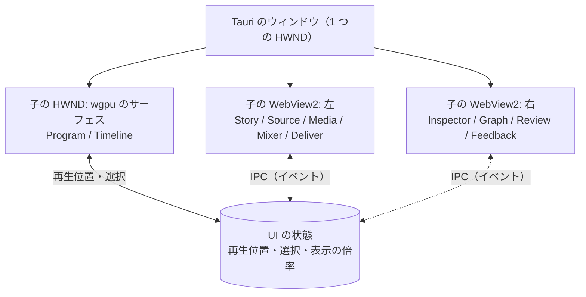

# UI

パネルの組み合わせで、どの作業も 1 つの画面で進める。どのパネルも同じプロジェクトのデータを見る。再生位置と選択は全体で 1 つ。文言は英語。

割り付け、Timeline の情報（レイヤーの見出し、縦のスクロール、帯の中身）、時間の操作（ツール、ズーム、スナップ）、キーフレームの見せ方、見つけやすさ（メニュー、ツールチップ、ショートカットの一覧、空の状態）、文言の選び方は [UI の分かりやすさ](18-ui-clarity.md) に書く。

| パネル | 作る場所 | 内容 |
|---|---|---|
| `Program` | wgpu | プログラムモニター。選ばれた GPU の名前、未描画のマーク、HDR |
| `Timeline` | wgpu | `sequence` のカットと接続したレイヤー。端のつまみ、刃、スナップ、マーカー、AI が変えた所の色、ショートで使っているカットのマーク。数千のカットと波形を 60 fps で |
| `Graph` | WebView（SVG） | 選んだパラメータの値の曲線。キーとベジェのハンドルのドラッグ（[RFC 0077](../rfcs/0077-keyframe-graph.md)） |
| `Mixer` | WebView | トラック（音を持てるレイヤー）ごとの音量・パン・ミュート・ソロ・送り先のバス、役割ごとのバスの音量、ダッキング、マスターの音量。メーターはトラックとマスターのピーク、マスターの短期・統合ラウドネスとトゥルーピーク |
| `Source` | wgpu（映像）+ WebView（一覧） | 素材を見て I/O で範囲を付ける |
| `Inspector` | WebView | 選んだもののパラメータの入力欄。プロジェクトの値と、`inspector_kind`（MCP の `kinds` と同じ種類の一覧）で引いたパラメータの組ごとの定義から作る。値の無いパラメータは既定値で出す |
| `Story` | WebView | 文字起こしを読み、範囲を選んで `selection` に。使っている・使っていないの色分け、採用・却下・保留を 1 キーで、話題の概観、検索、収録の中の編集者への指示のマーク |
| `Transition` | WebView | シーケンスのカットを長さに比例して並べ、境のトランジションの印と種類を出す。選んだカットの頭に、パックのトランジションの種類と長さを選ぶ・外す（1 操作が `setTransition` 1 回） |
| `Review` | WebView | 時刻・範囲・描き込みのコメント、返信、承認。AI の対応 1 回を前後 2 秒ずつ続けて再生。数値の点検の注釈 |
| `Media`、`Deliver` | WebView（別画面） | 素材の一覧と取り込みの進み具合。レンダーターゲットと書き出しの進み具合 |
| `Feedback` | WebView（右下） | 改善要望の受け付け。画面の部品を指して添付できる |

- ウィンドウの組み立て: Tauri の `unstable` の機能で 1 つのウィンドウに複数の子 WebView を置き [25]、wgpu のサーフェスは Tauri のウィンドウの HWND の下に自前の子 HWND を作って、そこに `wgpu::Surface` を張る。WebView2 の透過は Windows で当てにならないので（黒くなる報告がある [26]）、重ねずに並べる。領域の境目はドラッグで動かし、Rust が両方の矩形を更新する。
- 表示の倍率: サーフェスの大きさと WebView の矩形はウィンドウの物理ピクセルから決め（[window](spikes/window.md#実装のとき気をつける所)）、サーフェスの中の UI（Program と Source の割り付け、Timeline の行の高さ〔Small 18、Medium 28、Large 56〕、つまみの幅 7、目盛りの文字、当たり判定）は論理ピクセルで持つ。論理ピクセルは WebView の CSS の px と同じ大きさで、物理ピクセルとの換算は `mm-ui-layout` の `Scale` だけが行い、`mm-ui-wgpu` の `Ui` が描く所と入力を受ける所で通す。分け方は Windows の Per-Monitor V2、winit の `scale_factor`、egui の `pixels_per_point` と同じ。矩形の辺は画素に丸めず、細い線（太さ 2 論理ピクセル以下: 目盛り、カットの境、外枠、再生位置の線）だけ太さを整数の物理ピクセルにそろえる（egui と同じく、1.25 倍でも線の太さが位置で変わらない）。文字は論理ピクセルの字の大きさでシェーピングし、描くときに表示の倍率を掛け、行の矩形の左上を整数の物理ピクセルに置く（`Scale::label_to_physical`。基線が画素の境にそろい、1.25 倍でも字が上下ににじまない）。表示の倍率は毎フレーム子の HWND から読む（`GetDpiForWindow`）ので、表示の倍率の違うモニターへ動かしたときは物理ピクセルの大きさが変わらなくても割り付けを計算し直して描き直す。`WM_DPICHANGED` の推奨の矩形でウィンドウの大きさを直すのは tao が行う。Timeline の表示の範囲（秒あたりの論理ピクセル）は保つ。
- Timeline の割り付け: Timeline の高さはサーフェスの 45% で、中身の高さには合わせない（`split_viewers`）。Timeline の中の矩形（ツールバー、目盛りの帯、見出しの列、行の領域、縦のスクロールバー、ズームバー、ステータスバー）は `mm-ui-layout` の `TimelineLayout` が決め、まだ無い領域は大きさ 0。行の高さと上端は `Rows`、それにズームと縦のスクロールを合わせた見えている所は `Viewport` で、当たり判定、描く矩形、文字、`--play-test` のクリックの位置が同じ値から計算する。描くのは見えている行だけ（数千のレイヤーでも二分探索で引く）。行の領域からはみ出す矩形は切り、字は行の領域の外に描かない。描く関数は領域ごとに `mm-ui-layout/src/paint/` の下のファイルに分け、`paint.rs` から名前の順に呼ぶ。重ね順は呼ぶ順でなく `Depth`（背景と縞、帯、帯に重ねるもの、暗がり、行の領域を囲む部品）で決める。縦のスクロール、行の高さ、開いたときに見せる行は [UI の分かりやすさ](18-ui-clarity.md#レイヤーの行とレイヤーの見出し)。表示の状態（ズーム、スクロール、行の高さ、スナップの入/切）は描画スレッドが共有状態に置き、アプリが `.mm/view.json` に書く（`view_state.rs`）。
- Timeline の文字（目盛りの時刻と帯の名前）は wgpu のサーフェスに描く。置き方は `mm-ui-layout`（`labels.rs`、`text.rs`）が決め、`mm-ui-wgpu` が cosmic-text でシェーピングし（`fonts.rs`）、glyphon で描く（`text.rs`）。重ね順は、帯と目盛り（とドラッグ中のツールチップの矩形）、文字、再生位置の線とスナップの表示（ツールチップの矩形の上は除く）。
  - フォント: theme.json の `font.family` の先頭（Tahoma）。そのフォントに無い日本語の字（と全角の記号だけの語）は Yu Gothic UI、Meiryo の順のフォールバックのフォントでシェーピングし、絵文字と記号は cosmic-text の Windows の既定（Segoe UI Emoji、Segoe UI Symbol）に任せる。cosmic-text の既定は `ja-JP` の漢字を中国語のフォントでシェーピングするので、漢字も日本語のフォントに固定する。字の大きさは目盛りが `size.sm`、帯の名前が `size.base`。
  - 帯の名前: レイヤーにもカットにも名前の欄が無いので、素材の名前を出す。撮影素材と静止画は素材のファイル名、文字は最初の行（ルビの注記を外す）、入れ子と sequence は指す先の ID、素材の名前が無いもの（単色）は種類の名前（`Solid`）。種類は帯の色に任せ、名前に付けない（種類の語を付けると、狭い帯で素材の名前が見えなくなる）。sequence のレイヤーはカットごとに出し、隙間には出さない。名前は帯の見えている所の左に寄せ、入らない分は書記素クラスタの境で切って「…」を付け、帯の外には描かない。名前を入れる幅が 12 論理ピクセル未満の帯と、1 字と「…」も入らない帯には出さない。字の色は明るい字と暗い字のうち、帯を描いた色とのコントラストの比（WCAG 2 の式）が高い方で、どの種類の帯でも 4.5 以上。無効なレイヤーの帯は行の背景に薄く重ねて描くので、重ねた色で字を選び、字も薄くする。
  - 矩形に置く関数: 矩形の中に文字を置くのは `place`（`mm-ui-layout/src/text.rs`）。縦は中央、横は余白を空けて左、中央、右に揃え、入らなければ左に揃えて切り詰める。字は文字ごとの矩形（`Label::clip`）の外に描かない（glyphon の描く範囲にする）。帯の名前のほか、[UI の分かりやすさ](18-ui-clarity.md) のレイヤーの見出し、ツールバー、ステータスバー、再生の操作のバーもこの関数で置く。
  - 速さ: シェーピングの結果は文字列と字の大きさごとにキャッシュし、表示が変わってもシェーピングし直さない（新しく見えた文字列だけシェーピングする）。切り詰めはキャッシュした切り詰めの位置から決め、シェーピングの結果を右端で切って「…」を続けて描くので、拡大や移動の間もシェーピングし直さない。置き場所と色が前のフレームと同じなら glyphon の頂点も作り直さない（再生中は Timeline の文字が動かない）。狭い帯は測る前にスキップするので、全体表示で数千のカットが細いときはシェーピングしない。
  - 先行事例: シェーピングと描画は cosmic-text と glyphon（`mm-text-glyphon` と同じ組み合わせ）。論理の大きさでシェーピングして描くときに倍率を掛けるのは egui の `pixels_per_point`。シェーピングの結果を切って「…」を足し、シェーピングし直さないのは Chromium の `text-overflow: ellipsis`。見えている所の左に寄せるのは CSS の `position: sticky` と同じ考え。帯に素材の名前を出し、種類を色で分けるのは Premiere（メディアの種類ごとのラベルの色 [95]）と Resolve の帯と同じ〔推。どちらも帯にはクリップの名前を出し、既定は素材のファイル名〕。字の色の選び方は WCAG 2 のコントラストの比。新規設計: 名前の欄が無いときに素材の名前を出すこと、置き場所と色が同じなら頂点を作り直さないこと。
- 描き込み（Review のコメントの線、矩形、点）は Program の上に wgpu で描く。WebView から Program の上に何かを重ねることはしない。0〜1 の座標を Program に映っている映像の矩形（レターボックスを除く）に合わせ、太さは論理ピクセルで線 3、点の直径 12（モバイル版の線と同じ CSS の 3px。表示の倍率を掛け、映像の拡大には依らない）、色はテーマの `accent`。出し方は Frame.io と DaVinci Resolve に倣い、Program に映るフレームで比べる。時刻のコメントはその時刻を含むフレームで止めている間だけ、範囲のコメントは映るフレームが範囲に掛かる間（再生中も）出す。Review で選んだコメントがその位置にあればそれだけを、無ければ確認がまだ（`open`、`fresh`）のものを出す。サーフェスへの重ね描きだけで、フレームのキャッシュと書き出しには入らない（`mm-ui-wgpu` の `drawing.rs`、アプリの `review/drawing.rs`）。
- AI の変更は「対応 1 回」の提案として保留され（[操作の「提案」](05-ops.md#提案)）、Review が一覧（だれが、操作の要約、範囲）と承認・一部の承認・却下・取り消しを出す。保留中は Program を「提案を適用したフレーム」と「元のフレーム」で切り替えられる。
- Deliver の書き出し: レンダーターゲットはコンポジションを指す形のまま（本編とショートはそれぞれのコンポジションを持つ）で、書き出しの依頼の `sequence` の上書きは依頼の全体に 1 つ。縦長のプリセット（Shorts）は縦長のコンポジションを既定に選ぶ。コマンドの形は `ui/sdk/README.md`。
- キー操作は J/K/L、I/O、刃（`B`）、矢印、`[` `]` を先に。wgpu のサーフェスと WebView のどちらにフォーカスがあっても同じ操作になるよう、キーの表は Rust が 1 つ持つ。
- Timeline と Source の入力と、それが出す操作（`apps/movie-maker/src/sequence_edit.rs` が計画し、`edit::submit` が適用する。取り消しは `Ctrl+Z`、やり直しは `Ctrl+Y`）。

  | 入力 | 操作 |
  |---|---|
  | カットの入/出つまみのドラッグ | `ripple`（スナップ: 他のカットの端、レイヤーの端、再生位置、キーフレーム、マーカー） |
  | Alt を押してカットの端 | `roll`（出つまみは次との編集点、入つまみは前との編集点） |
  | カットの中のドラッグ | `slip`（中身がポインターについてくる向き） |
  | Shift + カットの中 | `slide` |
  | レイヤーの端（sequence のレイヤーはカットの外に出た端） | `trimLayer`（スナップ: 他のレイヤーとカットの端、再生位置、キーフレーム、マーカー。撮影素材は素材の先頭と終わりで止まる。タイムリマップのあるレイヤーのイン点は動かない） |
  | `,` / ボタン | `insert`（再生位置に近い編集点へ。Source の範囲） |
  | `.` / ボタン | `overwrite`（選んだカット、なければ再生位置のカット） |
  | `B` | `split`（再生位置） |
  | `Delete` / `Backspace` | `lift` / `extract`（選んだカット） |
  | `I` / `O` | `markIn` / `markOut`（Source の位置） |
  | `J` `K` `L` | 逆再生（映像のみ）/ 停止 / 再生（Source を選んでいれば Source） |
  | `N` / View > Snapping | スナップの入/切（表示の状態。操作にしない。ドラッグ中は押している間だけ反転） |

  ドラッグ中はプロジェクトのデータを変えず、`trimLayer` は帯の端だけを動かして描き、離したときに 1 つの操作として適用する（Premiere、Resolve のトリムと同じ）。吸い付いたときだけスナップの表示を出し、ポインターの横に動かした量のツールチップを出す（[UI の分かりやすさ](18-ui-clarity.md#スナップ)）。動かせる範囲は Timeline のモデル（`mm-ui-wgpu` の `timeline_model` が作る `TrimBounds`）が操作の検査と同じ素材の余白（`Layer::trim_room`）から持つので、離した操作が拒否されない。ドラッグ中の Esc と、離す前にキャプチャーを失ったとき（別のウィンドウが取った）は、操作を出さずにドラッグ中の見た目を戻す。

  sequence の長さが変わる編集（`insert`、`extract`、`ripple`、`insertTopics` など）は、sequence を置いたレイヤーのアウト点とコンポジションの長さも同じトランザクションで合わせる（`fitLayer`、[操作](05-ops.md)）。取り消し 1 回で戻る。
- スナップ、名前付きバージョン（`mm export --name`）と `mm diff` の意味の差分、操作ごとの自動保存とクラッシュからの復元（[保存の形](09-ingest-storage.md#バックアップと復旧)）。

## 優先度と Windows XP 風の採り方

優先度は、使いやすいこと > 高速なこと > Windows XP のムービーメーカー風であること。3 つがぶつかったら上を採る。

| XP のムービーメーカーの要素 | 採る | 採らない | 理由 |
|---|---|---|---|
| 配色（Luna の青。ウィンドウの地は `#ece9d8`、強調は `#316ac5`、Tahoma 系の字） | 既定のテーマにする。durun-dashboard の XP スキンと同じ値を使う（`:root[data-skin="xp"]` の変数 [38]） | ダークの OS でも明るい配色を強いること。テーマは切り替えられるようにし、`default`（暗い）も持つ | 結合したときに dashboard と同じ見え方になる。ユーザーが暗い画面で長く作業する日もある |
| ベベルと角丸 3 px のボタン、白から薄い青へのグラデーションの見出し | WebView の画面と wgpu のサーフェスの両方で描く | | 雰囲気の要。描くのは軽い |
| 左の作業ウィンドウ（Movie Tasks。手順を上から並べ、クリックで進む）〔推。XP のムービーメーカー 2 の記憶〕 | `Tasks` パネルとして持つ。取り込む → 切る → 文字と音を足す → 書き出す、の順に並べ、各項目が対応するパネルとマクロを開く。dashboard の `.xp-task-title`・`.xp-task-body` と同じ形 [38] | 作業ウィンドウからしかたどり着けない機能を作ること。全部の機能はキー操作とパネルからも届く | 初めての人の道しるべになる。慣れた人の邪魔にはしない |
| ストーリーボード（カットをサムネイルで横に並べる） | `Timeline` の表示の 1 つとして持つ（`sequence` のカットを等幅のカードで。トランジションはカードの間の小さな箱） | 時間に比例する表示の代わりにすること | 並び替えだけなら速く、話の流れを見るのに向く |
| 単色の背景の「コレクション」の一覧 | `Media` の見た目に合わせる | | |
| 中央のモニターと右の再生の操作 | `Program` は wgpu で描き、操作の列だけ XP 風の形に | 映像の上に飾りを重ねること | 速さと見え方を損なわない |
| ロゴ、アイコンの画像、フィルムの飾り | 自前で描く（dashboard と同じく CSS か、小さな SVG）。商標のロゴと画像はコピーしない | | |
| 効果の一覧のプレビューの小さな動画 | 後で。`shader.wgsl` のトランジションをフィクスチャの素材で描いた短い動画を出す | | |

- テーマの値（色、角丸、字、ベベルの線）は 1 つのファイル（`ui/theme/theme.json`）に置き、WebView の CSS 変数と wgpu のサーフェスの描画の両方がそこから読む。境目で色が食い違わない。
- 選択と操作の道: Timeline（wgpu）で選んだレイヤーは、Rust が共有状態に置き、Tauri のイベント `mm:layer-selected` で WebView に送る（選んだレイヤーの中身と素材の一覧。編集で中身が変わったときも送り直す）。Inspector の値の変更は `apply_op` で再生スレッドに届き、適用の後にプロジェクトのデータを置き直して、Timeline のモデルとレイヤーの一覧が追いつく。開いているコンポジションを消す操作は拒否する。
- Mixer の道: フェーダーとつまみは離したときに 1 回だけ `setLayerAudio`（レイヤーの音の設定の全体）か `setMixer`（コンポジションのミキサーの設定の全体）を `apply_ops` で送り、取り消し 1 回で戻る。メーターは、再生スレッドが音を先読みで混ぜるたびに区間ごとの値（トラックのピーク、マスターのピークとラウドネス）を記録し、再生位置を送る同期のスレッドが鳴っている位置の区間を選んで Tauri のイベント `mm:mixer-meters` で送る（60 Hz）。メーターは数十本の棒と数字なので、wgpu のサーフェスに置かず WebView で描く。
- 色の表示の式: 線形の光と画面の値の変換は Rec.1886（`v^2.4`、黒のオフセットなし）の 1 つだけ。`Program` のシェーダー、書き出しの `bt709`、Inspector の色選択（`ui/panels/inspector/src/color.ts`）が同じ式を使うので、選んだ `#101010` は `Program` にも `#101010` で出る。テーマと UI の部品の色（`theme.json`）は画面の値をそのまま指定し、変換しない。
- 使いやすさで XP 風より優先するもの: J/K/L とキー操作、ドラッグの滑らかさ（60 fps）、数千のカットの `Timeline`、パネルの大きさの変更、Inspector の入力フィールドの密度（XP の大きな余白はとらない）。
- durun-dashboard と結合したときは、dashboard のスキンが `xp` なら movie-maker も `xp`、`default` なら `default` にそろえる〔推。結合の設計で決める〕。

---

出典の番号（[1] など）は [references.md](references.md) を見る。
