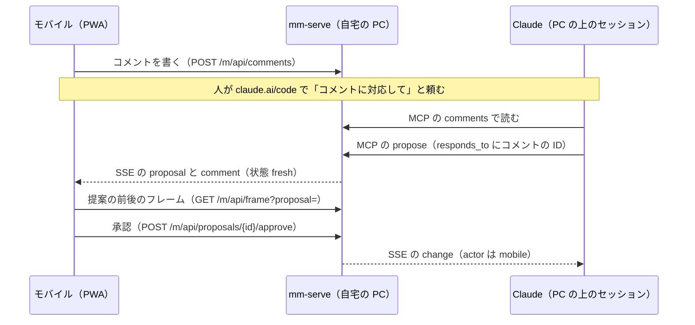
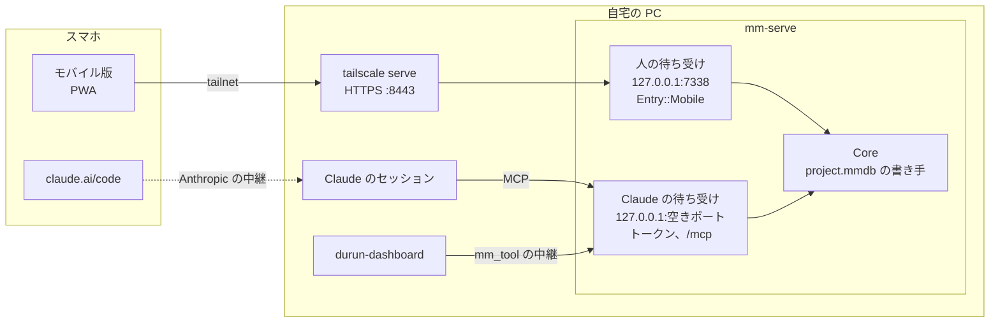

# モバイル版

段階 9 の終わりの条件は「出先で Story とコメントと操作の発行ができる」。
この章は、その形、つながり方、映像の届け方、画面、実装の分け方を決める。
形、つながり方、即時の操作の範囲、PC が閉じているとき、オフライン、通知は 2026-11-08 にユーザーが決めた（[決まったこと](16-open-questions.md#決まったこと) の 6〜11）。

| 項目 | 決めたこと |
|---|---|
| 形 | 自宅の PC の `mm-serve` が配る PWA（`ui/mobile/`、Preact）。対象は iOS の Safari と Android の Chrome。durun-dashboard からは URL を開く |
| つながり方 | Tailscale の `tailscale serve`（HTTPS、tailnet の中だけ）から、`mm-serve` の人の待ち受け（127.0.0.1 の決まったポート）へ。端末は PC のアプリで登録する |
| 権限 | 人の待ち受けは人の操作経路（`Entry::Mobile`）。提案の承認と却下を受ける。MCP は置かない |
| 映像 | 静止画のフレーム、区間ごとに作る HLS（360p 約 0.5 Mbps）、素材の音だけ。WebRTC は採らない |
| 操作の発行 | Story の操作とマーカーは即時（取り消しつき）。それ以外は、コメントで Claude に頼み、返った提案をモバイルで承認する |
| PC のアプリが閉じているとき | durun-dashboard から movie-maker を起動する |
| オフライン | 接続を前提にし、コメントだけ送信待ちのキューに置く |
| 通知 | durun-dashboard の通知に任せる。Web Push は作らない |

## 前提

- 正本は自宅の PC の `project.mmdb` で、書き手は 1 つ（[保存の形](09-ingest-storage.md#保存の形)）。描画とエンコードも PC の GPU で行う。モバイルは表示と入力だけを受け持つ。
- ユーザーは durun-dashboard を複数の端末から使っている。ダッシュボードは 127.0.0.1 で待ち、`tailscale serve` で tailnet に中継し、tailnet での名前で届いた要求だけを受ける [92]。tailnet はすでにある。
- Claude Code のセッションにもスマホから入る（claude.ai/code）。Claude は PC の上で動き、`mm-serve` の MCP で movie-maker を操作する（[HTTP サーバー](05-ops.md#http-サーバー)）。
- 回線は 4G/5G の従量か上限つきで、電波の弱い所もある。端末はバッテリーで動く。

主な流れは次のとおり。
人がモバイルでコメントを書き、claude.ai/code のセッションで Claude に対応を頼む。
Claude は MCP でコメントを読み、`propose` で提案を出す（`responds_to` にコメントの ID）。
人はモバイルで提案の前後のフレームを見比べ、承認か却下を決める。

## 形

### 先行事例

| 事例 | 中身 | 採るもの |
|---|---|---|
| Frame.io のモバイル | 上げた素材をサーバーが 360p〜2160p の H.264/H.265 のプロキシに変換して配る。API は 180p の配信用と、スクラブ用のフレームのスプライトも出す [82]。iOS のアプリは時刻つきのコメント、描き込み、返信を持ち、範囲のコメントと時刻の変更は持たない [83] | 低い画質の配信、フレームのスプライト、コメントの描き込み。範囲のコメントはモバイルでも持つ |
| DaVinci Resolve の Blackmagic Cloud | プロジェクトのライブラリをクラウドに置き、プロキシを優先して同期し、各自が手元に複製を持つ。ビンとタイムラインは自動でロックする [84] | 採らない。素材とプロジェクトのデータをクラウドに置く前提で、書き手が 1 つの `project.mmdb` と合わない |
| Premiere と Frame.io、Premiere の iPhone 版 | Premiere の iPhone 版は端末の上で編集し、Frame.io を経由してデスクトップで続ける [85]。レビューは Frame.io のアプリ | 採らない。端末の上の編集は素材を端末に持つ |
| LumaFusion | iPhone と iPad の上で編集する。素材は端末に置き、端末の間はプロジェクトの書庫（素材ごと、切った分だけ、素材なし）で移す [86] | 採らない。同じ理由 |
| CapCut のクラウドの下書き | 同じアカウントの端末の間で下書きと素材をクラウドの容量に同期する〔推。公式は容量の説明だけ [87]〕 | 採らない。素材を外に上げる前提 |
| Figma のモバイル | 閲覧とコメントが中心で、デザインのファイルは編集できない。Mirror はデスクトップで選んだフレームを映す [88] | 範囲を絞る考え方。重い編集は PC に残し、モバイルは見る、書く、決めるに絞る |

先例は 2 つに分かれる。
端末の上で編集する型（LumaFusion、Premiere の iPhone 版、CapCut）は、素材とプロジェクトのデータを端末かクラウドに置く。
レビューの型（Frame.io、Figma）は、サーバーが描いた低い画質のものを配り、コメントと決定だけを端末で受ける。
movie-maker は素材を外に出さない（通信量と容量）ので、レビューの型を採る。

### 判断

| 軸 | A. PWA（`mm-serve` が配る） | B. durun-dashboard の中の画面 | C. Tauri 2 のモバイル |
|---|---|---|---|
| 作る物 | `ui/mobile/` の画面と、`mm-serve` の人の待ち受け | ダッシュボードの画面と、`mm-serve` への中継 | iOS と Android のアプリ。この章の前の案では、端末に `mm-doc`、`mm-ops`、`mm-store` を載せて操作の並びで同期する案だった |
| ビルドと配布 | PC の `pnpm build` だけ。ストアも署名も要らない | 同じ | iOS は macOS と Xcode が要る [90]。ユーザーの開発機は Windows。署名と配布の手間 |
| 既存の画面の流用 | Preact と `ui/sdk` の `Transport`、パネルの `model.ts` をそのまま使う | ダッシュボードの画面の技術に合わせて書き直すか、iframe で A を埋める | WebView なので A と同じだけ流用できる |
| オフライン | 送信待ちのキュー（IndexedDB）まで | A と同じ | 端末に複製を持てる。ただし複製の同期は、書き手が 1 つで CRDT を使わない決まり（[同時書き込み](05-ops.md#同時書き込み)）と別の仕組みになる |
| 通知 | iOS 16.4 からホーム画面の Web アプリで Web Push [91] | ダッシュボードの通知 | ネイティブの通知 |
| 誰の操作かの区別 | 人の待ち受けを分けるので、MCP と混ざらない | ダッシュボードは人の画面と Claude の `mm_tool` の両方を中継するので、ダッシュボードの中で分ける必要がある | A と同じ |
| movie-maker の単独で動くか | 動く | ダッシュボードが要る | 動く |

A を採る（2026-11-08、ユーザー）。対象は iOS の Safari と Android の Chrome の両方。
ビルドも配布も PC の中で済み、iOS のために macOS を用意しなくてよい。
画面は `ui/` の Preact とパネルのモデルを流用できる。
B は、ユーザーがすでにスマホでダッシュボードを開いている点で開く所が 1 つになる利点がある。ただし movie-maker が単独で動かなくなり、ダッシュボードの中で人の操作と Claude の操作を分ける仕事が増える。A の画面をダッシュボードのムービーメーカーのウィンドウから URL で開けば、開く所が 1 つになる利点の大半は A でも得られる（[ダッシュボードとのつなぎ](#durun-dashboard-とのつなぎ)）。
C は、オフラインで長く作業する要望が出たときに改めて考える。

ブラウザで動かす点は[README の決まったこと](README.md#決まったこと2026-11-05ユーザー)の「ブラウザで動く前提を外す」とぶつからない。外したのは編集ソフトの本体をブラウザで動かすことで、PWA は描画もデータも持たない表示の窓にとどまる。

## つながり方

### 先行事例

| 事例 | 中身 | 採るもの |
|---|---|---|
| durun-dashboard の Tailscale 経由 [92] | サーバーは 127.0.0.1 で待ち、`tailscale serve` が tailnet へ中継する。`Host` を tailnet での名前（`tailscale status` から読む）と比べ、`Origin` も確かめる。HTTPS（`*.ts.net`）にすると通知とクリップボードが使える | 全部。名前の読み方と `Host` の確かめ方は `server/access.ts` と同じにする |
| `tailscale serve` の本人のヘッダー [89] | tailnet からの要求に `Tailscale-User-Login` などを付け、外から来た同じヘッダーは消す。待ち受けが 127.0.0.1 だけなら偽装できない。タグの付いた端末と Funnel には付かない | 本人の確認の 1 番目 |
| Plex、Jellyfin、Home Assistant の端末の登録〔推〕 | 自宅のサーバーに端末を登録し、長く使える資格を端末ごとに持たせ、サーバーの画面で登録を外す | 端末の登録と、登録を外すこと |
| `mm-serve` のトークン（[HTTP サーバー](05-ops.md#http-サーバー)） | 起動ごとの乱数を持ち主専用のフォルダーに置き、`Authorization: Bearer` で確かめる | 端末の資格も同じフォルダーに置く。置くのは資格のハッシュだけ |

### 新しく設計したもの

- 人の待ち受け: `mm-serve` に 2 つ目の待ち受けを足す。127.0.0.1 の決まったポート（既定 7338、設定で変える）で待ち、`tailscale serve --bg --https=8443 http://127.0.0.1:7338` で tailnet に出す。ダッシュボードの 443 と別のオリジンにし、画面のスクリプトを分ける。クッキーはポートで分かれないので、パスを `/m` に絞り `HttpOnly` にする。ルーターは別に作り、`/mcp` と `entry` の指定を持たない。この待ち受けから来た操作は全部 `Entry::Mobile`（人）で、`actor` は `{ kind: "mobile", name: <端末の名前>, device: <端末の ID> }`（端末の ID は記録の `txns.actor_device` と提案の `actor_device`、`decided_device` に残す。コメントの書き手は `{ kind, name }` のまま）。Claude の待ち受けの発行元は今のまま `cli` と `mcp` だけなので、Claude の操作の発行元が `mobile` になる経路は無い。
- 確かめる順: (1) `Host` が tailnet での名前（`tailscale status --json` の `Self.DNSName`）で、`Origin` があれば同じオリジン。(2) `Tailscale-User-Login` があり、登録した端末のときと同じ人。(3) 端末の資格のクッキーが登録した資格のハッシュと合う。(4) 書き込みの要求はヘッダー `X-MM-Mobile: 1` を持つ（別のオリジンのフォームからの送信を止める）。順に 403、401、401、403。
- 端末の資格をクッキーにする理由: SSE の `EventSource` はヘッダーを足せない [93]。クッキーは `HttpOnly`、`Secure`、`SameSite=Strict`、パスは `/m`。`SameSite=Strict` は同じ tailnet の別の端末やダッシュボード（:443）のページを同じサイトとみなして止めないので、別のオリジンからの書き込みは (1) の `Origin` と (4) のヘッダーで止める（ヘッダーを付けた別のオリジンの要求には CORS の事前確認が要り、事前確認は資格を持たないので 401 で拒否される）。同じサイトのページは同じ名前のクッキーを足せるので、送られた資格のどれか 1 つが合えば通す。
- 端末の登録: PC のアプリの Devices パネル（右の WebView）で「Add device」を押すと、5 分だけ使える 8 文字の登録コードと、その登録コードを入れた URL の QR を出す。モバイルは登録コードを `POST /m/pair` に送り、端末の資格（32 バイトの乱数）をクッキーで受け取る。PC は資格の BLAKE3 のハッシュと端末の名前、`Tailscale-User-Login`、登録した時刻を持ち主専用のフォルダー（`%LOCALAPPDATA%\movie-maker\devices.json`）に置く。登録コードは 1 回で消え、5 回間違えたら無効にする。登録コードを先に確かめ、登録コードを知らない者に登録した名前を探らせない。名前の誤りでは登録コードを消さない。端末の名前は登録した端末の間で一意（大文字と小文字は区別しない）で、履歴と提案の一覧に発行元として出す。トランザクションの取り消し（undo）でどの端末が出したかは、登録ごとに新しく引く端末の ID（8 バイトの乱数）で見分ける。名前は登録を外すと別の端末が同じ名前で登録できるので、見分けに使わない（Kubernetes の `ownerReferences` が名前でなく `uid` で持ち主を指すのと同じ考え方）。手で入れた登録コードは Crockford の Base32 として読む（O を 0、I と L を 1）。登録を外すと、その端末の開いている SSE も閉じる。登録と登録を外すのは PC のアプリからだけで、モバイルからはできない。Claude が PC のファイルを読めても、ハッシュから資格は作れない。
- 登録コードを手で入れる経路も持つ: iOS ではホーム画面に置いた Web アプリと Safari でクッキーが分かれることがある〔推〕。QR を Safari で開いた後にホーム画面へ置いたときは、Web アプリの中で登録コードを入れ直す。Safari の登録は資格を使った登録なので、名前は別にする（同じ名前は `name_taken`）。
- 資格が効いたかを確かめる: 端末がクッキーを保存しない（Safari の「すべての Cookie をブロック」など）と、PC では登録が済み登録コードも消えたまま、画面は登録の画面に残る。モバイルは `POST /m/pair` の応答の後に `GET /m/api/project` を読み直し、401 なら英語の文言で知らせる（画面だけの code `pairing_not_kept`）。PC は資格を一度も使っていない登録にフラグ（`devices.json` の `unused`）を立て、その資格の付いた要求が初めて通ったときに下ろす。フラグの立った登録は操作を出していないので名前を塞がず、同じ名前の登録し直しで置き換える。登録コードの期限（5 分）を過ぎても使われなければ端末の一覧から消し、その資格も通さない。フラグの無い記録（フラグを足す前の `devices.json`）は使った登録とみなす。
- QR の URL は登録の画面 `https://<tailnet での名前>:8443/m/pair?code=<登録コード>`（`MobileServer::pairing_url`）。PWA の画面（`/m/api/` の外の読み出し）は資格の無い端末にも配り、`Host` と本人のヘッダーだけを確かめる。
- 拒否した要求の応答の `code` とログの理由: `forbidden_host`、`forbidden_origin`（403）、`no_tailnet_login`、`no_device`、`unknown_device`、`login_mismatch`（401）、`missing_mobile_header`（403）。登録の失敗は `pairing_unavailable`（登録コードが無い、期限切れ、使い切った）、`pairing_wrong_code`（401）、`name_taken`（409）。

#### 設定の手順

PC で 1 回だけ行う。tailnet と Tailscale の HTTPS の証明書（管理画面の DNS で MagicDNS と HTTPS Certificates を有効）はある前提。

1. movie-maker を起動する。人の待ち受けが 127.0.0.1:7338 で待つ（ポートが使われていると起動の画面に出る）。
2. 管理者でないターミナルで `tailscale serve --bg --https=8443 http://127.0.0.1:7338` を実行する。`--bg` で PC を再起動しても残る。
3. `tailscale serve status` で `https://<端末の名前>.<tailnet の名前>.ts.net:8443` が `http://127.0.0.1:7338` に向いていることを確かめる。ダッシュボードの 443 の行はそのまま残る。
4. PC のアプリの Devices パネルで「Add device」を押し、スマホのカメラで QR を読む（読めなければ `/m/pair` の画面で 8 文字の登録コードを入れる）。
5. やめるときは `tailscale serve --https=8443 off`。登録した端末は PC のアプリで登録を外す。

`tailscale funnel` は使わない。Funnel を通った要求には `Tailscale-User-Login` が付かず、2 番目の確認で 401 になる。タグの付いた端末からの要求も同じ。

### 権限

承認と却下は人の操作として受け、MCP からは受けない（[操作の「提案」](05-ops.md#提案)）。人の待ち受けはこの決まりの「人の操作経路」に入り、MCP の経路には入らない。

| できること | 人の待ち受け（モバイル） | Claude の待ち受け（MCP） |
|---|---|---|
| 読む（プロジェクトの要約、文字起こし、コメント、提案、静止画のフレーム） | できる | できる |
| 映像の配信（HLS、素材の音） | できる | 置かない |
| コメントを書く、返信する | できる | 返信だけ（`comment_reply`） |
| コメントの状態 | `done`、`wontfix`、`open` に戻す | 対応を適用した時に `fresh` になるだけ |
| 操作を即時に適用する | 下の表の操作だけ | 全部の操作 |
| 提案を出す | できる（「PC で決める」の下書き） | できる（`propose`） |
| 提案の承認、一部の承認、却下、保留に戻す | できる | できない（403） |
| 取り消し | 全体の直前のトランザクションがこの端末のもののときだけ（違えば 409 `not_latest`）。承認で適用したトランザクションは提案を決めた者のもの、それ以外は発行元のもの（PC のアプリで承認した提案は、提案を出した端末からも取り消せない）。端末は端末の ID で見分け、ID の無い記録（ID を記録する前の行）はどの端末からも取り消せない | できる |
| ロックの付いたレイヤー | 触れない（ロックは PC のアプリ以外の経路に効かせる） | 触れない |
| 端末の登録と、登録を外すこと | できない | できない |

モバイルから即時に適用できる操作は、Story で切る・並べる操作とマーカーに限る。

| 組 | 操作 |
|---|---|
| 話題と選別 | `addTopic`、`removeTopic`、`addSelection`、`removeSelection`、`rate`、`tag` |
| 文字起こし | `deleteWords`、`fixTranscript`、`cutWords` |
| 並べる | `insertTopics` |
| マーカー | `addMarker`、`removeMarker` |

ほかの操作（端の詰め、レイヤー、パラメータ、書き出し）は 403 `not_on_mobile` で断る。小さな画面で細かい編集を誤るより、コメントで Claude に頼み、提案の前後を見て決める方が確かなため。表に操作を足すときは、この表と `mm-story` の `MOBILE_OPS` を同じ PR で変える。

## 映像の届け方

### 先行事例

Frame.io は、上げた素材をサーバーが段階の画質に変換し、低い画質から配る。スクラブにはフレームのスプライトを使う [82]。
movie-maker の取り込みが作るプレビュー動画（540p、cq 28）は 1 時間あたり約 2.6 GB、平均で約 5.8 Mbps あり（[エンジンの「プレビュー」](06-engine.md)）、モバイルの回線にはそのまま流せない。

### 新しく設計したもの

| 方法 | 使う所 | 量の見積もり〔推〕 | 判断 |
|---|---|---|---|
| 静止画のフレーム（`GET /m/api/frame` の WebP、幅 360〜720） | コメントの時刻、カットの先頭、提案の前後、スクラブのつまみの上 | 1 枚 20〜60 KB | 採る。最初に作る |
| 区間ごとに作る HLS（MPEG-TS、4 秒の区間、H.264。360p 約 0.5 Mbps と 540p 約 1.2 Mbps、AAC 64 kbps） | 編集した結果を通して見る | 360p で 1 時間約 250 MB | 採る |
| 素材の音だけ（AAC 64 kbps の m4a、Range で読む） | Story で文字起こしの所を聞く | 1 時間約 29 MB | 採る |
| 提案の区間の短い動画（範囲の前後 2 秒、MP4） | 提案を動きで確かめる | 1 本 数百 KB〜数 MB（6 秒で約 0.7 MB） | 採る。HLS の後 |
| WebRTC で Program を流す | 再生の操作をその場で返す | 見ている間ずっと 1〜3 Mbps、PC は常にエンコード | 採らない。レビューに 60 fps のスクラブは要らず、電池と回線を食う |
| プレビュー動画をそのまま | | 1 時間 2.6 GB | 採らない |

- HLS の区間は見られたときに作る。プレイリストは今のバージョンのコンポジションの全区間を並べ、区間の要求が来たら描いて符号化して返し、次の 2 区間を先に作る。符号化は `mm-export` から `mm-encode-ffmpeg` の `h264_ts` で、目標のビットレートの H.264 と AAC の MPEG-TS に 1 回で書く。親のプレイリスト（`Streamer::master_playlist`）の `BANDWIDTH` は、VBV が許す 1 区間の最大（区間ごとにバッファーが 9 割埋まった所から始まり、4 秒の区間で上限の 1.45 倍）を見込んだピークの値。`mm-serve` は `/m/api/stream/{comp}/index.m3u8` で親のプレイリストを配り、端末はそれを読んで画質を選ぶ。親のプレイリストは `EXT-X-INDEPENDENT-SEGMENTS`（区間は 1 つずつ別に符号化して IDR から始まる）を持ち、`CODECS` は `mm-encode-ffmpeg` の `h264_ts` が固定する High profile、level 4.0（`avc1.640028`）と AAC-LC（`mp4a.40.2`）。描くのは `mm-stream` の専用のスレッドの 1 つの `Engine` で、PC の再生を止めない。`GET /frame` も `Streamer::with_engine` で同じ `Engine` を使える。区間の符号化は `mm-export` の符号化の段（`Engine` を持たない別のスレッド）が行い、描画の段はフレームを 1 つ描くごとに急ぎの仕事（静止画のフレーム、`GET /frame`、キャッシュの破棄）を挟むので、それらは区間 1 本ではなく描いている 1 フレームの終わりまで待つ。
- 区間のキーは区間の時間の範囲に掛かるもの（レイヤーとカットの JSON、区間の中の相対の位置、ノードの種類のバージョンと `cache_fingerprint`、素材の `contentHash`。[RFC 0013](../rfcs/0013-render-order-and-cache-keys.md) のフレームのキャッシュと同じ考え方）と画質から作り、URL に入れる。編集で変わらない区間はキーが同じなので作り直さず、端末のブラウザーにも残る（`Cache-Control: immutable`）。キーにはデコーダーの名乗りうる名前の全部（`Engine::decoder_backend_ids`。フレームのキャッシュの `unopened_decoder` と同じ）を入れ、どれかの画素の作り方のバージョンが上がったら前の区間を使わない。`decode=auto` は素材ごとにデコーダーを選ぶので、開くまでどれが画素を作るか分からない。区間は `cache/mobile/hls/` に置き、上限（既定 2 GiB）を超えたら使った時刻の古いものから捨てる。消しても作り直せる。
- 提案の区間の短い動画は `Play` を押したときに作る。書くのは提案を適用した後（`Before` と `After` の `After`）。`mm-serve` が提案を適用したプロジェクトと範囲（`comp_spans` と、触るレイヤーの見えている区間を適用の前と後の両方で引いたものを全部含む範囲。提案が足すレイヤーと動かすレイヤーの行き先も入る）を渡し、`mm-stream` の `Streamer::clip` が前後に 2 秒のプリロールとポストロールを足して（上限 30 秒）、`mm-export` から `mm-encode-ffmpeg` の `h264`（CRF 18、AAC）で 360p の MP4 に 1 回で書く。moov を先頭に置く（`+faststart`）ので、端末は `Range` で読みながら再生を始められる。描くのは HLS と同じ `Engine` で、描いた後に適用した操作が触る所を描画のキャッシュから捨てる（`GET /frame?proposal=` と同じ）。キーは適用する操作の JSON、範囲、範囲に掛かるもののハッシュ（区間のキーと同じたどり方）で、URL（`clip/{key}.mp4`）と `ETag` に入れる。提案の更新、却下、承認、範囲の中の編集のどれでもキーが変わるので、消す処理は持たず、置き場所の `cache/mobile/clips/` が上限 256 MiB を超えたら使った時刻の古いものから捨てる。
- 短い動画は作り終えるまで要求を待たせ、202 で再試行させない。`<video>` は 202 を再試行せず、作るのは 6 秒の範囲で 1 秒足らず（RTX 5090）なので、HLS の区間と同じく待たせる方が、押した操作の中の `play()` のまま再生が始まる。同じキーの要求は 1 つの出来上がりを待ち、同時に作るのは 2 本まで（超えた要求は 503）、待つのは 120 秒まで（超えたら 503 `timeout`。作るのは続け、出来たものはキャッシュに残る）。
- 短い動画の URL には、HLS の区間と同じくキー（範囲に掛かるもののハッシュ）を入れる（CDN の内容のハッシュつきの URL と同じ考え方）。端末は提案の応答（`GET /m/api/proposals/{id}?comp=&ops=`）の `clip_url` を押す前に読んでおき、編集の通知（`change`）のたびに読み直す。範囲の中が編集されると URL が変わり、再生中の短い動画を止める。選ぶ操作を変えたら、読み終えるまで `Play` を押せない。作り終えた短い動画はキーで引くので、再生の途中の `Range` の続きは前のキーの同じバイトで答え、別の MP4 のバイトを混ぜない。作っていない古いキーは 404 で、今のキーへはリダイレクトしない（リダイレクトすると、続きの `Range` が別の MP4 のバイトになる）。再生が失敗したら端末は URL を読み直す。応答は `immutable`。古いキーのファイルは消さず、ほかの短い動画と同じく置き場所の上限（256 MiB）で使った時刻の古いものから捨てる。キーを作るのは提案の 1 件の応答のときだけで、端末が読むのは提案を開いている間の編集の通知のたび。
- 符号化は 360p の CRF 18 のまま（6 秒で約 0.7 MB、約 1 Mbps）。YouTube や Vimeo の 360p（0.5〜1 Mbps）の上の端と同じ程度で、30 秒の上限でも数 MB に収まり、moov が先頭なので読み始めてすぐ再生できる。HLS の 360p（約 0.5 Mbps）のように上限を付けるには `mm-encode-ffmpeg` に MP4 の配信用のコーデックが要るので、[後の段階の注意](15-roadmap.md#試作で分かった後の段階の注意)に回す。
- コンテナは fMP4 でなく MPEG-TS にする。区間を 1 つずつ別に符号化して、編集の前後で作った区間を 1 本のプレイリストに混ぜるので、区間ごとに PAT、PMT、SPS、PPS を持ち、共通の初期化の区間（`EXT-X-MAP`）が要らない形が合う。
- iOS の Safari は HLS をそのまま再生する。Android の Chrome は直接の再生に頼らず、Media Source Extensions の上の hls.js で再生する。HEVC は端末ごとの差が大きいので使わない。
- 画質は 360p から始め、帯域に余裕があればプレーヤーが 540p へ上げる。親のプレイリストは軽い順に並べ、iOS のネイティブの再生は先頭の 360p から、hls.js は `startLevel: 0` で 360p から始める。区間は見られたときに作るので、最初の区間の待ちを短くし、作る時間を含む実測の帯域で上げるかを決める。画面に画質の切り替えは置かない。
- 電池: 映像は端末のハードウェアのデコーダーが読む H.264 に限る。画面を隠したら（`visibilitychange`）SSE を閉じ、戻ったら開き直して `hello` のバージョンから読み直す。時間で読み直す処理は持たない。

## 画面

`ui/mobile/` に置く。文言は英語（[UI](08-ui.md)）。テーマは `ui/theme/theme.json` を読む。下のタブで 3 つの画面を切り替える。

| タブ | 中身 |
|---|---|
| `Watch` | 上に映像（16:9、上に固定）。その下にカットの境とコメントのマーカーの付いたスクラブバー。その下にコメントの一覧（`Open`、`Fresh`、`Done` で絞る。`Fresh` を先頭に） |
| `Story` | 素材の一覧から文字起こしを開く。話題ごとの段落。使っている・使っていないの色分けはデスクトップの Story と同じ |
| `Proposals` | 提案の一覧（新しい順）。だれが、名前、操作の要約、触る範囲、後の編集と重なるか |

- コメント: 下の大きな `Comment` を押すと再生を止め、その時刻のフレームの上に入力欄を出す。文字は OS の音声入力でも入る。`Range` で今の時刻を始めにし、再生して止めた所を終わりにする。`Draw` で止めたフレームに指で線と矩形を描く（座標は映像の矩形を 0〜1 に正規化する。映像の矩形は映像の領域（縦向きは 16:9、横向きの全画面では画面）に、コンポジションの縦横比を保って収めた所で、縦のショートなどの左右のレターボックスの余白を除く。余白から描いた点は映像の縁に寄せる。デスクトップの Program の映像の矩形と同じ計算なので、同じ点がデスクトップの同じ所に出る。線の太さ（3 px）と点の直径（12 px）は画面のピクセルで決め、デスクトップと同じ。16:9 でないコンポジションに映像の領域を基準に描いた前の描き込みは移さない（どの端末のどの向きで描いたかを持たない）。デスクトップは Review の一覧に描き込みの数を出し、Program の上に wgpu で重ねて描く。[UI](08-ui.md)）。スレッドの画面で返信し、下のボタンで `Done`、`Won't fix`、`Reopen` を決める。
- コメントの形（`comments` の表の `json`。[保存の形](09-ingest-storage.md#表)。型は `ui/sdk/src/comments.ts`）: `{ id, comp, at | range: {in, out}, text, drawing: [{ kind: "stroke" | "rect" | "point", points }], author: { kind, name }, replies: [{ id, author, text, created_ms }], state, created_ms, client_id?, responded_txn? }`。`at` は時刻のコメントの時刻で、範囲のコメントでは `null`（`range` を持つ）。`author` は文字列でなくオブジェクト（端末は `kind: "mobile"`、`name` が端末の名前）。状態は人が書いて `open`、Claude の対応（`responds_to` を持つトランザクションの適用か提案の承認）で `fresh`（`responded_txn` がそのトランザクション）、人が確かめて `done` か `wontfix`。`fresh` は人からは決められず（400）、済みのコメントは対応で動かない。
- コメントの API: `POST /comments` は `{ comp, at | range, text?, drawing?, client_id? }`。本文か描き込みが要り、座標は 0〜1。`client_id` が同じ再送は書かずに先のコメントを返す（送信待ちのキューの再送用）。`GET /comments?state=&comp=&from=&to=` は `{ comments }`（書いた順）で、`from` と `to`（秒）は両方渡すとその区間と重なる時刻と範囲のコメントだけ。`POST /comments/{id}/replies` は `{ text }`、`POST /comments/{id}/state` は `{ state }`。どれも成功は `Comment` を返し、失敗は `{ error: { code, message } }`。書く、状態、描き込みは人の操作経路だけで、Claude の待ち受けは 403。変更は SSE の `comment`（`{ id, state }`）で流れる。
- 提案: カードを開くと前後のフレームを並べ、押すと切り替える（デスクトップの Program の切り替えと同じ）。`Play` は区間の短い動画（提案の応答の `clip_url`、選んだ操作だけを適用）に替え、URL を読むまでは押せない。映像が出るまでフレームの上に `Rendering clip…` を重ねる。iOS の Safari は押した操作の中で呼んだ `play()` だけを許すので、`<video>` を先に置き、押した操作の中で `src` を入れて `play()` を呼ぶ。`Play` は保留中で範囲（シーケンスの範囲か触るレイヤー）を持つ提案だけに出す。下の `Approve`（操作を選べば一部だけ）と `Reject`。決めた後の 5 秒は `Undo` を出す（全体の直前のときだけ効く）。
- Story: 単語を 1 回押すと始め、別の単語を押すと終わりになり、間を範囲にする（ドラッグはスクロールとぶつかるので使わない）。下の操作バーに `Keep`、`Reject`、`Hold`（`rate`）、`Topic`（範囲から話題）、`Delete`（`deleteWords`）、`Play`（その単語から素材の音）。話題の一覧は長押しで並べ替え、離すと開いているシーケンスへ `insertTopics`。上に検索。
- 「PC で決める」: 操作の前に切り替えると、即時に適用せず提案（`entry` は `mobile`）として出す。PC の Review かモバイルの `Proposals` で決める。
- 片手で使う要点: 決める操作は画面の下の 3 分の 1 に置く。押す所は 44 pt 以上。スワイプの操作には同じことをするボタンも置く。確認の画面は出さず、`Undo` で戻せるようにする。横にすると映像だけを全画面にする。
- オフライン: 段階 9 では接続を前提にする。コメントだけは送信待ちのキュー（IndexedDB）に置き、つながったら送る。localStorage は 5 MB 前後で上限に達すると書けず、書くたびに全体を書き直すので、描き込みつきのコメントが溜まる送信待ちには使わない。Safari の 7 日の消去（ITP）は IndexedDB と localStorage に同じく効き、ホーム画面に置いた Web アプリは Safari と別に数えるので、ホーム画面から使う前提にし、`navigator.storage.persist()` で容量が足りないときの消去も避けるよう頼む。操作は `base_version` を付けて送り、`Conflict` なら画面に出して読み直す。

### durun-dashboard とのつなぎ

- ダッシュボードのムービーメーカーのウィンドウに、モバイル版の URL（`https://<端末の名前>.<tailnet の名前>.ts.net:8443/m/`）を出す。画面は埋め込まず URL を開く（[レビューと Claude の対応](10-review-improve.md#レビューと-claude-の対応)の方針と同じ）。
- PC の movie-maker が閉じているときは、ダッシュボードのムービーメーカーのウィンドウから起動する（ダッシュボードはすでに起動できる）。人の待ち受けは movie-maker と一緒に始まる。
- ダッシュボードは `GET /events` の `change` の `actor` で人とエージェントを分け、人の操作をフックでセッションに届ける（`docs/movie-maker-connect-design.md`）。今は `gui` を人とみなしているので、`mobile` も人に数える。

## HTTP の形

人の待ち受けのパスは全部 `/m` の下に置く。形は Claude の待ち受けと同じ（失敗は `{"error": {"code","message", ...}}`）。

| パス | 中身 |
|---|---|
| `GET /m/` | PWA の画面、マニフェスト、Service Worker。`ui/mobile` のビルドの出力 |
| `POST /m/pair` | `{ code, device_name }` → `{ device_name, device: { id, name, login, paired_at_ms } }` と端末の資格のクッキー（資格は本文に入れない）。資格を確かめる前に受ける唯一の API |
| `GET /m/api/project` | `{ version, compositions, sequences, open_composition, cuts }`（素材のパスは返さない）。`open_composition` は先頭のコンポジション、`cuts` はその中のカットの境の秒（スクラブバーの目盛り） |
| `GET /m/api/story/overview`、`/transcript?asset=`、`/range?asset=&first=&last=`、`/search?q=` | `ui/panels/story/src/api.ts` の `StoryApi` と同じ形 |
| `POST /m/api/ops` | `{ op }` か `{ txn }`、`base_version` は必須。即時に適用できる操作だけ |
| `POST /m/api/undo` | 全体の直前のトランザクションがこの端末（端末の ID で見分ける）のもののときだけ。承認で適用したトランザクションは提案を決めた者のもの |
| `GET /m/api/comments?state=`、`GET /m/api/comments/{id}`、`POST /m/api/comments`、`POST /m/api/comments/{id}/replies`、`POST /m/api/comments/{id}/state` | コメントの一覧、1 件、書く、返信、状態 |
| `GET /m/api/proposals`、`GET /m/api/proposals/{id}`、`POST /m/api/proposals`、`POST /m/api/proposals/{id}/approve`、`/reject`、`/reopen` | 提案。形は Claude の待ち受けの `/proposals` と同じで、`comp_spans: [{ comp, layer, sequence, start, end }]`（`scope.sequences` の範囲を、そのシーケンスを置いたレイヤーのコンポジションの秒に変換したもの。時間の写像を持つレイヤーは変換しない）を足す。`GET /m/api/proposals/{id}?comp=&ops=` は `clip_url`（今の中身の短い動画の URL。保留中でない提案、範囲の無い提案、配信を持たない待ち受けは `null`）も足す |
| `GET /m/api/frame?comp=&t=&width=&proposal=&ops=` | 静止画のフレーム。`t` は `comp`（省くと先頭のコンポジション）の時間軸の秒。保存したデータは WebP（`ETag` に `If-None-Match` で 304）、`proposal` つきは提案を適用した PNG |
| `GET /m/api/stream/{comp}/index.m3u8`、`GET /m/api/stream/{comp}/{quality}.m3u8`、`GET /m/api/stream/{comp}/seg/{key}.ts` | HLS の親のプレイリスト、画質ごとのプレイリスト、区間。親のプレイリストは画質ごとのプレイリストを相対パス `{quality}.m3u8` で指し、画質ごとのプレイリストは区間を相対パス `seg/{key}.ts` で指す（どの名前のコンポジションともパスがぶつからない） |
| `GET /m/api/audio/{asset}.m4a` | 素材の音だけ |
| `GET /m/api/proposals/{id}/clip/{key}.mp4?comp=&ops=` | 提案の区間の短い動画（MP4）。`key` は範囲に掛かるもののハッシュ、`comp` は範囲を見るコンポジション、`ops` は適用する操作の番号で、URL は `clip_url` が渡す。作り終えるまで待たせ、`Range` に 206、`ETag` に `If-None-Match` で 304、`immutable`。作り終えたキーは範囲の中が編集された後も同じバイトで答え、作っていない古いキーは 404 `not_found`、読めないキーは 400。保留中でない提案は `GET /m/api/frame?proposal=` と同じ 422、範囲が無ければ 404 `no_range`、同時に作る数か待つ時間の上限を超えたら 503 |
| `GET /m/api/events` | SSE。`hello`、`change`、`resync`、`proposal` に加えて `comment`（`{ id, state }`）。返信では `state` が変わらないので、端末は `comment` を受けたら `GET /m/api/comments/{id}` で 1 件を読み直す |

人の待ち受けのルーターは `crates/mm-serve/src/mobile/mod.rs` の `router` で、ほかのモジュールの `/m/api/` は名前の順に `merge` か `nest` で 1 行ずつ載せる。ガードは全体に掛かり、通った要求に `Extension<DeviceInfo>`（登録した端末）と `Extension<Caller>`（`Entry::Mobile`、発行元の名前は端末の名前で、端末の ID も持つ）を入れる。

Claude の待ち受けにはコメントの `GET /comments`、`POST /comments/{id}/replies` と、MCP のツール `comments`、`comment_reply` を足す（操作でないツール。`mcp_tools.rs` に名前の順で 1 つずつ）。
提案の区間の短い動画は Claude の待ち受けに置かない。Claude は動画を見ないので、`GET /frame?proposal=` のフレームで前後を比べる。

## 段階 9 の実装の分け方

| 順 | 担当 | 領域（areas.toml） | 書く所 | 完了の条件 |
|---|---|---|---|---|
| 1 | 人の待ち受けと端末の登録 | claude-entry（`Entry::Mobile` は doc-and-ops の 1 行） | `crates/mm-serve/src/mobile/`、`crates/mm-ops/src/context.rs` | `Host`、本人のヘッダー、クッキー、`X-MM-Mobile` の各拒否、登録コードの期限と回数、即時の操作の表の外を 403、MCP からの承認は今のまま 403 をテストで確かめる |
| 1 | コメントの API と MCP のツール | claude-entry と doc-and-ops（`mm-store`） | `crates/mm-serve/src/comments.rs`、`crates/mm-store/src/history.rs`、`mcp_tools.rs` に 2 行 | 状態の移り変わり（対応で `fresh`）、`versions/review.json` への書き出し、SSE の `comment` |
| 1 | Story の読み出しをクレートに | ui-panels（story） | 新しい `crates/mm-story/`、`apps/movie-maker/src/win/story.rs` | アプリの Story のコマンドの結果が変わらない。`mm-serve` から呼べる |
| 1 | 映像の配信 | 新しい領域 `stream` | 新しい `crates/mm-stream/` | 区間のキーが編集で変わる所だけ変わる。区間を ffprobe で読み直せる。素材の音だけの m4a |
| 1 | `ui/mobile` の骨組み | 新しい領域 `ui-mobile` | `ui/mobile/` | PWA のマニフェスト、Service Worker、HTTP の `Transport`、登録の画面、タブ。モックのサーバーのデモと 390x844 のスクリーンショット |
| 2 | `ui/mobile` の Watch と Proposals | ui-mobile | `ui/mobile/src/watch/`、`ui/mobile/src/proposals/` | 描き込みつきのコメント、返信、状態、提案の前後と承認。スクリーンショット |
| 2 | `ui/mobile` の Story | ui-mobile | `ui/mobile/src/story/` | 2 回押しの範囲、`rate`、話題、並べ替え、素材の音。スクリーンショット |
| 2 | アプリの端末の登録の画面と人の待ち受けの起動 | app-shell | `apps/movie-maker/` | QR、端末の一覧と登録を外す操作、待ち受けのポートが使われていたときの文言 |
| 2 | デスクトップの Review のコメント | ui-panels（review） | `ui/panels/review/` | コメントの一覧、返信、状態。モバイルで書いたコメントが出る |
| 2 | durun-dashboard のつなぎ | durun-dashboard | `durun-dashboard/server/movieMaker.ts` など | `mobile` を人に数える。モバイル版の URL を出す |
| 3 | 通しの確認 | testkit-and-bench | `fixtures/`、e2e | Playwright の WebKit（iPhone）と Chromium（Android）の端末の設定で、コメント → MCP の `propose` → 承認を通す。人が実機で Tailscale 越しに確かめる |

`15-roadmap.md` の段階 9 の「並行に進められる領域」には次の文を書いた。

> 人の待ち受けと端末の登録（`mm-serve`、`Entry::Mobile`） ‖ コメントの API と MCP のツール ‖ Story の読み出しを `mm-story` に ‖ 映像の配信（`mm-stream`） ‖ `ui/mobile` の骨組み。続けて `ui/mobile` の Watch と Proposals ‖ `ui/mobile` の Story ‖ アプリの端末の登録 ‖ デスクトップの Review のコメント ‖ durun-dashboard のつなぎ。最後に通しの確認（iOS の Safari と Android の Chrome、実機）

1 の 2 つの担当は同じ `mm-serve` を書く。ファイルは分かれ、重なるのは `lib.rs` の `mod` と `http.rs` のルーターの 1 行ずつなので、名前の順の位置に足す。

---

出典の番号（[1] など）は [references.md](references.md) を見る。
