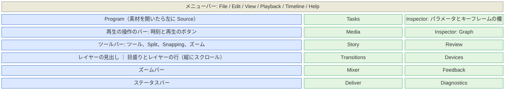
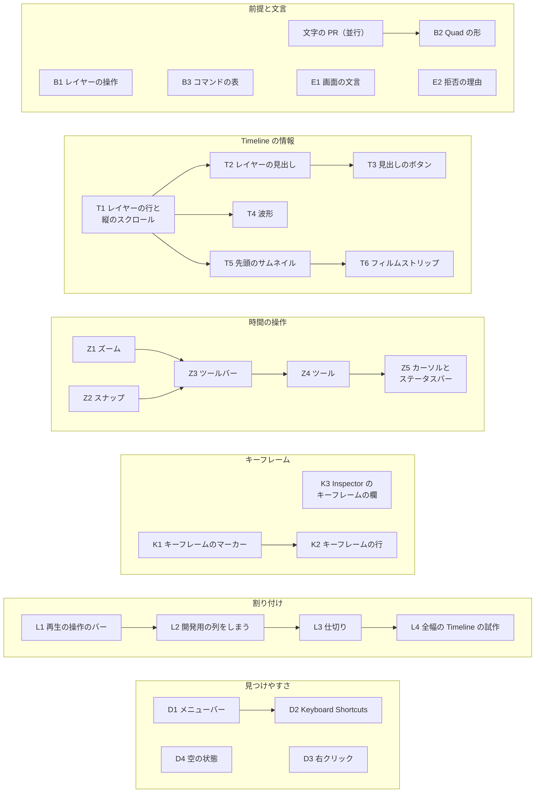

# UI の分かりやすさ

ユーザーの評価は「UI を見て、どういう操作ができるのか伝わってこない」「一言で言うと情報量が不足している」。この設計書は有名な編集ソフトの画面に倣って、画面に出す情報と操作の手がかりを足す。優先度は [UI](08-ui.md) と同じく、使いやすいこと > 高速なこと > XP 風。

パネルの中身と XP 風の採り方は 08-ui.md が持つ。ここは割り付け、Timeline の情報、時間の操作、キーフレームの見せ方、見つけやすさ、文言、PR の分け方を持つ。サーフェスに文字を描く仕組み（目盛りの文字、帯の名前）は並行の PR（`feature/movie-maker-surface-text`）が作る。ここではそれを前提にし、「文字の PR」と呼ぶ。文字の PR は `Item::label` と `CutBar::label`（帯の名前）を足し、`paint.rs` の出力を文字の下（`timeline_quads`）と上（`timeline_overlay`）に分け、文字を glyphon で描く。

## 今の画面で足りないもの

ep03 を開いた画面（2026-11-10）とコードで確かめた。

| 場所 | 今 | 困ること |
|---|---|---|
| 割り付け | ウィンドウの左半分がサーフェス（Program と Timeline）、右半分が WebView の 3 列。比は `layout.rs` の `SPLIT = 0.5` で固定 | Timeline がウィンドウの半分の幅しかない。境界を動かせない |
| 中央の列（`apps/movie-maker/web/transport.js`） | 実装の名前、GPU、通知の遅れ、時計の種類、レイヤーの生の一覧が主役。再生のボタン、Source の J/K/L と In/Out と Insert/Overwrite、Split/Lift/Extract、Undo/Redo も詰め込まれ、横にはみ出す | 開発の情報が場所を取る。再生のボタンが Program から離れている |
| Timeline のレイヤーの行 | レイヤー 1 本が 1 行（`ROW_H` 24 で固定）。見出しも縦のスクロールも無い。高さは中身に合わせ、上限はサーフェスの半分（`screen.rs`） | ep03 では 0.1 秒の文字のレイヤー 32 本が上の行を埋め、本編の sequence の行が画面の外に出る |
| 帯 | 種類の色（`palette.rs` の `item_color`）だけ。名前、サムネイル、波形が無い | 箱が何か分からない。短いレイヤーは 3 px の点に見える |
| ズームとスクロール | Ctrl+ホイールでズーム、ホイールで横に動かす（`controller.rs` の `wheel`）。キー、ボタン、全体表示が無い | ズームできることが画面から分からない。全体を見る手段が無い |
| スナップ | つまみのドラッグで他の端と再生位置に吸い付く（`snap.rs`）。入/切が無い。ガイド線（`PaintState::guide`）は吸い付かなくても出る | 吸い付いたか、何に吸い付いたかが分からない |
| ツールとカーソル | ツールが無い。帯の中のドラッグはカットなら slip、レイヤーなら何もしない。カーソルは常に矢印（`surface.rs` の `IDC_ARROW`） | どこを掴むと何が起こるかが分からない。レイヤーを時間の上で動かせない |
| キーフレーム | Inspector のパラメータごとにキーフレームナビゲーター（◀ ◆ ▶。`KeyframeNav.tsx`）、Graph に選んだパラメータの曲線。Timeline には出ない | どこに打ったかが見えない |
| 見つけやすさ | メニューバー、サーフェスのツールチップ、ショートカットの一覧、右クリックのメニューが無い。Tasks の項目の多くは実装が無く、押しても何も起きない（`groups.ts` の `media.transcribe` など） | キー操作を知らなければ使えない |
| 空の状態 | Inspector は「No layer selected」だけ。Story は CLI の `tools/transcribe` を案内する | 次に何をすればよいかが分からない |
| 文言 | 中央の列は日本語（プレビュー、先頭、停止など）、パネルは英語 | 混ざっている |

## 先行事例

### 採るもの

観点ごとに、先行事例の形と、この設計で採る形を並べる。番号は [references.md](references.md) の出典。Premiere は Adobe Premiere Pro、Resolve は DaVinci Resolve、FCP は Final Cut Pro、AE は After Effects。

| 観点 | 先行事例 | 採る形 |
|---|---|---|
| 割り付け | Premiere、Resolve の Edit、FCP、CapCut は、上に素材とビューアーと Inspector、下に全幅の Timeline を置く [96][101][109][110]。Resolve の Cut と Avid は素材の列を全高にし、ビューアーと Timeline を縦に重ねる [101][119] | 先に Cut と Avid の形（サーフェスの列に Program と Timeline を重ね、横に WebView の列）。全幅の Timeline は試作の後（[割り付け](#割り付け)） |
| 帯 | Resolve は Filmstrip、Thumbnail、Simple から選び、背が低いと Simple に畳む。波形は入/切できる [99]。FCP の Clip Appearance は波形とフィルムストリップの割合を 6 段階で選び、高さのスライダーを持つ [104]。Premiere はメディアの種類ごとにラベルの色を付け、トラックを高くするとサムネイルと波形とキーフレームが大きく出る [95] | 行の高さを 3 つ（Small、Medium、Large）にし、高さに応じて名前、先頭のサムネイル、フィルムストリップ、波形を出し分ける。種類の色は今のまま |
| レイヤーの見出し | Premiere はロック、同期ロック、出力の切り替え、ターゲット [96]。Resolve は色、番号、名前、有効/ミュート、ロック、Auto Select [99]。AE はレイヤーごとに、ラベルの色、名前、表示の切り替え（目のアイコン）、ソロ、ロック、Shy の列 [98]。Shotcut は Mute、Hide、Lock [115] | AE の形（1 行が 1 レイヤー）。種類の色、名前、有効のボタン、ロックのボタン、音のあるレイヤーだけ Mute と Solo、キーフレームの開閉 |
| 縦のスクロールと行の高さ | Resolve は見出しの上端のドラッグ、View Options のスライダー、Shift+ホイール [99]。Kdenlive はホイールで横、Shift+ホイールで縦に動かし、トラックごとに高さを変えられる [112]。Shotcut は Ctrl+= と Ctrl+- で高さを変える [115] | ホイールは横、Shift+ホイールと見出しの上のホイールは縦。高さは見出しの右クリックと View メニュー |
| ズーム | Premiere は = と -、下のズームスクロールバーの両端をつまむ [94]。Resolve は Full Extent Zoom、Detail Zoom、Custom Zoom のボタンとスライダー、Ctrl+= と Ctrl+-、Shift+Z で全体表示と元の倍率を行き来する [100]。FCP は Cmd+= と Cmd+-、Shift+Z [106]。Shotcut は =、-、0、Ctrl+ホイール [115]。CapCut は Ctrl+ホイール [111] | =、-、Ctrl+=、Ctrl+-、Ctrl+ホイール、Shift+Z（Resolve と同じく行き来する）。ツールバーに −、スライダー、+、Full Extent Zoom。Timeline の下にズームバー |
| スナップ | Resolve は Snapping のボタンと N。ドラッグ中に N を押すと反転し、吸い付いた辺に白い線を出す [100]。FCP はボタンと N。ドラッグ中に N を押している間だけ切り替わる [106]。Premiere は S [94]。Shotcut は磁石のボタンと Ctrl+P、Alt で一時的に止める [115]。VEGAS は F8、Shift で反転 [118] | N とツールバーの Snapping のボタン（入のときは押された見た目）。ドラッグ中の N で反転。吸い付いたときだけガイド線と上下の三角を出す |
| ツールとカーソル | Resolve は Timeline の上のツールバーに Selection Mode（A）、Trim Edit Mode（T）、Blade Edit Mode（B）を並べる。辺で Resize、編集点で Roll のカーソルになり、ドラッグ中はフレーム数のツールチップを出す [100]。FCP は A、T、B [107]。Premiere は V、C、B [94]。VEGAS は修飾キーで、ツールを替えずに slip と slide をする [118] | Selection（A）、Trim（T）、Blade（B）の 3 つ。カットの端の Alt（roll）は今のまま。帯の中の slip と Shift の slide は Trim に移す。カーソルの形とドラッグ中のツールチップ |
| キーフレーム | Resolve は Inspector のひし形と前後の矢印、[ と ] で移動。打ったクリップの右下のボタンから、クリップの下に Keyframe Editor を開く [102]。Premiere は Effect Controls の右に時間の欄を持ち、Show Video Keyframes で Timeline のクリップの上に出す [97]。AE はプロパティの行の上にキーフレームを並べ、U でアニメーションのあるプロパティだけを出す [98]。FCP は Video Animation editor と Inspector のボタン [108]。CapCut と Kdenlive はクリップの上にひし形 [110][112] | 帯の下端にキーフレームのマーカー。レイヤーの見出しの ▸ と U で、パラメータごとのキーフレームの行。Inspector の右にキーフレームの欄と Show Only Keyframed Properties。[ と ] で前後へ |
| 再生の操作の置き場所 | Premiere は Program モニターの下にボタンと時刻を置く。ボタンエディターで並べ替えられる [96]。Resolve は Viewer の下に再生、In/Out、全体のジョグバー [101] | Program の下に再生の操作のバーとジョグバー。Source を開いたら Source の下にも（Mark In/Out、Insert、Overwrite） |
| パネルとワークスペース | Resolve は上端の Interface toolbar でパネルを出し入れし、Workspace > Reset UI Layout で戻す [101]。Premiere は Reset to Saved Layout [96]。Shotcut は Restore Default Layout [115] | 仕切りをドラッグで動かし、WebView の列を開け閉めし、View > Reset UI Layout で既定に戻す |
| 空の状態 | Premiere の空の Timeline は「Drop media here to create sequence」と出す [96]。Resolve の Cut は Media Pool の上に Import Media のボタンを置く [101]。FCP は Import Media のボタン [109]。Kdenlive は Welcome 画面 [114] | Program、Timeline、Inspector、Story、Tasks に次の一歩を出す（[空の状態](#空の状態)） |
| ショートカットの見つけ方 | Premiere、Resolve、FCP は視覚的なキーボードで割り当てを見せる [94][101][107]。Kdenlive の Find Action（Ctrl+Alt+I）は操作を名前で探して実行する [113]。Shotcut の Actions and Shortcuts は名前とキーで探し、Enter で実行する [116] | メニューの項目の右にキー。? で開く Keyboard Shortcuts のウィンドウで、名前とキーで探して実行する |
| ツールチップとステータスバー | Premiere のツールのツールチップは名前とキー [94]。Blender のステータスバーはマウスのボタンごとの操作を出す [117]。Kdenlive はステータスバーの左にヒントを出す [113] | ツールチップは「名前 (キー)」。サーフェスの下端のステータスバーに、ポインターの下でできることを出す |
| 操作の表を 1 つにする | VS Code はコマンドを ID で登録し、Command Palette、キーの割り当て、メニューが同じコマンドを呼ぶ [120]。KDE の KXmlGui は操作を KActionCollection にまとめ、ショートカットの画面（KShortcutsDialog）がその集まりを設定する [121] | UI のコマンドの表（[見つけやすさ](#見つけやすさ)） |

### 採らないもの

- Resolve のページの切り替え（下のボタンで Media、Cut、Edit などを替える）。パネルが少なく、1 画面で足りる。
- FCP のトラックの無い Timeline のロールとレーンの表示 [105]。行の順はレイヤーの重なりの順そのものなので、AE の形を採る。
- Resolve の Cut の上下 2 本の Timeline。ズームバーが全体の中の見えている範囲を示すので、上の全体の帯は作らない。
- 視覚的なキーボード、キーの割り当ての変更、他のソフトの割り当てのプリセット（Resolve [101]）、ボタンエディター（Premiere [96]）。後で。まず探せることを先にする。
- Resolve の Enable Clip（D）[103] と Premiere の Enable。どちらもクリップを場所に残して薄く出すが、movie-maker の `disable` はカットを配置から外して後ろを詰める（[操作](05-ops.md#操作)）。外したカットの見せ方と戻し方を決めるときに一緒に足す。

## 新しく設計するもの

- サーフェスと WebView を重ねずに並べる構成のまま、Timeline を広く取る割り付けの順。
- レイヤーの数だけ行が並ぶ Timeline で、短いレイヤーが本編を押し出さないこと。開いたときに sequence の行を見せ、Shy でレイヤーの行を隠し、表示の状態を `.mm/` に置く。
- UI のコマンドの表を Rust に 1 つ置き、ネイティブのメニュー、サーフェスのツールチップ、WebView の `title`、Keyboard Shortcuts のウィンドウ、ステータスバーが同じ表を読むこと。
- サーフェスの部品のツールチップを Win32 のツールチップで出すこと。最前面のポップアップのウィンドウなので、子 WebView の上にも出る〔推。[122] はポップアップのウィンドウで、最前面にしないと親のウィンドウに隠れることがあると書く。Z5 で確かめる〕。
- 開発の情報の置き場所（Diagnostics パネル）。

## 割り付け

青はサーフェス（wgpu）、緑は WebView の 2 列のタブ（1 列に 1 つのパネルを出す）。

- WebView は 2 列。左の列は Tasks、Media、Story、Transitions、Mixer、Deliver。右の列は Inspector（パラメータ、キーフレームの欄、Graph）、Review、Devices、Feedback、Diagnostics。右の列はキーフレームの欄のために 300 から 400 論理ピクセルに広げる（`ui/theme/theme.json` の `right-column`。左は `left-column` の 260 のまま）。
- WebView の幅は 2 列の幅の和（660 論理ピクセル）で決め、サーフェスはウィンドウの残りを取る。既定のウィンドウ（`layout.rs` の `INITIAL_SIZE`、幅 1600 論理ピクセル）でサーフェスは 940（約 59%）、幅 1920 で 1260（約 66%）。ウィンドウの幅の割合で WebView を決めると、1600 のウィンドウの 35%（560）に 2 列が入らない。ウィンドウを広げた分を Program と Timeline に回すのは、Resolve と Premiere で横のパネルの幅がウィンドウの大きさで変わらないのと同じ〔推〕。
- サーフェスは上から Program、再生の操作のバー、仕切り、Timeline（ツールバー、目盛りとレイヤーの行、ズームバー）、ステータスバー。Timeline の高さは既定でサーフェスの 45% にし、仕切りで変える。中身の高さには合わせない。
- 開発の情報（GPU、実装、通知の遅れ、時計、レイヤーの生の一覧）は Diagnostics パネルに移す。計装の値は今どおり `--report` にも出る。
- 仕切りはサーフェスと WebView の境界、Program と Timeline の境界の 2 つ。どちらもドラッグで動かす。WebView の列は View メニューで開け閉めし、閉じた分だけサーフェスが広がる。割り付けはプロジェクトではなくユーザーの設定に置き（置き場所は L3 で決める）、View > Reset UI Layout で既定に戻す。
- メニューバーはウィンドウの上端に Tauri のメニューで出す [123]。
- 全幅の Timeline（Premiere、Resolve の Edit、FCP、CapCut の形）は後で決める。Program と Timeline を別々の子 HWND のサーフェスにし、Timeline の HWND をウィンドウの全幅に置く形になる。2 つのスワップチェーンを 1 つの描画スレッドから 60 fps で出せるか、キーの行き先、大きさの変更を試作（L4）で測る。子 WebView を 2 つにして Program の左右に置く形も、Tauri の issue #9798 [25] と合わせて試作で確かめる。

## Timeline の情報

### レイヤーの行とレイヤーの見出し

Timeline の 1 行がレイヤー 1 本（今と同じく、上が前のレイヤー）。

| 行の高さ | 論理ピクセル | 帯の中身（Resolve の 3 つの見せ方に倣う） |
|---|---|---|
| Small | 18 | 名前だけ |
| Medium | 28 | 先頭のサムネイル（キャッシュの `thumbs/`）、名前、音があれば下端に細い波形 |
| Large | 56 | フィルムストリップ、名前、下半分に波形 |

- 既定は Medium、sequence の行は Large。高さは View > Track Height で全部の行を、レイヤーの見出しの右クリックでその行だけを変える。
- 縦のスクロール: 中身が Timeline の高さを超えたら、右に縦のスクロールバーを出す。目盛りの帯、ツールバー、ズームバーは動かない。ホイールは横に動かし（今と同じ）、Shift+ホイールと見出しの上のホイールは縦に動かす。
- 開いたときは sequence の行が見える位置までスクロールする。sequence の行が無ければいちばん下の行を見せる。
- レイヤーの見出しは幅 180 論理ピクセル。左から、種類の色の帯と種類の略号（V: Footage、I: Image、T: Text、S: Solid、C: Composition、Seq: Sequence。Other は無し）、名前（レイヤーの ID）、有効のボタン（目の形）、ロックのボタン（鍵の形。`lockLayer`。Claude の操作経路から守る）、音を持てるレイヤー（撮影素材、入れ子、sequence。Mixer のトラックと同じ）だけ Mute と Solo のボタン（M、S。`setLayerAudio`。Mixer と同じ値で、入の色も Mixer と同じテーマの `danger` と `accent`）、キーフレームがあれば ▸。ボタンは入を明るく、切を薄く描く。
- 幅 180 は、今の割り付け（サーフェスが 800 論理ピクセル）で行の領域に 78%、[割り付け](#割り付け)の後（940）で 81% を残す。Premiere と Resolve も見出しの幅はウィンドウの幅で変わらない〔推〕。
- 名前は ID にする。ID は Claude と CLI がレイヤーを指す名前で、コンポジションの中で重ならない。素材の名前は帯に出す（[帯](#帯)）。AE はレイヤーの名前の列に名前（無ければ素材の名前）を出すが、AE の帯には名前が無い。ここは帯が素材の名前を持つので、見出しは行を見分けられる ID を出す。取り込みで振った ID（ep03 の `lyrics-3430` は元のトラックの名前とクリップの番号）も、素材の名前（`f_1351.png`）より中身が分かる。
- 見出しをクリックするとレイヤーを選ぶ（帯のクリックと同じ）。T3 までは、ボタンの上を押してもレイヤーを選ぶ。縦にドラッグすると重なりの順を変える（`moveLayer`、AE と同じ）。
- 見出しの列の上の角（目盛りの帯の左）に、再生位置のタイムコード（`HH:MM:SS:FF`）と隠した行の数を出す〔推。Premiere と Resolve は Timeline の左上に時刻を出す〕。フレームは WebView の Frame の数と同じく、再生位置を含むフレーム（切り捨て）。
- Shy（AE [98]）: View > Shy Selected Layers（D3 の後は見出しの右クリックからも）でレイヤーに Shy のフラグを立て、View > Hide Shy Layers でフラグの立った行を Timeline から外す。描画と書き出しは変わらない。隠した数は見出しの列の上に出す（「4 hidden」）。

表示の状態（ズーム、スクロール、行の高さ、Shy、スナップの入/切）はプロジェクトのデータに入れず、`.mm/view.json` に置く。操作ではないので、取り消しの列と `versions/` に入らない。`.mm/` は [保存の形](09-ingest-storage.md#保存の形) では動作中を示すファイル（`lock`、`lock.info`）の置き場所で「消してよい」ので、T1 が 09 の木の説明に表示の状態を足す。消しても表示が既定に戻るだけで、バックアップ（`backups/`）と `mm import` の復旧には関わらない。

### 帯

- 名前は文字の PR が描く。名前は素材の名前（撮影素材と静止画は素材のファイル名、文字は最初の行、入れ子と sequence は指す先の ID、単色は `Solid`）で、種類は名前に付けず、帯の色とツールチップで示す（Premiere と Resolve の帯もクリップの名前だけを出す〔推〕）。帯の幅が足りなければ名前を出さず、ツールチップで出す。
- ツールチップは種類、名前、範囲、長さ（「Text · Opening Title · 00:00:05:00–00:00:08:00 (3:00)」）。
- 無効のレイヤーは色を薄くして斜線を引く（Resolve の dimmed [103]）。無効のカットは配置から外れて長さを持たない（`disable`、[操作](05-ops.md#操作)）ので、帯には出ない（Timeline のモデルも有効なカットだけを並べる）。
- 先頭のサムネイルはキャッシュの `thumbs/` の 1 枚（Media パネルと同じ）。フィルムストリップは素材ごとに間隔を置いた縮小画像をキャッシュに作り、テクスチャのアトラスで描く（T6）。
- 波形はキャッシュの波形（`MediaState::waveform` と同じ区間のピーク）をカットとレイヤーの素材の範囲で切り出し、縦の矩形の並びで描く。
  T4 が決めた形: 波形の元（`WaveSource`）はモデルのレイヤーとカットが持ち、ピーク（`Peaks`）は素材のコンテンツハッシュで `Ui::set_wave` に渡す。波形の時刻は、素材の時刻に音と映像の先頭のずれ（`timebase_offset`）を足したもの（キャッシュの波形は音の最初のサンプルから数え、再生の音は映像の先頭を素材の時刻 0 に置く）。カットの波形はカットの速さにレイヤーの速さを掛けて進め、タイムリマップのあるレイヤーには出さない。Medium は帯の下端のマーカーの高さ、Large は下半分に、`Depth::Wave`（帯の上、つまみと外枠の下）で描く。名前は上の部分、マーカーは波形の上に重なる。1 列（2 論理ピクセル）が受け持つ時間のピークの最大を、2 個ずつの最大を重ねた階層から引く。列の境は時刻に固定する（横に動かしても同じ列が同じ時間を受け持ち、縮小した波形がちらつかない）。ピークは見た目の振幅（平方根）を 1 バイトで持ち、全部の階層で元のピーク 1 個に約 2 バイト（ep03 の音のある 34 素材、約 20 時間で 15 MB）。矩形は倍率と見えている範囲が変わったときだけ作り直す。描く関数の入力は `PaintInput` の 1 つで、`timeline_quads` と `timeline_overlay` はそれだけを受ける（描くものを足す PR は公開する関数を増やさずにフィールドを足す）。読み込みはアプリの描画スレッドの脇のスレッドで、キャッシュに無い素材は、素材の一覧が変わったときと、取り込みが素材の出力を作り終えたとき（`Shared::ingest_serial`）に探し直す。geneva から読み込んだ素材はコンテンツハッシュが大きさと更新の時刻（`size…-mtime…`）で、取り込みが作るキャッシュの名前と合わないので、波形は出ない。
- トランジションの箱（カットの境）とマーカーは後で足す。

## 時間の操作

### ツールバー

Timeline の上端に置く（Resolve と CapCut と同じ）。左から並べる。

| グループ | ボタン |
|---|---|
| 取り消し | Undo、Redo |
| ツール | Selection、Trim、Blade（押されているものを強調） |
| 編集 | Split Clip、Lift、Extract |
| スナップ | Snapping（入のときは押された見た目） |
| ズーム | Zoom Out、スライダー、Zoom In、Full Extent Zoom |

ボタンはアイコンと短い名前。アイコンは Windows の記号のフォント（Segoe Fluent Icons、無ければ Segoe MDL2 Assets）の文字を文字の仕組みで描き、三角と四角とひし形は Quad の形で描く〔推。文字の PR の作りで決める〕。

### ツール

| ツール（キー） | 帯の中のドラッグ | 帯の端のドラッグ | カーソル |
|---|---|---|---|
| Selection（A） | レイヤーは時間の上で動かす（新しい操作 `shiftLayer`）。カットは選ぶだけ | カットは `ripple`、Alt で `roll`。レイヤーは `trimLayer` | 矢印。端は左右の矢印、Alt では roll の形 |
| Trim（T） | カットは `slip`、Shift で `slide` | Selection と同じ | slip と slide の形 |
| Blade（B） | カットをポインターの時刻で `split`（再生位置とフレームに吸い付く） | Selection と同じ | 刃の形。レイヤーの上は禁止の形 |

- 再生位置での split は `Ctrl+B`（Split Clip）に移す。Resolve の B と FCP の B は Blade のツールで、FCP と CapCut は Cmd/Ctrl+B で再生位置を割る [100][107][111]。08-ui.md のキーの表と `verify_edit.rs` の B は、Z4 が合わせて直す。`verify_edit.rs` の `surface::post_key` は `WM_KEYDOWN` だけを投げ、`key_name` は修飾キーを `GetKeyState` から読むので、Ctrl+B を投げる手段（`SendInput` か、キーの名前で `keys::dispatch` を呼ぶ）も Z4 が足す。
- Selection の帯の中のドラッグは、レイヤーを `shiftLayer` で前後に動かす（[RFC 0206](../rfcs/0206-layer-time-ops.md)）。操作は始まりが 0 より前になる動かし方も受ける（`trimLayer` と同じ）ので、0 で止めるならドラッグの側で量を切る〔推。帯の左端は 0 で止め、0 より前から始まるレイヤーは今の位置より前へ動かさない。0 より前に出た部分は書き出しに出ず Timeline にも見えないので、先頭が欠けても気づきにくいため。ドラッグ中のツールチップとステータスバーには止めた後の量を出す〕。接続のあるレイヤーも、接続を変えずに動く。
- カットの並べ替え（FCP のマグネティックタイムラインのドラッグ）は後。

### ズーム

- キー: `=` と `Ctrl+=` で Zoom In、`-` と `Ctrl+-` で Zoom Out、`Shift+Z` で Full Extent Zoom。`+` も Zoom In にする（US のキー配列では Shift+=、JIS のキー配列では Shift+; で出る）。もう一度 `Shift+Z` で元の倍率と位置に戻る（間にほかの操作で表示を変えたら、もう一度全体表示にする）。キーとボタンの拡大の中心は再生位置、Ctrl+ホイールの中心はポインター（今と同じ）。1 回の倍率は √2（2 回で 2 倍。ホイールの 1 目盛りの 1.15 倍より大きく、押した分が見て分かる）。再生位置が見えていなければ、拡大した後に再生位置を中央に置く（拡大した所が見えるように）。
- ツールバーのスライダーは秒あたりの論理ピクセルを対数で動かす（縮小の下限 `TimeView::zoom_floor` から `MAX_PX_PER_SEC`）。縮小の下限は全体表示の倍率と `MIN_PX_PER_SEC` の小さい方で、長いコンポジションも全体が収まるまで縮められる。
- ズームバー: Timeline の下端の横のバー（高さ 14 論理ピクセル。横は行の領域と同じ範囲で、縦のスクロールバーの下の角も溝の色で埋める）。ズームバーが表す範囲（コンポジションの全体と見えている範囲を合わせたもの）の上に、見えている範囲のスクロールボックスを出し、中のドラッグで動かし、両端（幅 7。スクロールボックスの幅の 1/3 まで）のドラッグで反対の端を保って拡大縮小する（Premiere のズームスクロールバー [94]）。スクロールボックスの幅の下限は 24 論理ピクセルで、縦のスクロールバーと同じ色。溝を押すと押した側へ 1 画面ぶん送る（縦のスクロールバーと同じ）。再生位置もバーの上に再生位置の色の細い線で出す（Resolve は再生位置が画面の外にあるとき、バーの上にその位置を出す [100]）。
- 再生位置が行の領域の端を越えたら、越えた先が見えるまでその向きへ 1 画面ずつ送る。再生中は Premiere の Page Scroll〔推〕。止めている間も、キーとメニューの移動（← →、Shift+← →、↑ ↓、Home、End）で動かした再生位置を見失わないよう同じく送る〔推〕。左へ送るときは 0 より前を見せない。端の外にあった再生位置が動いても送らず、人が動かした表示を保つ。ドラッグの間は、ポインターの下の時刻が変わって編集の量が飛ぶので送らない。

### スナップ

- `N` とツールバーの Snapping で入/切。入/切は表示の状態に置く。ドラッグ中に `N` を押すと、押している間だけ反転する。
- 目標は今の目標（0、終わり、他のレイヤーとカットの端、再生位置）に、キーフレームとマーカーを足す。
- 吸い付いたときだけ、スナップの表示（太さ 2 で全高のガイド線と、目盛りの帯と下端の三角）を出す。吸い付いた先が帯の端なら、その端を明るくする。ステータスバーに何に吸い付いたかを出す（「Snapped to Playhead」）。吸い付いていないドラッグにはガイド線を出さない。
- ドラッグ中はポインターの横に、動かした量のツールチップを出す（「+12f」「−00:00:01:05」。f はフレーム。Resolve のドラッグ中のフレーム数 [100]）。

Z2 で決めたこと（新しく設計したもの）:

- 吸い付く距離は 8 論理ピクセル（`SNAP_PX`）で、時間でなく画面の距離にする（ズームの倍率に依らず同じ手応えになる）。スナップを切っている間は目標を求めない。
- 同じ近さの目標は、再生位置、レイヤーとカットの端、キーフレーム、マーカー、始まりと終わりの順に採る。人が置いた時刻ほど先にし、始まりと終わりは端と重なりやすいので最後にする。近さの差が 1 マイクロ秒以内なら同じ近さとみなす（同じフレームの時刻を、有理数の時刻とフレームへの丸めの別の計算で求めた誤差を吸収する）。キーフレームは Timeline のモデルの `Item::keyframes`（K1 のマーカーと同じ値）、マーカーはコンポジションのマーカーの時刻（`TimelineModel::markers`。Timeline にはまだ描かない）から引く。
- 端が目標に届かない（素材の端や 1 フレームの長さで止まった）ときは、吸い付いたことにせず、スナップの表示を出さない。
- 上下の三角（`QuadShape`）は切ると形が変わるので、K1 と同じく外接する矩形が時刻の列に全部入るかを描く側が確かめ、入るときだけ `Canvas::push_quad` で描く。時刻の列の端に吸い付いたときはガイド線だけになる。
- ボタンを押している間（ドラッグ中）の `N` は入/切を変えず、離すかドラッグが終わると戻る。キーを離したことはサーフェスの `WM_KEYUP` で受け、ポインターの入力のキューで描画スレッドへ渡す（ドラッグの終わりとの前後を保つ）。
- 何に吸い付いたかの文は `SnapTarget::message` が持つ（Snapped to Playhead、Snapped to Layer Edge、Snapped to Clip Edge、Snapped to Keyframe、Snapped to Marker、Snapped to Start、Snapped to End）。Z5 のステータスバーはこの文と、動かした量の文（`drag_amount`）を出す。
- ドラッグ中のツールチップの量はポインターの向き（右が正）にする。`slip` は操作の量（素材のイン点）がポインターと逆なので、中身が動いた向きで出す。1 秒より短ければフレーム数、1 秒からは時:分:秒:フレーム。ツールチップの矩形はポインターの右に置き、入らなければ左に置く。文字は 1 回でまとめて描くので、矩形に重なるほかの文字（帯の名前、目盛りの時刻）は矩形の手前で切り、文字の上に重ねる再生位置の線とスナップの表示は矩形の外だけに描く（ツールチップが線の手前に見える）。

### カーソル、ツールチップ、ステータスバー

- カーソルはサーフェスの `WM_SETCURSOR` で、当たった所、ツール、修飾キーから決める [124]。左右の矢印は `IDC_SIZEWE`、禁止は `IDC_NO`、roll、slip、slide、刃は自前のカーソル。
- ツールチップは「名前 (キー)」と、要るときだけ 1 行の説明。文はどれも UI のコマンドの表から取る。WebView の部品は `title` で出す。
- サーフェスの部品（ツールバー、再生の操作のバー、見出しのボタン、帯）は Win32 のツールチップで出す。帯は拡大とスクロールで動くので、部品ごとにツールチップの対象の矩形を登録せず、トラッキングのツールチップ（[122]）にして、ポインターの下の部品が変わったら文と位置を差し替える〔推。Z5 で確かめる〕。ツールチップは最前面で作る（[122]）。ポインターの下の部品は描画のスレッドの `TimelineController` が知っているので、ツールチップを持つ UI のスレッドに渡す。
- ステータスバーはサーフェスの下端の 1 行。左にポインターの下でできること、右に状態を出す。

| ポインターの下 | 左に出す文の例 |
|---|---|
| カットの端（Selection） | Drag: Ripple Trim · Alt+Drag: Roll |
| カットの中（Trim） | Drag: Slip · Shift+Drag: Slide |
| レイヤーの中（Selection） | Drag: Move in Time · Click: Select |
| 目盛り | Click or Drag: Move Playhead |
| レイヤーの見出し | Drag: Reorder Layers · Right-click: Layer Menu |
| ドラッグ中 | Ripple Trim +12f · Snapped to Playhead · N: Toggle Snapping · Esc: Cancel |

右には「Snapping On」「Selection Tool」を出す。

### キーの表に足すもの

| キー | コマンド | 先行事例 | PR |
|---|---|---|---|
| `=`、`+`、`Ctrl+=` / `-`、`Ctrl+-` | Zoom In / Zoom Out | Premiere [94]、Resolve [100] | Z1 |
| `Shift+Z` | Full Extent Zoom | Resolve [100]、FCP [106] | Z1 |
| `↑` / `↓` | Previous Edit / Next Edit（前後の帯の端へ。レイヤーとカットの始まりと終わり、0、終わり） | Resolve [101] | Z1 |
| `Shift+←` / `Shift+→` | Step One Second Back / Forward（fps を丸めたフレームの数） | Resolve [101] | Z1 |
| `N` | Snapping | Resolve [100]、FCP [106] | Z2 |
| `A`、`T`、`B` | Selection Tool、Trim Tool、Blade Tool | Resolve [100]、FCP [107] | Z4 |
| `Ctrl+B` | Split Clip | FCP [107]、CapCut [111] | Z4 |
| `[` / `]` | Go to Previous Keyframe / Go to Next Keyframe | Resolve [102] | K2 |
| `U` | Show Keyframe Editor | AE の U [98] | K2 |
| `Alt+X` | Clear In and Out | Resolve の Option-X [101] | L1 |
| `Ctrl+I` | Import Media | Resolve [101] | D1 |
| `?` | Keyboard Shortcuts | Shotcut [116] | D2 |

- キーの名前の決まりは Z1 が `keys.rs` の `with_modifiers` と `transport.js` の `keyName` に入れ、後の PR は割り当てだけを足す。修飾キーは Ctrl、Shift、Alt の順に付ける。Shift は英字、数字、矢印に付け（`Shift+KeyZ`、`Shift+ArrowLeft`）、Space、Home、Delete などほかの名前のキーには今どおり Ctrl と一緒のときだけ付ける（Shift+Space は Space）。
- 記号のキー（`=`、`+`、`-`、`,`、`.`、`[`、`]`、`?` など）はキー配列でキーの位置が違う（JIS のキー配列では `=` が Shift+-）。記号のキーは押された文字を名前にする（サーフェスは `WM_KEYDOWN` の仮想キーを今のキー配列で文字にし〔`ToUnicodeEx`。デッドキーの途中の状態を変えない指定で文字にする〕、WebView は `KeyboardEvent.key`）。Shift は文字に含まれるので、記号の名前には付けない（JIS のキー配列の `Ctrl+=` は Ctrl+Shift+- で押すが、名前は `Ctrl+=`）。サーフェスで文字にするときは Shift だけを押した状態で文字にする（Ctrl を含めると制御文字になる）。画面のキーの見た目も文字で出す。テンキーの数字と記号も押された文字（`1`、`+`）。英字、数字、矢印、Space、Home、End、Delete、Backspace、Enter、Escape、Tab、PageUp、PageDown、Insert、F1〜F12 は code の名前のキーで、`KeyZ` の形の名前にする（サーフェスは仮想キー、WebView は `KeyboardEvent.code` から作る。JIS と US のキー配列で同じ）。
- 日本語の IME が入っていると、サーフェスの `WM_KEYDOWN` は英字が `VK_PROCESSKEY` で届き、英字のキーが効かない〔推〕。サーフェスの HWND には IME を結び付けない（`ImmAssociateContextEx` に空の入力のコンテキストと flags 0 を渡す）。外すのはサーフェスの HWND だけで、同じ親の子の WebView の HWND と親の IME は変えない（WebView の入力欄が日本語を受けるのは WebView2 の別のプロセスの窓で、ここで外す IME には掛からない〔推〕）。外した HWND が入力のコンテキストを持たず、隣の HWND と親が持ったままなことは単体テストで、JIS のキー配列の記号のキーは `--play-test` で確かめた（2026-11-10）。IME をオンにして打つ確かめは、キーを送る試験では IME を通らないので手で行う。
- キーを押し続けたときは、ズーム（Zoom In、Zoom Out）と移動（← →、Shift+← →、↑ ↓）だけを、OS のキーの繰り返しのたびに実行する（Premiere と Resolve の矢印とズームのキー〔推〕）。再生と停止（Space、J、K、L）、編集、Full Extent Zoom は、繰り返すと押した回数より多く働くので最初の押下だけ。繰り返すコマンドは `keys.rs` の `REPEATS` に ID で足す。再生スレッドは届いているフレームと秒の移動を足して 1 回で描き、描くのが繰り返しより遅くても、キーを離した後に進み続けない。

## キーフレーム

### Timeline

- キーフレームのマーカー: キーフレームのあるレイヤーの帯の下端に、そのレイヤーの全部のパラメータのキーフレームの時刻をひし形（一辺 9 論理ピクセル）で並べる。6 論理ピクセルより近いマーカーは 1 つにまとめる。Small の行では短い縦線にする。見出しには ▸ を出す。
- マーカーをクリックすると、その時刻へ再生位置を動かす。`[` と `]` は選んだレイヤーの前後のキーフレームへ動かす（選んでいなければ全部のレイヤー）。
- キーフレームの行: 見出しの ▸ か `U` で、そのレイヤーの行の下に、キーフレームのあるパラメータごとの行を開く（AE のプロパティの行、Resolve の Keyframe Editor）。キーフレームの行の見出しはパラメータの名前（「Transform › Position」）。
- キーフレームの行の操作: クリックで選び、そのパラメータを Inspector と Graph で選ぶ。ドラッグで `moveKeyframe`（再生位置、帯の端、他のキーフレームに吸い付く）。Delete で `removeKeyframe`。Alt+クリックで、その時刻のパラメータの値を `setKeyframe` で打つ（Resolve の Option+クリック [102]）。値の曲線は Graph に任せる。
- レイヤーのパラメータのキーフレームの時刻はコンポジションの時刻なので（`mm-render` は合成の時刻 `CompCx::t` で評価し、Inspector も再生位置で評価する）、そのまま描く。再フレーミング（`reframe.<カット>.*`）のキーフレームは素材の時刻なので（[データの形](03-data-model.md)）、カットを通してコンポジションの時刻に変換する。マーカーとキーフレームの行は Timeline のモデル（`mm-ui-wgpu` の `timeline_model`）が、プロジェクトのデータのパラメータから作る。

### Inspector

- キーフレームの欄: 各パラメータの行の右に、選んだレイヤーの範囲（イン点からアウト点）の時間の欄を置く（Premiere の Effect Controls の右 [97]）。再生位置の縦線、キーフレームのひし形、選んだキーフレームは `accent` の色。クリックで再生位置を動かし、ドラッグで `moveKeyframe`、Delete で `removeKeyframe`。
- Inspector の上に Show Only Keyframed Properties の切り替えを置く（Premiere [97]、AE の U [98]）。
- 区画の見出しの行の欄には、中のパラメータのキーフレームをまとめたひし形を見るだけで出す（Premiere の summary keyframes [97]）。区画を畳んでも、どこに打ったかが分かる。
- 今のキーフレームナビゲーター（◀ ◆ ▶）と補間の選択は残す。ツールチップは Go to Previous Keyframe、Add/Remove Keyframe、Go to Next Keyframe。

## 見つけやすさ

### UI のコマンドの表

画面の操作を Rust の 1 つの表（`apps/movie-maker/src/win/commands.rs`）に置く。キーの表（`keys.rs`）はキーからコマンドの ID を引くだけにする。

| 列 | 中身 |
|---|---|
| ID | `<分類>.<動詞>`。今の Tasks の名前（`media.import`、`export.start`）の形に合わせる（`timeline.zoom_in`、`playback.toggle`） |
| 名前 | 英語の文言（[文言](#文言)） |
| キー | キーの表の名前（`Shift+KeyZ`）。画面にはキーの見た目（Shift+Z）で出す |
| 説明 | ツールチップの 2 行目。要るときだけ |
| メニュー | メニューと右クリックのメニューでの場所。表には置かず、メニューの並び（`menu.rs`。[メニューバー](#メニューバー)）が持つ。WebView に送る表の `menu` はそこから引く |
| 持ち主 | Rust で実行するか、WebView のパネル（パネルを開く。`media.import` は Media） |
| 押せるか | 今押せるか、チェックの状態（Snapping） |

- WebView は IPC で表を読み、`run_command` で実行する。表が変わったら（押せるかの変化）イベントで知らせる。パネルが持ち主のコマンドをアプリの呼び出し箇所（メニュー、キー）から呼ぶときは、Tauri のイベント `mm:panel-command` で Shell に渡す（[メニューバー](#メニューバー)）。
- Tasks の項目はこの表の ID を指す。実装の無い項目は薄い色にし、ツールチップに「Not available yet」と出す（`TaskItem::disabled` は今もある）。
- 表は人の操作の入口だけを持つ。データの変更は今どおり操作（`Op`）で行う。
- 表から実行したコマンドは、ID と入口（キー、メニュー、ツールバー、右クリック、Keyboard Shortcuts のウィンドウ）を使い方の記録に残す（[計装](17-instrumentation.md#使い方の記録)の「ショートカットとメニューのどちらで呼んだか」）。

### メニューバー

| メニュー | 項目 |
|---|---|
| File | Import Media…、Export…（Deliver を開く）、Exit |
| Edit | Undo、Redo、Lift、Extract、Mark In、Mark Out、Clear In and Out、Insert、Overwrite |
| View | Zoom In、Zoom Out、Full Extent Zoom、Snapping、Track Height、Show Keyframe Editor、Hide Shy Layers、パネル（Tasks、Media、Story、Inspector など）、Diagnostics、Reset UI Layout |
| Playback | Play / Stop、Play Reverse、Play Forward、Step One Frame Back / Forward、Step One Second Back / Forward、Go to Start、Go to End、Previous Edit、Next Edit、Go to Previous / Next Keyframe |
| Timeline | Selection Tool、Trim Tool、Blade Tool、Split Clip、Add Transition… |
| Help | Keyboard Shortcuts…、About |

- Split Clip と Add Transition… は Timeline に置く。Resolve の Timeline のメニューは、再生位置でクリップを割る Split Clip と、選んだ編集点に既定のトランジションを足す Add Transition を持つ [103]。Lift と Extract は選んだカットを抜くので、Resolve の Delete Selected と Ripple Delete と同じく Edit に置く [103]。
- 項目は UI のコマンドの表から作り、メニューの中の並びと区切り線は `menu.rs` がメニューごとのコマンドの ID の並びとして持つ。VS Code の `contributes.menus` が項目からコマンドを指してグループで区切るのと同じ形で [120]、KDE の KXmlGui も操作の集まりとメニューの並び（ui.rc）を分けて持つ [121]。区切り線は空でないグループの間にだけ入れる。右クリックのメニュー（D3）も、当たった所ごとに同じ形の並びを置いて同じ関数（`menu::items`）で作る。
- 表に無い ID はスキップする。後の PR が足すコマンドの ID（`timeline.zoom_in`、`timeline.toggle_snapping`、`timeline.selection_tool`、`playback.previous_edit`、`source.clear_in_out`、`app.show_keyboard_shortcuts` など）は先に並びに置いてあり、表に足すとメニューに出る。項目がまだ無いメニューは、開いても何もできないので出さない（今は View。Z1 が Zoom を表に足すと出る）。View のパネル（Tasks、Media など）、Diagnostics、Track Height の項目は、パネルを選ぶコマンドの形と行の高さを決める PR（L2、L3、T1 の後）が並びに足す。
- 項目の右にキーを出す。キーはメニューのアクセラレーターに登録せず、項目の文字の `\t` の後ろに見た目だけを書く。Windows のメニューは `\t` の後ろをキーの列に出し [126]、muda はアクセラレーターが無ければ項目の文字をそのまま使う [125]。キーの処理は今どおり `keys::dispatch` が持つ。
- アクセラレーターを登録しない理由: Tauri は登録したアクセラレーターをアプリのメッセージループで `TranslateAcceleratorW((*msg).hwnd, …)` に通し、`WM_COMMAND` をキーを受けたウィンドウに送る [125]。サーフェスの子 HWND にフォーカスがあると `WM_COMMAND` はサーフェスに届き、メニューのイベントにならないままキーが消える（英字 1 つのキーに限らない）。WebView のキーは WebView2 のプロセスに届くので、この経路を通らない。
- 押せるかとチェックの状態は、WebView に送る表（`mm:commands-changed`）と同じ元から反映する。同期のスレッドが表の変化を見つけたら、メインスレッドで項目に反映する。メニューから実行するコマンドは押せるかを見る（`commands::run`。押せない項目は Windows が選ばせない）。
- パネルが持ち主のコマンドをメニューとキーから呼ぶと、Rust はウィンドウのフック（`commands::WindowHook`）で Tauri のイベント `mm:panel-command`（中身はコマンドの ID）を送り、Shell が Tasks の項目と同じくパネルのタブを開き、パネルの `requests` を進める。File > Import Media… と Ctrl+I は Media を開いて取り込みを始め、Export… は Deliver を開き、Timeline > Add Transition… は Transitions を開く。Exit（閉じるボタンと同じく、描画と再生を止めてから閉じる）と About（名前とバージョンのダイアログ）も、同じフックで Tauri のウィンドウが実行する。
- キーでメニューを開くのは F10 とアクセスキー。F10 はメニューモードに入る Windows の標準のキーで [127]、サーフェスは F10 を既定のウィンドウプロシージャ（`DefWindowProcW`）に渡す。メニューの名前は `&File` のように先頭の字をアクセスキーにし [126]、Alt+F、Alt+E、Alt+P、Alt+T、Alt+H で開く（サーフェスでは、Alt+英字の `WM_SYSCHAR` を既定のウィンドウプロシージャが受けて開く）。Alt を離したときのメニューモードは今どおり止める（`surface.rs` が `WM_SYSKEYUP` を既定のウィンドウプロシージャに渡さない。Alt+ドラッグの roll の後に次のキーを奪われないため）。キーの表にある Alt+英字（L1 の Alt+X など）は、サーフェスが `WM_SYSCHAR` を既定のウィンドウプロシージャに渡さない（渡すとアクセスキーとして探され、合う字が無いと警告音が鳴る）。キーの表に Alt+英字を足すときは、アクセスキーの字（F、E、V、P、T、H）と重ねない。
- WebView にフォーカスがあると、WebView2 は F10 をウィンドウに渡すが、Alt+英字は渡さない（Alt だけを押して離しても渡さないので、メニューモードに入らない）。そこで `transport.js` が `key_event` で送った、キーの表に無い Alt+英字は、ウィンドウのフックがウィンドウに `WM_SYSCOMMAND`（`SC_KEYMENU` とその字）を送ってメニューを開く [127]。どちらも、動いているアプリにキーを送って確かめた（2026-11-10）。

### Keyboard Shortcuts のウィンドウ

- `?` と Help > Keyboard Shortcuts… で開く。Tauri の別の小さなウィンドウ（最上位の WebView のウィンドウ）にし、本体のウィンドウの中央の上に出す。サーフェスの上にも重なる（Shotcut の Actions and Shortcuts は独立したダイアログ [116]）。
- コマンドの表をメニューごとに並べ、名前とキーで絞り込む。Enter で実行して閉じる。今押せないものは薄い色で出す。
- キーの割り当ての変更は後。

### 右クリックのメニュー

サーフェスの右クリックで、当たった所に合わせたメニューをネイティブのポップアップで出す。Tauri の `Window::popup_menu_at`（muda が `TrackPopupMenu` を呼ぶ [125]）で出し、メニューバーと同じ `on_menu_event` で受ける〔推。D3 で確かめる〕。項目はコマンドの表から作り、キーを右に出す。当たり判定の結果は描画のスレッドの `TimelineController` が持つので、右クリックを受ける UI のスレッドから引ける形にする。

| 当たった所 | 項目 |
|---|---|
| カット | Split Clip Here、Lift、Extract、Show Keyframe Editor |
| レイヤーの帯とレイヤーの見出し | Enable Layer、Lock Layer、Shy、Bring Forward、Send Backward、Track Height、Show Keyframe Editor |
| 目盛り | Full Extent Zoom（マーカーの追加は後） |
| 空き | Full Extent Zoom、Snapping |

### 空の状態

| 場所 | 出すもの |
|---|---|
| Program（コンポジションに中身が無く、素材も無い） | 「Import video and audio to start」と「File > Import Media… (Ctrl+I)」 |
| Timeline（コンポジションに中身が無い） | 「Open a clip in Media, mark In (I) and Out (O), then press Insert (,)」。sequence のレイヤーが無ければ最初の Insert が作る（下の箇条）。Media から Timeline へのドラッグは後 |
| Inspector（何も選んでいない） | コンポジションの要約（名前、大きさ、fps、長さ、レイヤーの数）と「Select a layer in the Timeline to see its properties.」。名前はコンポジションの ID、長さは見出しの列の上の角と同じタイムコード |
| Story（文字起こしが無い） | 「No transcript yet. Transcription runs outside the app for now: run tools/transcribe on a clip, then reopen this tab.」。アプリの中の Transcribe のコマンドができたら、ボタンに替える |
| Tasks | 実装の無い項目を薄くする（[UI のコマンドの表](#ui-のコマンドの表)） |

- 中身が無いのは、レイヤーが無いか、どのレイヤーもカットの無いシーケンスを置いた sequence のレイヤーのとき。無効のレイヤーとカットは中身に数え、案内を出さない。判定はコンポジションの中身で決め、Timeline の行の見え方では決めない。Shy で全部の行を隠しても案内は出さない（隠した数は見出しの列の上の角に出る。T3）。判定は `mm-ui-wgpu` の `empty_state`。
- 素材を取り込んだ後は、取り込みはもう次にすることではないので、Program の案内を出さない。
- sequence の自動作成: sequence のレイヤーが無いコンポジションへの Insert と Overwrite（置き換えるカットが無いので Insert と同じ）は、空の sequence と、それを置く sequence のレイヤーを足してからカットを入れる（`sequence_edit/new_sequence.rs` の `NewSequence`）。1 つのトランザクションなので、途中の操作が拒否されれば全部戻り、取り消しも 1 回で全部戻る。メニューの Insert と Overwrite も、Source に素材を開いていれば押せる。Timeline の手順も、`mm new` の直後に足す `main` のようにレイヤーが無いコンポジションに出す（手順のとおりに押せば最初の Insert が sequence を作る）。Split、Lift、Extract は編集するカットが無いので、今のまま拒否する。
  - 先行事例: Premiere の空の Timeline は「Drop media here to create sequence」と出し、最初のクリップから sequence を作る [96]。Premiere の sequence は長さを持たず、最後のクリップの終わりで再生も書き出しも終わる。新しい sequence の名前は Sequence 01 から番号で付き、クリップを落として作った sequence にはクリップの名前が付く〔推〕。Resolve は最初のクリップで Timeline 1 を作り、CapCut はメイントラックを作る〔推〕。FCP はプロジェクトに最初から基本ストーリーラインがあり、最初のクリップでビデオのプロパティ（大きさとフレームレート）が決まる〔推〕。
  - 新規設計: 新しい操作は足さず、既存の操作の並び（`addSequence`、`addLayer`、`insert`、`fitLayer`）で作る。新しいレイヤーは操作の前のデータに無く、`with_fitted_layers` が `fitLayer` を足さないので、並びに入れる。レイヤーはコンポジションの先頭から一番上に置き、長さを入れたカットの長さにするので、後の編集にも追従する。ID は Timeline の見出し、Story の並べ先、Mixer に名前として出るので、Premiere と Resolve の新しい sequence に合わせて、sequence を `Sequence <番号>`、sequence のレイヤーを `Sequence <番号> layer` にする。番号は 1 から数え、種類を問わずプロジェクトのほかの ID と重複しない最初のものにする（触る所の `Touches` は ID の種類を区別しない）。クリップの名前は付けない。Story の Arrange では話題が複数の素材にまたがり、帯に出る素材のファイル名とも見分けにくいため。
  - コンポジションの長さ: レイヤーの無いコンポジションは、入れたカットの長さにする（`fitLayer` の `duration`）。その長さは中身から決めたものでなく（`mm new` の直後に足す `main` の長さは仮のもの）、短いカットの後ろの黒い画面まで再生し書き出すより、Premiere の sequence と同じく中身の終わりで終える方が自然なため。ほかのレイヤーがあるコンポジションは、その置き場所が長さに依るので、追従の決まり（伸ばすだけ）のままにする。大きさと fps はカットに合わせない（Premiere は最初のクリップで決めるが、コンポジションは作った時点で決まっている）。
  - Story の Arrange は `story_arrange` 1 つで送り、並べ先の決め方（選んだ sequence、無ければ先頭）と、プロジェクトに sequence が無いときの自動作成を、アプリが送る直前の最新のデータで行う。パネルの一覧が古くても sequence を二重に作らない。並べ先の欄の下には「No sequence yet. Arrange creates one in the open composition.」と出す。Story の Delete とトランジションは、切るカットも掛けるカットも無いので作らない。モバイル版の Arrange は、`addSequence` と `addLayer` が即時に適用できる操作の表（[モバイル版の権限](12-mobile.md#権限)）に無いので作らず、「No sequence yet. Press Insert or Arrange on the PC to create one.」と PC で作る操作を案内する。
- 要約は選択のイベント（`mm:layer-selected`）に載せる。購読より前に Rust が送ったイベントは WebView に届かないので、Shell は選択のイベントを聞き始めたら頼み（`mm:layer-selection-request`）を投げ、`transport.js` は選択の Tauri イベントを購読し終えてから `layer_selection` で今の選択を読んで答える。時間では待たない。購読してから読む形は UI のコマンドの表（Shell の `useCommandTable`）と同じ。

## 文言

画面の文言は全部英語にする（2026-11-10、ユーザー）。英語の解説記事やショートカットの名前と、そのまま対応するため。

- 語は Premiere Pro と DaVinci Resolve の英語の UI でよく使う語にそろえる。2 つが違うときは、movie-maker の操作の名前（`lift`、`extract`）に近い方を採る。
- レイヤー、コンポジション、キーフレームの語は AE に合わせる（Layer、Composition、Keyframe）。データの形が AE の形のため。
- シーケンスのカットは画面では Clip と呼ぶ（Premiere と Resolve の語）。コードと設計書の用語（カット、`Cut`）は変えない。
- 時刻は `00:01:23:12`（時:分:秒:フレーム）で出す。フレームの番号はツールチップに出す。

| 概念 | 画面の文言（キー） | Premiere | Resolve |
|---|---|---|---|
| 再生 / 停止 | Play / Stop (Space) | Space で再生と停止 [94] | Play and stop、Pause/Start Playback [101] |
| 先頭 / 末尾 | Go to Start (Home) / Go to End (End) | 〔推〕Go to Sequence Start / End | 先頭と末尾へ（Home / End）[101] |
| 1 フレーム | Step One Frame Back (←) / Step One Frame Forward (→) | ← と → でフレーム単位 [94] | Step One Frame Back / Forward [101] |
| 前後の帯の端 | Previous Edit (↑) / Next Edit (↓) | 〔推〕Go to Previous / Next Edit Point | Previous Edit / Next Edit [101] |
| 1 秒 | Step One Second Back (Shift+←) / Step One Second Forward (Shift+→) | — | Step One Second Back / Forward [101] |
| J/K/L | Play Reverse (J) / Stop (K) / Play Forward (L) | 〔推〕Shuttle Left / Stop / Right | Play Reverse / Stop / Play Forward [101] |
| マーク | Mark In (I) / Mark Out (O) / Clear In and Out (Alt+X) | Mark In / Mark Out / Clear In and Out [94] | Mark In / Mark Out / Clear In and Out [101] |
| 3 点編集 | Insert (,) / Overwrite (.) | `,` と `.` [94] | Insert / Overwrite [103] |
| 消す | Lift (Delete) / Extract (Backspace) | Lift / Extract [94] | Delete Selected / Ripple Delete [103] |
| 割る | Split Clip (Ctrl+B) | Add Edit (Ctrl+K) [94] | Split Clip [103] |
| ツール | Selection Tool (A) / Trim Tool (T) / Blade Tool (B) | Selection Tool / Razor Tool / Ripple Edit Tool [94] | Selection Mode / Trim Edit Mode / Blade Edit Mode [100] |
| スナップ | Snapping (N) | Snap in Timeline (S) [94] | Snapping (N) [100] |
| ズーム | Zoom In (=) / Zoom Out (-) / Full Extent Zoom (Shift+Z) | Zoom In / Zoom Out [94] | Full Extent Zoom、Shift+Z [100] |
| 行の高さ | Track Height: Small / Medium / Large | 見出しの境界のドラッグ [95] | Video track height [99] |
| レイヤーの見出し | Enable Layer / Lock Layer / Mute / Solo / Shy | Toggle Track Output / Toggle Track Lock [96] | Enable Track / Lock Track / Mute / Solo [99] |
| キーフレーム | Add/Remove Keyframe / Go to Previous Keyframe ([) / Go to Next Keyframe (]) / Show Keyframe Editor (U) / Show Only Keyframed Properties | Add/Remove Keyframe、Show Video Keyframes、Show Only Keyframed Properties [97] | Show Keyframe Editor、[ と ] [102][103] |
| 取り消し | Undo (Ctrl+Z) / Redo (Ctrl+Y) | — | Undo / Redo [103] |
| 割り付け | Reset UI Layout | Reset to Saved Layout [96] | Reset UI Layout [101] |
| キーの一覧 | Keyboard Shortcuts (?) | Keyboard Shortcuts [94] | Keyboard Customization [101] |
| 取り込み | Import Media… (Ctrl+I) | 〔推〕Import… | Import Media [101] |
| ビューアー | Program / Source | Program Monitor / Source Monitor [96] | Timeline Viewer / Source Viewer [101] |
| パネル | Transitions（今の Transition）、Diagnostics（新しい） | — | — |

### 日本語が残っている所

| 場所 | 今 | 置き換え |
|---|---|---|
| `transport.js` | プレビュー、フレーム、先頭、再生 / 停止、末尾、素材を選ぶ、レイヤー | Program、Frame、Go to Start、Play / Stop、Go to End、Choose a clip…、Layers。-1 と +1 のボタンには Step One Frame Back / Forward の `title` |
| `transport.js` の情報の欄 | プロジェクト、コンポジション、主の時計、壁時計（音の出力なし）、音の出力、なし、実装、通知の遅れ | Project、Composition、Clock、System clock (no audio output)、Audio Output、None、Backends、Sync Lag（L2 で Diagnostics に移る） |
| 取り消しの知らせ（`history.rs`） | `mcp の操作を取り消した: <名前>` | `Undo: <名前> (mcp)`、`Redo: <名前>`、`Nothing to undo`、`Couldn't undo: <理由>` |
| アプリの IPC のエラー（`apps/movie-maker/src/win/` の `media.rs`、`deliver.rs`、`edit.rs`、`ipc.rs`、`deliver/guards.rs`、ほかの `*_ipc.rs`） | 素材が無い、書き出し中、操作の形が違う など | Clip not found、Export in progress、Invalid operation など |
| 編集の結果の文言（`edit_actions.rs`、`sequence_edit.rs`。`EditState::set_message` を通って Source の下に出る） | 再生位置にカットが無い、カットを選んでいない など | No clip at the playhead、No clip selected など |
| 操作を拒否した理由（`mm-ops` の `ops/*.rs`、`param_ref.rs`、`proposal.rs`、`editor.rs`、`error.rs`（Conflict、Locked）、`mm-doc` の `validate.rs`、`mm-types` の `error.rs` の頭の文（「引数が不正: 」）） | 検査の文（Shell の上に出る） | 英語の文。CLI と MCP にも同じ文が出る |

デコード、エンコード、GPU などの深い所のエラーの文（約 400）は今回は替えない。画面に出るときは、英語の要約（「Export failed」）の下に詳しい文を畳んで出す〔推。出す所ごとに後で〕。

## PR の分け方

1 つの PR は 1〜2 日分より小さくする。終わりの条件は ep03 を作業用のフォルダーにコピーして `--play-test 4 --report <out.json> --screenshot <out.png>` で撮ったスクリーンショットで見えるもの。操作の途中のスクリーンショットは `verify_edit.rs` の通しに手順を足して撮る。カーソル、ツールチップ、メニューのポップアップは PrintWindow に写らないので、テストで確かめる。

PR の名前の頭の字は分類を表す（B: 前提、E: 文言、T: Timeline の情報、Z: 時間の操作、K: キーフレーム、L: 割り付け、D: 見つけやすさ）。

図は、同じ分類の中の順だけを示す。分類をまたぐ依存は表の「依存」の列に書く。

### 並行に進める PR

| 波 | PR | 始められる条件 |
|---|---|---|
| 第 1 波 | 文字の PR（並行）、E1、E2、B1、B3、K3 | すぐ。互いに並行 |
| 第 2 波 | T1、B2、D1 | T1 と B2 は文字の PR が入ってから（`paint.rs`、`timeline.rs`、`lib.rs`、`ui.rs`、`model.rs`、`quads.rs`、`mm-ui-wgpu` のテストの置き場所が重なる）。D1 は B3 |
| 第 3 波 | T2、T4、T5、Z1、Z2、K1、L1、D4 | それぞれの依存（表の「依存」の列） |
| 第 4 波 | T3、T6、Z3、K2、L2、D2 | 同上 |
| 第 5 波 | Z4、L3 | 同上 |
| 第 6 波 | Z5、D3、L4 | 同上 |

同じ波の中でも Timeline の Rust（`mm-ui-layout`、`mm-ui-wgpu`）に触る PR（第 3 波の T2、T4、T5、Z1、Z2、K1、L1、D4）は同じファイルに足す。T1 が Timeline の中の矩形（ツールバー、目盛り、見出しの列、レイヤーの行、ズームバー、ステータスバー）を 1 つの型に決め、`paint.rs` を領域ごとのファイルに分けておく（文字の PR の、文字の下に描く `timeline_quads` と上に描く `timeline_overlay` の分け方は保つ）。後の PR は自分の領域のファイルを足し、共有のファイルには名前の順の位置に 1 行で足す。

T1 が決めた形: 矩形の型は `TimelineLayout`（`mm-ui-layout/src/timeline_layout.rs`）。まだ無い領域は大きさ 0 の定数で場所だけを決めてあり、足す PR が自分の定数を変える。Timeline の高さの下限（`MIN_TIMELINE_H`）はその定数から求める。行の高さと上端は `Rows`、それにズームと縦のスクロールを合わせた見えている所は `Viewport` で、当たり判定、描画、文字、`--play-test` のクリックの位置（`verify_place.rs`）が同じ値を見る。描く関数は `paint/<領域>.rs` に置き、`paint.rs` の `timeline_quads`（文字の下）か `timeline_overlay`（文字の上）の呼び出しに名前の順で 1 行足す。重ね順は呼ぶ順でなく `Depth` で決める（帯の中に描く矩形〔T4 の波形〕は、帯〔`Bar`〕と、帯に重ねるもの〔`OnBar`。端のつまみ、外枠〕の間に区分を 1 つ足す）。テクスチャで描くサムネイルとフィルムストリップ（T5、T6）は矩形の並びの外なので、`Bar` までの矩形の後、残りの矩形の前に描く（文字と同じく、境目の数を `Canvas` の区分から出す）。行の領域からはみ出す矩形は `Canvas::push_in` で切る。ひし形と三角（`QuadShape`）は切ると形が変わるので、切らずに描く。K1 が決めた扱い: 外接する正方形が行の領域に全部収まるひし形だけを `Canvas::push_quad` で描き、領域の端や行の途中で隠れる位置の帯のマーカーは、切っても形が変わらない縦線（矩形）に替えて `push_in` で切る（`keymarks::is_line`）。マーカーの位置は変えず、形だけが変わる。先例は Premiere と AE が時間軸の端でキーフレームを切ること。先例が解消しない点（切ると半分のひし形が残る）に、縦線への切り替えを足した。Medium と Large の帯は名前を上の部分（`labels::name_area`。Medium は帯の高さ 25 からマーカーの 9 を除いた 16）に置き、下端の `MARK_PX`（9 論理ピクセル）にマーカーを並べて、字とひし形を重ねない（Premiere と Resolve もクリップの名前を上に置く）。Small の帯は名前が帯の全体を使うので、マーカーを下端から 4 論理ピクセルの縦線にし、字の下の方にだけ掛ける。キーフレームの時刻は `Item::keyframes`（コンポジションの秒）で、`mm-doc` の `Layer::keyframe_times` が作る。`shiftLayer` が動かすパラメータと同じ一覧（`Layer::comp_time_params` と `comp_time_params_mut`）を読み、端のつまみの `Layer::trim_room` と同じく、操作と Timeline が `mm-doc` の同じ所を見る。再フレーミングの素材の時刻のキーフレームは含めない（K2 でカットを通して足す）。マーカーのまとめ方は先頭のキーフレームから数えるので、横に動かしても位置は変わらない。マーカーを押すと `Hit::BarMark` で、レイヤーを選んで再生位置を動かす。マーカーは端のつまみより上に描くので、重なる所ではマーカーが勝つ（つまみはマーカーの上で掴める）。ホバーしたマーカーは、Inspector のキーフレームの欄で選んだひし形と同じ accent で中を塗り、縁を明るくする（accent に近い青の帯でも紛れない）。レイヤーの見出しは右端にキーフレームの開閉（`Cells::disclosure`、幅 12 論理ピクセル）を空け、キーフレームのあるレイヤー（`Item::has_keyframes`）だけに ▸ を描く。キーフレームの無いレイヤーも空けるので、ボタンの列は行ごとにずれない。▸ を押したときにキーフレームの行を開くのは K2。全体表示は長いコンポジションでも全体を収め（`MIN_PX_PER_SEC` より細かく、下限は `MIN_FIT_PX_PER_SEC`）、Ctrl+ホイールの縮小も全体が収まる所まで（`TimeView::zoom_floor`）。

Z1 が決めた形: Timeline の表示や再生位置を変える UI のコマンドは、`mm-ui-layout` の `TimelineCommand` に足し（Z1 のズームと前後の帯の端、Z2 の `ToggleSnapping`）、コマンドの表の持ち主を `Owner::App(Action::Timeline(..))` にする。キーとメニューから呼ぶと、ドラッグとの前後を保つため `PointerEvent::Command` としてポインターの入力のキュー（`Shared::input`）に積み、描画スレッドの `Ui::pointer` が `TimelineController::handle` に渡す。前後の帯の端へのシークは `Action::Seek` で返り、`render/sync.rs` の `handle_input` は、スクラブのシークと違って Home と End と同じく再生を止めずに送る（`Seeks::jump`。溜めた Program のシークは捨てる）。前後の帯の端（`edit_target`）はスナップの目標とは別に、0、終わり、レイヤーとカットの端から求め、Z2 がスナップの目標に足すキーフレームとマーカーでは止まらない。ページ送りは `Ui::set_playhead` が再生位置を受けるたびに `TimelineController::page_scroll` に渡し、再生中かどうかで分けない。押し続けで繰り返すコマンドは `keys::REPEATS` で、サーフェスは `WM_KEYDOWN` の繰り返しのフラグ（lParam の 30 ビット目）、WebView は `transport.js` が `key_event` に付けて送る `repeat` を見る。キーの名前は `keys::vk_name`（code の名前のキー）、`keys::symbol_name`（記号のキーは押された文字）、`keys::with_modifiers`（修飾キー）で作り、サーフェスの記号のキーは `keyboard::key_name_in` が今のキー配列（`keyboard::keyboard_layout`）で文字にする（`surface.rs` からは振り分けの呼び出しだけ）。ズームバーの高さは `ZOOMBAR_H`（14）で、高さが足りないときは目盛りの帯を先に取る。ズームバーの当たり判定は `Hit::ZoomBar`、スクロールボックスと端とドラッグの計算は `zoombar.rs`、描く関数は `paint/zoombar.rs`（縦のスクロールバーの下の角もここが塗る）。

L1 が決めた形: 再生の操作のバーは `mm-ui-layout/src/transport.rs`（高さ `TRANSPORT_H` の 56 論理ピクセル）。上からタイムコードの行（左に再生位置、右に Program は全体の長さ、Source はイン点とアウト点）、ジョグバー、ボタンの行を重ねる（Premiere の Program モニターの下端と同じ並び。タイムコードをボタンの行の左右に置くと、Source を開いた幅 400 論理ピクセルのバーでボタンの幅が縮み、アイコンが重なる）。`SurfaceLayout` の `program_transport` と `source_transport` が映像の領域の真下のバーの矩形で、映像の領域（`program`、`source`）はバーの分だけ低い（映像の矩形とレターボックスと Review の描き込みは映像の領域から求めるので、ずれない）。ビューアーの領域がバーの高さの 2 倍に足りなければ、バーを出さずに映像に回す（映像の見えないビューアーは使えず、再生の操作はキーとメニューにもあるため）。Program のボタンは Resolve の Viewer の並び（Go to Start、Play Reverse、Stop、Play Forward、Go to End）に Premiere の Step One Frame Back / Forward を足したもので、同じ形のボタンを置かない。再生中は Play Forward を入の色で塗る。Source の In、Out、Clear、Insert、Overwrite は、ボタンの行に全部の名前が入れば名前のボタン、入らなければアイコンのボタン。ボタンはコマンドの表の ID を持ち、押せるかはアプリがコマンドの表から渡す（`ViewerState::disabled`）。押して同じボタンの上で離したときに実行する（Windows のボタンと同じく、押したまま外へずらして離せば取りやめ）。ジョグバーのシークは描画の 1 周でビューアーごとに最後の 1 つだけ送り、再生中なら止める（Timeline の目盛りのスクラブと同じ）。三角は `QuadShape`、縦線と括弧は細い矩形で描き、切らない。`--play-test` はボタンとジョグバーの位置を `transport_button` と `jog_track` で引いて押す（`verify_transport.rs`）。

### 前提と文言

| PR | 中身 | 依存 | 触る範囲 | 終わりの条件 |
|---|---|---|---|---|
| E1 `fix/movie-maker-ui-english` | 画面に直に書いた文言、アプリの IPC のエラー、編集の結果の文言、取り消しの知らせを英語に（[文言](#文言)の表）。Transition のタブを Transitions に。05-ops.md の取り消しの知らせの例も直す | なし | `apps/movie-maker/web/transport.js`、`apps/movie-maker/src/win/` の `history.rs`、`edit.rs`、`edit_actions.rs`、`sequence_edit.rs`、`media.rs`、`deliver.rs`、`deliver/guards.rs`、`ipc.rs`、ほかの `*_ipc.rs` とテスト、`ui/panels/transition/src/panel.ts`、`docs/design/05-ops.md` | 中央の列に日本語が無い。Undo の後の知らせが英語 |
| E2 `fix/movie-maker-op-errors-english` | 操作を拒否した理由を英語に | なし | `crates/mm-ops/src/ops/*.rs`、`param_ref.rs`、`proposal.rs`、`editor.rs`、`error.rs`、`crates/mm-doc/src/validate.rs`、`crates/mm-types/src/error.rs`（頭の文だけ）、文を比べるテスト（`mm-serve` を含む） | 画面は変わらない。拒否の文のテストが英語で通る |
| B1 `feature/movie-maker-layer-time-ops` | 操作 `shiftLayer { layer, by }` と `setLayerEnabled { layer, enabled }`。RFC を書く。`shiftLayer` はレイヤーの `start` と、レイヤーのパラメータのキーフレームの時刻（コンポジションの時刻）を `by` だけ動かす。素材のイン点とアウト点、再フレーミングのキーフレーム（素材の時刻）、タイムリマップ（レイヤーの始まりからの時刻）は変えない（AE でレイヤーを動かすとキーフレームが一緒に動くのと同じ）。逆操作は `-by` の `shiftLayer`、`setLayerEnabled` は前の値を置く同じ操作（`lockLayer` と同じ形）。`touches` はどちらもレイヤー | なし | `crates/mm-ops/src/ops/`（新しい 2 つのファイル、`mod.rs`）、`op.rs`、生成物（`ops.json`、`ops.ts`。`scripts/regen.sh`）、`docs/rfcs/`、`docs/design/05-ops.md`（操作の一覧） | 画面の部品は変わらない。`mm op` の `shiftLayer` で動かしたレイヤーが、Timeline で動いた時刻に出て、キーフレームも同じだけ動く |
| B2 `feature/movie-maker-quad-shapes` | `Quad` に形（矩形、ひし形、上下左右の三角）を足し、シェーダーで形の外を捨てる | 文字の PR | `crates/mm-ui-layout/src/geom.rs`、`crates/mm-ui-wgpu/src/quads.rs` とシェーダー、`crates/mm-ui-wgpu/tests/it/`（文字の PR が `tests/offscreen.rs` を移す先） | 期待画像のテストでひし形と三角が出る |
| B3 `feature/movie-maker-command-table` | UI のコマンドの表、`run_command`、WebView のツールチップ、Tasks の実装の無い項目を薄く | なし | `apps/movie-maker/src/win/commands.rs`（新）、`keys.rs`、`ipc.rs`、`ui/sdk/src/`、`ui/shell/src/Shell.tsx`、`ui/panels/tasks/src/` | Tasks の実装の無い項目が薄い。ボタンの `title` はテストで確かめる |

### Timeline の情報

| PR | 中身 | 依存 | 触る範囲 | 終わりの条件 |
|---|---|---|---|---|
| T1 `feature/movie-maker-timeline-rows` | 行の高さ（Small、Medium、Large）、縦のスクロールとスクロールバー、Shift+ホイール、Timeline の高さをサーフェスの割合に、開いたときに sequence の行を見せる、表示の状態（`.mm/view.json`）、Timeline の中の矩形の型と `paint.rs` の分割 | 文字の PR | `crates/mm-ui-layout/src/` の `timeline.rs`、`paint.rs`（分ける）、`controller.rs`、`screen.rs`、`lib.rs`、`crates/mm-ui-wgpu/src/ui.rs`、`apps/movie-maker/src/win/verify_edit.rs`、`apps/movie-maker/src/win/view_state.rs`（新）、`docs/design/08-ui.md`（帯の高さ 24）、`docs/design/09-ingest-storage.md`（`.mm/` の中身） | ep03 で Timeline の右に縦のスクロールバー、下に高い sequence の行が見え、文字のレイヤーの行はその上に続く |
| T2 `feature/movie-maker-timeline-headers` | レイヤーの見出し（種類の色と略号、名前、有効、ロック、Mute、Solo の表示）、見出しの列の上の角のタイムコード、見出しの上のホイール | 文字の PR、T1 | `crates/mm-ui-layout/src/header.rs`（新）、`timeline.rs`（`Item` にロックと音の状態。帯の名前は文字の PR の `Item::label`）、`crates/mm-ui-wgpu/src/model.rs` | 見出しに fxtext-32 などの名前と種類の色、ロックと有効の状態が並び、見出しの列の上の角にタイムコードが出る |
| T3 `feature/movie-maker-header-toggles` | 見出しのボタンで `setLayerEnabled`、`lockLayer`、`setLayerAudio`。見出しのドラッグで `moveLayer`。Shy（View > Shy Selected Layers）と Hide Shy Layers | T2、B1、D1 | `header.rs`、`controller.rs`、`apps/movie-maker/src/win/sequence_edit.rs`（操作を作る所）、`view_state.rs`、`commands.rs` | 有効を切ったレイヤーの行が薄くなり、Program からそのレイヤーが消える。Hide Shy Layers で Shy の行が消え、左上の角に隠した数が出る |
| T4 `feature/movie-maker-timeline-waveform` | 音のあるレイヤーとカットの波形 | T1 | `crates/mm-ui-layout/src/wave.rs`（新）、`crates/mm-ui-wgpu/src/model.rs`、`apps/movie-maker/src/win/render.rs`（波形を読む） | sequence の行のカットに波形が出る |
| T5 `feature/movie-maker-timeline-thumb` | 帯の先頭のサムネイル（キャッシュの `thumbs/`）。テクスチャの Quad の描き方 | T1、B2（`quads.rs` が重なる） | `crates/mm-ui-wgpu/src/thumbs.rs`（新）、`quads.rs`、`render.rs` | Medium と Large の行の帯の左にサムネイルが出る |
| T6 `feature/movie-maker-timeline-filmstrip` | フィルムストリップ（素材ごとの縮小画像をキャッシュに作り、アトラスで描く）。2 日を超えそうなら、縮小画像を作る所と描く所に分ける | T5 | `crates/mm-ingest/`（縮小画像）、`apps/movie-maker/src/win/media.rs`、`thumbs.rs` | Large の行の帯に縮小画像が並ぶ |

### 時間の操作

| PR | 中身 | 依存 | 触る範囲 | 終わりの条件 |
|---|---|---|---|---|
| Z1 `feature/movie-maker-timeline-zoom` | ズームのキー、Shift+Z の行き来、ズームバー、再生位置のページ送り、移動のキー（↑ ↓ の Previous/Next Edit、Shift+← → の Step One Second）、ズームと移動のキーの押し続け、キーの名前の決まり（英字と矢印の Shift、記号は押された文字）、サーフェスの IME を切る | T1、B3 | `crates/mm-ui-layout/src/zoombar.rs`（新）、`time_view.rs`、`controller.rs`、`apps/movie-maker/src/win/keys.rs`、`commands.rs`、`keyboard.rs`（新。記号のキーの文字）、`surface.rs`（IME と繰り返し）、`ipc.rs`（`key_event` の `repeat`）、`playback/intake.rs`（移動をまとめる）、`apps/movie-maker/web/transport.js`（`keyName` と `repeat`） | Timeline の下にズームバー。Shift+Z の後は全体が収まる。JIS のキー配列で `=`（Shift+-）と `-` でズームする |
| Z2 `feature/movie-maker-timeline-snapping` | N で入/切、ドラッグ中の反転、スナップの表示、ドラッグ中のツールチップ、キーフレームとマーカーの目標 | 文字の PR、T1、B2、B3 | `crates/mm-ui-layout/src/snap.rs`、`controller.rs`、`paint.rs`、`keys.rs`、`commands.rs` | つまみのドラッグで吸い付いた所に太いガイド線と三角とドラッグ中のツールチップ。吸い付かない所では線が無い |
| Z3 `feature/movie-maker-timeline-toolbar` | ツールバー（Undo、Redo、Split Clip、Lift、Extract、Snapping、ズーム）。ツールのボタンの場所は空けておく | Z1、Z2、文字の PR | `crates/mm-ui-layout/src/toolbar.rs`（新）、`crates/mm-ui-wgpu/src/ui.rs`、`apps/movie-maker/src/win/surface.rs` | Timeline の上にツールバー。Snapping が押された見た目 |
| Z4 `feature/movie-maker-timeline-tools` | Selection、Trim、Blade と A、T、B。Ctrl+B の Split Clip（`verify_edit.rs` から Ctrl+B を投げる手段も）。Selection の帯の中のドラッグで `shiftLayer`。08-ui.md のキーの表を直す | Z3、B1 | `crates/mm-ui-layout/src/gesture.rs`、`controller.rs`、`toolbar.rs`、`apps/movie-maker/src/win/edit_actions.rs`、`sequence_edit.rs`、`keys.rs`、`verify_edit.rs`、`docs/design/08-ui.md` | Blade を選んだツールバーのスクリーンショットと、レイヤーを動かした後の帯のスクリーンショット |
| Z5 `feature/movie-maker-surface-cursor-hints` | カーソルの形、サーフェスのツールチップ（Win32）、ステータスバー | Z4、B3、文字の PR | `apps/movie-maker/src/win/surface.rs`、`cursor.rs` と `tooltip.rs`（新）、`crates/mm-ui-layout/src/hint.rs`（新）、自前のカーソルの画像（`apps/movie-maker/icons/`） | `verify_edit.rs` の通しでカットの端にポインターを乗せたときのスクリーンショットで、ステータスバーに「Drag: Ripple Trim」が出る。カーソルとツールチップはテスト |

### キーフレーム

| PR | 中身 | 依存 | 触る範囲 | 終わりの条件 |
|---|---|---|---|---|
| K1 `feature/movie-maker-timeline-keyframe-marks` | 帯のキーフレームのマーカー、見出しの ▸、マーカーのクリックで移動 | T1、B2、B3 | `crates/mm-ui-layout/src/keymarks.rs`（新）、`timeline.rs`（`Item` にキーフレームの時刻）、`crates/mm-ui-wgpu/src/model.rs` | キーフレームのあるレイヤーの帯の下端にひし形が並ぶ |
| K2 `feature/movie-maker-keyframe-editor` | キーフレームの行（`U`、ドラッグ、Delete、Alt+クリック）、`[` と `]`、Inspector と Graph との選択のつなぎ | K1、T2、Z1（記号のキーの名前） | `keymarks.rs`、`controller.rs`、`apps/movie-maker/src/win/edit.rs`、`keys.rs`、`commands.rs`、選んだパラメータのイベント（`ui/shell`、`ui/panels/inspector`、`ui/panels/graph`） | ▸ を開いたレイヤーの行の下に、パラメータごとの行とひし形 |
| K3 `feature/movie-maker-inspector-keyframe-strip` | Inspector のキーフレームの欄、Show Only Keyframed Properties、区画の見出しの行のまとめたひし形 | なし | `ui/panels/inspector/src/`（`KeyframeStrip.tsx` を新しく）、`inspector.css` | Inspector の各パラメータの右に時間の欄、ひし形、再生位置の線 |

### 割り付け

| PR | 中身 | 依存 | 触る範囲 | 終わりの条件 |
|---|---|---|---|---|
| L1 `feature/movie-maker-program-transport` | Program の下の再生の操作のバー（時刻、ボタン、ジョグバー）。Source を開いたら Source の下にも（Mark In/Out、Clear In and Out と Alt+X、Play Reverse、Stop、Play Forward、Insert、Overwrite） | 文字の PR、T1、B2、B3 | `crates/mm-ui-layout/src/transport.rs`（新）、`screen.rs`、`crates/mm-ui-wgpu/src/ui.rs`、`apps/movie-maker/src/win/surface.rs` | Program の下に時刻とボタン。Source を開くと Source の下にもバー |
| L2 `feature/movie-maker-layout-columns` | 中央の列をしまう（`transport.js` から画面を消し、キーと再生位置の橋だけ残す）、Diagnostics パネル、WebView の幅を 2 列の幅の和に、右の列を 400 に | L1、E1 | `apps/movie-maker/web/transport.js`、`apps/movie-maker/src/win/layout.rs`（割り付けの関数）、`ui/shell/src/`（`Shell.tsx`、`shell.css`、`panels.ts`）、`ui/panels/diagnostics/`（新）、`ui/theme/theme.json` | 中央の列が無く、サーフェスがウィンドウの幅から 2 列の幅を引いた残り。Diagnostics のタブに GPU が出る |
| L3 `feature/movie-maker-splitters` | 仕切りのドラッグ、WebView の列の開け閉め、割り付けの保存、View > Reset UI Layout | L2、D1 | `apps/movie-maker/src/win/layout.rs`、`surface.rs`、`menu.rs`、`crates/mm-ui-layout/src/screen.rs` | 仕切りを動かしたスクリーンショットと、開き直した後の同じ割り付けのスクリーンショット |
| L4 `spike/movie-maker-two-surfaces` | 全幅の Timeline の試作（2 つのサーフェス、60 fps、キー、大きさの変更）。結果で案を決める | L3 | `spikes/`、`docs/design/spikes/` | 全幅の Timeline のスクリーンショットと、fps と present の待ちの記録 |

### 見つけやすさ

| PR | 中身 | 依存 | 触る範囲 | 終わりの条件 |
|---|---|---|---|---|
| D1 `feature/movie-maker-menu-bar` | メニューバー（コマンドの表から）。キーの見た目は項目の文字の `\t` の後ろ（アクセラレーターは登録しない）。チェックと押せるかの状態。Ctrl+I の Import Media。キーでメニューを開く手段 | B3 | `apps/movie-maker/src/win/menu.rs`（新）、`layout.rs`（新。`app.rs` からウィンドウを作る所と割り付けの関数を移す）、`commands.rs`、`keys.rs`、`surface.rs`（F10）、`ui/sdk/src/commands.ts`、`ui/shell/src/Shell.tsx` | ウィンドウの上端に File、Edit、Playback、Timeline、Help（View は Z1 が Zoom を表に足すと出る） |
| D2 `feature/movie-maker-shortcuts-window` | Keyboard Shortcuts のウィンドウ（`?`、絞り込み、Enter で実行） | B3、D1、Z1（記号のキーの名前） | `ui/shortcuts/`（新）、`ui/tools/build.ts`（ページの入口を足す）、`apps/movie-maker/src/win/layout.rs` か `menu.rs`（ウィンドウを開く。ウィンドウはコードで作り、`capabilities/default.json` は全部のウィンドウに当たる） | 「zoom」で絞ったウィンドウに Zoom In (=)、Zoom Out (-)、Full Extent Zoom (Shift+Z) |
| D3 `feature/movie-maker-context-menus` | 右クリックのメニュー（`Window::popup_menu_at`） | B3、T3、Z4 | `apps/movie-maker/src/win/surface.rs`、`context_menu.rs`（新） | 項目の並びはテスト（ポップアップは PrintWindow に写らない） |
| D4 `feature/movie-maker-empty-states` | 空の状態の案内（Program、Timeline、Inspector、Story） | 文字の PR、B3、T1 | `crates/mm-ui-layout/src/empty.rs`（新）、`crates/mm-ui-wgpu/src/empty.rs`（新）、`ui.rs`、`apps/movie-maker/src/win/ipc.rs`、`web/transport.js`、`ui/shell/src/Shell.tsx`、`ui/panels/inspector/src/EmptyInspector.tsx`（新）、`ui/panels/story/src/StoryPanel.tsx` | 空のプロジェクトで Program に案内、カットの無い sequence のレイヤーだけのコンポジションで Timeline に案内、Inspector にコンポジションの要約 |

### 衝突しやすい共有ファイル

| ファイル | 触る PR | 決まり |
|---|---|---|
| `crates/mm-ui-layout/src/` の `lib.rs`、`timeline.rs`、`paint.rs`、`controller.rs`、`screen.rs` | 文字の PR、T1〜T4、Z1〜Z4、K1、K2、L1、L3、D4 | 文字の PR、T1 の順に先。後の PR は自分の領域のファイルを足し、`pub use`、`Item` のフィールド、`paint.rs` の呼び出しには名前の順の位置に 1 行で足す |
| `crates/mm-ui-wgpu/src/` の `ui.rs`、`model.rs`、`quads.rs` | 文字の PR、T1、T2、T4、T5、K1、L1、Z3、B2 | 同上。`quads.rs` は文字の PR、B2、T5 の順 |
| `crates/mm-ui-wgpu/tests/` | 文字の PR、B2 | 文字の PR が `tests/it/` にまとめた後に足す |
| `apps/movie-maker/src/win/keys.rs`、`commands.rs` | B3、T3、Z1、Z2、Z4、K2、L1、D1、D2 | B3 が先。キーの名前の決まりは Z1。コマンドとキーは ID の名前の順に足す（キーの試験は `keys/tests.rs`） |
| `apps/movie-maker/src/win/surface.rs` | Z1、Z3、Z5、L1、L3、D1、D3 | 当たった所ごとの処理は別のファイルに置き、`surface.rs` には振り分けの 1 行だけ足す |
| `apps/movie-maker/src/win/app.rs`、`layout.rs` | D1、D2、L2 | ウィンドウを作る所と割り付けの関数は `layout.rs` が持ち、`app.rs` には起動の流れだけを置く |
| `apps/movie-maker/src/win/verify_edit.rs` | T1、Z4 | 行の位置は `mm-ui-layout` の関数から引く（定数の `ROW_H` を使わない） |
| `apps/movie-maker/web/transport.js` | E1、Z1、L2 | E1 が先。Z1 は `keyName` と、keydown で送る `repeat` だけ |
| `crates/mm-ops/` と生成物（`ops.json`、`ops.ts`） | B1、E2 | 生成物が衝突したら `scripts/regen.sh` で作り直す |
| `ui/theme/theme.json`、`ui/shell/src/` | L2、B3、K2 | 列の値は L2 だけが変える |
| `docs/design/08-ui.md`、`05-ops.md` | 文字の PR、T1、Z4（08-ui.md）、E1、B1（05-ops.md） | 文字の PR と T1 は「表示の倍率」の同じ段落に触るので、文字の PR が先 |
| `docs/design/references.md` | この設計書の PR と、出典を足す PR | 番号が重なったら、後から入る PR が番号を送る |

---

出典の番号（[94] など）は [references.md](references.md) を見る。
