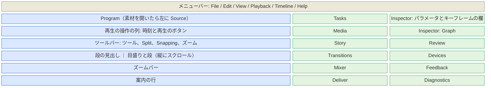
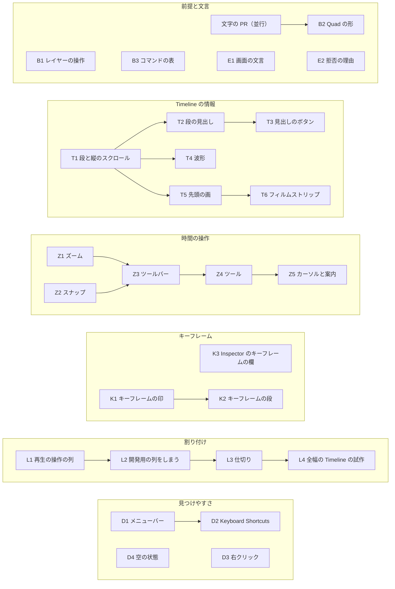

# UI の分かりやすさ

ユーザーの評価は「UI を見て、どういう操作ができるのか伝わってこない」「一言で言うと情報量が不足している」。この設計書は有名な編集ソフトの画面に倣って、画面に出す情報と操作の手がかりを足す。優先度は [UI](08-ui.md) と同じく、使いやすいこと > 高速なこと > XP 風。

パネルの中身と XP 風の採り方は 08-ui.md が持つ。ここは割り付け、Timeline の情報、時間の操作、キーフレームの見せ方、見つけやすさ、文言、PR の分け方を持つ。サーフェスに文字を描く仕組み（目盛りの文字、帯の名前）は並行の PR（`feature/movie-maker-surface-text`）が作る。ここではそれを前提にし、「文字の PR」と呼ぶ。文字の PR は `Item::label` と `CutBar::label`（帯の名前）を足し、`paint.rs` の出力を文字の下（`timeline_quads`）と上（`timeline_overlay`）に分け、文字を glyphon で描く。

## 今の画面で足りないもの

ep03 を開いた画面（2026-11-10）とコードで確かめた。

| 場所 | 今 | 困ること |
|---|---|---|
| 割り付け | 窓の左半分がサーフェス（Program と Timeline）、右半分が WebView の 3 列。比は `app.rs` の `SPLIT = 0.5` で固定 | Timeline が窓の半分の幅しかない。境目を動かせない |
| 中央の列（`apps/movie-maker/web/transport.js`） | 実装の名前、GPU、通知の遅れ、時計の種類、レイヤーの生の一覧が主役。再生のボタン、Source の J/K/L と In/Out と Insert/Overwrite、Split/Lift/Extract、Undo/Redo も詰め込まれ、横にはみ出す | 開発の情報が場所を取る。再生のボタンが Program から離れている |
| Timeline の段 | レイヤー 1 本が 1 段（`ROW_H` 24 で固定）。見出しも縦のスクロールも無い。高さは中身に合わせ、上限はサーフェスの半分（`screen.rs`） | ep03 では 0.1 秒の文字のレイヤー 32 本が上の段を埋め、本編の sequence の段が画面の外に出る |
| 帯 | 種類の色（`palette.rs` の `item_color`）だけ。名前、画、波形が無い | 箱が何か分からない。短いレイヤーは 3 px の点に見える |
| ズームとスクロール | Ctrl+ホイールでズーム、ホイールで横に動かす（`controller.rs` の `wheel`）。キー、ボタン、全体表示が無い | ズームできることが画面から分からない。全体を見る手段が無い |
| スナップ | つまみのドラッグで他の端と再生位置に吸い付く（`snap.rs`）。入/切が無い。ガイド線（`PaintState::guide`）は吸い付かなくても出る | 吸い付いたか、何に吸い付いたかが分からない |
| ツールとカーソル | ツールが無い。帯の中のドラッグはカットなら slip、レイヤーなら何もしない。カーソルは常に矢印（`surface.rs` の `IDC_ARROW`） | どこを掴むと何が起こるかが分からない。レイヤーを時間の上で動かせない |
| キーフレーム | Inspector のパラメータごとに ◀ ◆ ▶（`KeyframeNav.tsx`）、Graph に選んだパラメータの曲線。Timeline には出ない | どこに打ったかが見えない |
| 見つけやすさ | メニューバー、サーフェスのツールチップ、ショートカットの一覧、右クリックのメニューが無い。Tasks の項目の多くは実装が無く、押しても何も起きない（`groups.ts` の `media.transcribe` など） | キー操作を知らなければ使えない |
| 空の状態 | Inspector は「No layer selected」だけ。Story は CLI の `tools/transcribe` を案内する | 次に何をすればよいかが分からない |
| 文言 | 中央の列は日本語（プレビュー、先頭、停止など）、パネルは英語 | 混ざっている |

## 先行事例

### 採るもの

観点ごとに、先行事例の形と、この設計で採る形を並べる。番号は [references.md](references.md) の出典。

| 観点 | 先行事例 | 採る形 |
|---|---|---|
| 割り付け | Premiere、Resolve の Edit、FCP、CapCut は、上に素材とビューアーと Inspector、下に全幅の Timeline を置く [96][101][109][110]。Resolve の Cut と Avid は素材の列を全高にし、ビューアーと Timeline を縦に重ねる [101][119] | 先に Cut と Avid の形（サーフェスの列に Program と Timeline を重ね、横に WebView の列）。全幅の Timeline は試作の後（[割り付け](#割り付け)） |
| 帯 | Resolve は Filmstrip、Thumbnail、Simple から選び、背が低いと Simple に畳む。波形は入/切できる [99]。FCP の Clip Appearance は波形と画の割合を 6 段階で選び、高さのスライダーを持つ [104]。Premiere はメディアの種類ごとにラベルの色を付け、トラックを高くすると画と波形とキーフレームが大きく出る [95] | 段の高さを 3 つ（S、M、L）にし、高さに応じて名前、先頭の画、フィルムストリップ、波形を出し分ける。種類の色は今のまま |
| 段の見出し | Premiere はロック、同期ロック、出力の切り替え、ターゲット [96]。Resolve は色、番号、名前、有効/ミュート、ロック、Auto Select [99]。AE はレイヤーごとに、ラベルの色、名前、目、ソロ、ロック、Shy の列 [98]。Shotcut は Mute、Hide、Lock [115] | AE の形（段 = レイヤー）。種類の色、名前、目（有効）、鍵、音のあるレイヤーだけ M と S、キーフレームの開閉 |
| 縦のスクロールと段の高さ | Resolve は見出しの上端のドラッグ、View Options のスライダー、Shift+ホイール [99]。Kdenlive はホイールで横、Shift+ホイールで縦に動かし、トラックごとに高さを変えられる [112]。Shotcut は Ctrl+= と Ctrl+- で高さを変える [115] | ホイールは横、Shift+ホイールと見出しの上のホイールは縦。高さは見出しの右クリックと View メニュー |
| ズーム | Premiere は = と -、下のズームスクロールバーの両端をつまむ [94]。Resolve は Full Extent Zoom、Detail Zoom、Custom Zoom のボタンとスライダー、Ctrl+= と Ctrl+-、Shift+Z で全体表示と元の倍率を行き来する [100]。FCP は Cmd+= と Cmd+-、Shift+Z [106]。Shotcut は =、-、0、Ctrl+ホイール [115]。CapCut は Ctrl+ホイール [111] | =、-、Ctrl+=、Ctrl+-、Ctrl+ホイール、Shift+Z（Resolve と同じく行き来する）。ツールバーに −、スライダー、+、Full Extent Zoom。Timeline の下にズームバー |
| スナップ | Resolve は Snapping のボタンと N。ドラッグ中に N を押すと反転し、吸い付いた辺に白い線を出す [100]。FCP はボタンと N [106]。Premiere は S [94]。Shotcut は磁石のボタンと Ctrl+P、Alt で一時的に止める [115]。VEGAS は F8、Shift で反転 [118] | N とツールバーの Snapping のボタン（入のときは押された見た目）。ドラッグ中の N で反転。吸い付いたときだけガイド線と上下の三角を出す |
| ツールとカーソル | Resolve は Timeline の上のツールバーに Selection Mode（A）、Trim Edit Mode（T）、Blade Edit Mode（B）を並べる。辺で Resize、編集点で Roll のカーソルになり、ドラッグ中はフレーム数のツールチップを出す [100]。FCP は A、T、B [107]。Premiere は V、C、B [94]。VEGAS は修飾キーで、ツールを替えずに slip と slide をする [118] | Selection（A）、Trim（T）、Blade（B）の 3 つ。カットの端の Alt（roll）は今のまま。帯の中の slip と Shift の slide は Trim に移す。カーソルの形とドラッグ中の量の札 |
| キーフレーム | Resolve は Inspector のひし形と前後の矢印、[ と ] で移動。打ったクリップの右下のボタンから、クリップの下に Keyframe Editor を開く [102]。Premiere は Effect Controls の右に時間の欄を持ち、Show Video Keyframes で Timeline のクリップの上に出す [97]。AE はプロパティの行の上にキーフレームを並べ、U でアニメーションのあるプロパティだけを出す [98]。FCP は Video Animation editor と Inspector のボタン [108]。CapCut と Kdenlive はクリップの上にひし形 [110][112] | 帯の下端にキーフレームの印。段の見出しの ▸ と U で、パラメータごとのキーフレームの段。Inspector の右にキーフレームの欄と Show Only Keyframed Properties。[ と ] で前後へ |
| 再生の操作の置き場所 | Premiere は Program モニターの下にボタンと時刻を置く。ボタンエディターで並べ替えられる [96]。Resolve は Viewer の下に再生、In/Out、全体のジョグバー [101] | Program の下に再生の操作の列とジョグバー。Source を開いたら Source の下にも（Mark In/Out、Insert、Overwrite） |
| パネルとワークスペース | Resolve は上端の Interface toolbar でパネルを出し入れし、Workspace > Reset UI Layout で戻す [101]。Premiere は Reset to Saved Layout [96]。Shotcut は Restore Default Layout [115] | 仕切りをドラッグで動かし、WebView の列を開け閉めし、View > Reset UI Layout で既定に戻す |
| 空の状態 | Premiere の空の Timeline は「Drop media here to create sequence」と出す [96]。Resolve の Cut は Media Pool の上に Import Media のボタンを置く [101]。FCP は Import Media のボタン [109]。Kdenlive は Welcome 画面 [114] | Program、Timeline、Inspector、Story、Tasks に次の一歩を出す（[空の状態](#空の状態)） |
| ショートカットの見つけ方 | Premiere、Resolve、FCP は視覚的なキーボードで割り当てを見せる [94][101][107]。Kdenlive の Find Action（Ctrl+Alt+I）は操作を名前で探して実行する [113]。Shotcut の Actions and Shortcuts は名前とキーで探し、Enter で実行する [116] | メニューの項目の右にキー。? で開く Keyboard Shortcuts の窓で、名前とキーで探して実行する |
| ツールチップと案内の行 | Premiere のツールのツールチップは名前とキー [94]。Blender のステータスバーはマウスのボタンごとの操作を出す [117]。Kdenlive はステータスバーの左にヒントを出す [113] | ツールチップは「名前 (キー)」。サーフェスの下端の案内の行に、ポインターの下でできることを出す |
| 操作の表を 1 つにする | VS Code はコマンドを ID で登録し、Command Palette、キーの割り当て、メニューが同じ ID を参照する [120]。KDE の KXmlGui は操作を KActionCollection にまとめ、ショートカットの画面（KShortcutsDialog）がその集まりを設定する [121] | UI のコマンドの表（[見つけやすさ](#見つけやすさ)） |

### 採らないもの

- Resolve のページの切り替え（下のボタンで Media、Cut、Edit などを替える）。パネルが少なく、1 画面で足りる。
- FCP のトラックの無い Timeline のロールとレーンの表示 [105]。段の順はレイヤーの重なりの順そのものなので、AE の形を採る。
- Resolve の Cut の 2 段の Timeline。ズームバーが全体の中の見えている範囲を示すので、上段の全体の帯は作らない。
- 視覚的なキーボード、キーの割り当ての変更、他のソフトの割り当てのプリセット（Resolve [101]）、ボタンエディター（Premiere [96]）。後で。まず探せることを先にする。
- Resolve の Enable Clip（D）[103] と Premiere の Enable。どちらもクリップを場所に残して薄く出すが、movie-maker の `disable` はカットを配置から外して後ろを詰める（[操作](05-ops.md#操作)）。外したカットの見せ方と戻し方を決めるときに一緒に足す。

## 新しく設計するもの

- サーフェスと WebView を重ねずに並べる構成のまま、Timeline を広く取る割り付けの順。
- レイヤーの数だけ段が並ぶ Timeline で、短いレイヤーが本編を押し出さないこと。開いたときに sequence の段を見せ、Shy で段を隠し、表示の状態を `.mm/` に置く。
- UI のコマンドの表を Rust に 1 つ置き、ネイティブのメニュー、サーフェスのツールチップ、WebView の `title`、Keyboard Shortcuts の窓、案内の行が同じ表を読むこと。
- サーフェスの部品のツールチップを Win32 のツールチップの窓で出すこと。最前面のポップアップの窓なので、子 WebView の上にも出る〔推。[122] はポップアップの窓で、最前面にしないと親の窓に隠れることがあると書く。Z5 で確かめる〕。
- 開発の情報の置き場所（Diagnostics パネル）。

## 割り付け

青はサーフェス（wgpu）、緑は WebView の 2 列のタブ（1 列に 1 つのパネルを出す）。

- WebView は 2 列。左の列は Tasks、Media、Story、Transitions、Mixer、Deliver。右の列は Inspector（パラメータ、キーフレームの欄、Graph）、Review、Devices、Feedback、Diagnostics。右の列はキーフレームの欄のために 300 から 400 論理ピクセルに広げる（`ui/theme/theme.json` の `right-column`。左は `left-column` の 260 のまま）。
- WebView の幅は 2 列の幅の和（660 論理ピクセル）で決め、サーフェスは窓の残りを取る。既定の窓（`app.rs` の `INITIAL_SIZE`、幅 1600 論理ピクセル）でサーフェスは 940（約 59%）、幅 1920 で 1260（約 66%）。窓の幅の割合で WebView を決めると、1600 の窓の 35%（560）に 2 列が入らない。窓を広げた分を Program と Timeline に回すのは、Resolve と Premiere で横のパネルの幅が窓の大きさで変わらないのと同じ〔推〕。
- サーフェスは上から Program、再生の操作の列、仕切り、Timeline（ツールバー、目盛りと段、ズームバー）、案内の行。Timeline の高さは既定でサーフェスの 45% にし、仕切りで変える。中身の高さには合わせない。
- 開発の情報（GPU、実装、通知の遅れ、時計、レイヤーの生の一覧）は Diagnostics パネルに移す。計装の値は今どおり `--report` にも出る。
- 仕切りはサーフェスと WebView の境、Program と Timeline の境の 2 つ。どちらもドラッグで動かす。WebView の列は View メニューで開け閉めし、閉じた分だけサーフェスが広がる。割り付けはプロジェクトではなくユーザーの設定に置き（置き場所は L3 で決める）、View > Reset UI Layout で既定に戻す。
- メニューバーは窓の上端に Tauri のメニューで出す [123]。
- 全幅の Timeline（Premiere、Resolve の Edit、FCP、CapCut の形）は後で決める。Program と Timeline を別々の子 HWND のサーフェスにし、Timeline の HWND を窓の全幅に置く形になる。2 つのスワップチェーンを 1 つの描画スレッドから 60 fps で出せるか、キーの行き先、大きさの変更を試作（L4）で測る。子 WebView を 2 つにして Program の左右に置く形も、Tauri の issue #9798 [25] と合わせて試作で確かめる。

## Timeline の情報

### 段と段の見出し

段はレイヤー 1 本（今と同じく、上が前のレイヤー）。

| 段の高さ | 論理ピクセル | 帯の中身（Resolve の 3 つの見せ方に倣う） |
|---|---|---|
| S | 18 | 名前だけ |
| M | 28 | 先頭の画（キャッシュの `thumbs/`）、名前、音があれば下端に細い波形 |
| L | 56 | フィルムストリップ、名前、下半分に波形 |

- 既定は M、sequence の段は L。高さは View > Track Height で全部の段を、段の見出しの右クリックでその段だけを変える。
- 縦のスクロール: 中身が Timeline の高さを超えたら、右に縦のスクロールバーを出す。目盛りの帯、ツールバー、ズームバーは動かない。ホイールは横に動かし（今と同じ）、Shift+ホイールと見出しの上のホイールは縦に動かす。
- 開いたときは sequence の段が見える位置までスクロールする。sequence の段が無ければいちばん下の段を見せる。
- 段の見出しは幅 180 論理ピクセル。左から、種類の色の帯と種類の略号（V、I、T、S、C、Seq）、名前（レイヤーの ID）、目（有効）、鍵（`lockLayer`。Claude の操作経路から守る）、音のあるレイヤーだけ M と S（`setLayerAudio`。Mixer と同じ値）、キーフレームがあれば ▸。
- 見出しをクリックするとレイヤーを選ぶ（帯のクリックと同じ）。縦にドラッグすると重なりの順を変える（`moveLayer`、AE と同じ）。
- 見出しの列の上（目盛りの帯の左の角）に、再生位置の時刻と隠した段の数を出す〔推。Premiere と Resolve は Timeline の左上に時刻を出す〕。
- Shy（AE [98]）: View > Shy Selected Layers（D3 の後は見出しの右クリックからも）で段に印を付け、View > Hide Shy Layers で印の付いた段を Timeline から外す。描画と書き出しは変わらない。隠した数は見出しの列の上に出す（「4 hidden」）。

表示の状態（ズーム、スクロール、段の高さ、Shy、スナップの入/切）はプロジェクトのデータに入れず、`.mm/view.json` に置く。操作ではないので、取り消しの列と `versions/` に入らない。`.mm/` は [保存の形](09-ingest-storage.md#保存の形) では動作中を示すファイル（`lock`、`lock.info`）の置き場所で「消してよい」ので、T1 が 09 の木の説明に表示の状態を足す。消しても表示が既定に戻るだけで、バックアップ（`backups/`）と `mm import` の復旧には関わらない。

### 帯

- 名前は文字の PR が描く。帯の幅が足りなければ名前を出さず、ツールチップで出す。
- ツールチップは種類、名前、範囲、長さ（「Text · title-1 · 00:00:05:00–00:00:08:00 (3:00)」）。
- 無効のレイヤーは色を薄くして斜線を引く（Resolve の dimmed [103]）。無効のカットは配置から外れて長さを持たない（`disable`、[操作](05-ops.md#操作)）ので、帯には出ない（Timeline のモデルも有効なカットだけを並べる）。
- 先頭の画はキャッシュの `thumbs/` の 1 枚（Media パネルと同じ）。フィルムストリップは素材ごとに間隔を置いた縮小の画をキャッシュに作り、テクスチャのアトラスで描く（T6）。
- 波形はキャッシュの波形（`MediaState::waveform` と同じ区間のピーク）をカットとレイヤーの素材の範囲で切り出し、縦の矩形の並びで描く。
- トランジションの印（カットの境の箱）とマーカーは後で足す。

## 時間の操作

### ツールバー

Timeline の上端に置く（Resolve と CapCut と同じ）。左から並べる。

| 組 | ボタン |
|---|---|
| 取り消し | Undo、Redo |
| ツール | Selection、Trim、Blade（押されているものを強調） |
| 編集 | Split Clip、Lift、Extract |
| スナップ | Snapping（入のときは押された見た目） |
| ズーム | Zoom Out、スライダー、Zoom In、Full Extent Zoom |

ボタンはアイコンと短い名前。アイコンは Windows の記号のフォント（Segoe Fluent Icons、無ければ Segoe MDL2 Assets）の字を文字の仕組みで描き、三角と四角とひし形は Quad の形で描く〔推。文字の PR の作りで決める〕。

### ツール

| ツール（キー） | 帯の中のドラッグ | 帯の端のドラッグ | カーソル |
|---|---|---|---|
| Selection（A） | レイヤーは時間の上で動かす（新しい操作 `shiftLayer`）。カットは選ぶだけ | カットは `ripple`、Alt で `roll`。レイヤーは `trimLayer` | 矢印。端は左右の矢印、Alt では roll の形 |
| Trim（T） | カットは `slip`、Shift で `slide` | Selection と同じ | slip と slide の形 |
| Blade（B） | カットをポインターの時刻で `split`（再生位置とフレームに吸い付く） | Selection と同じ | 刃の形。レイヤーの上は禁止の形 |

- 再生位置での split は `Ctrl+B`（Split Clip）に移す。Resolve の B と FCP の B は Blade のツールで、FCP と CapCut は Cmd/Ctrl+B で再生位置を割る [100][107][111]。08-ui.md のキーの表と `verify_edit.rs` の B は、Z4 が合わせて直す。`verify_edit.rs` の `surface::post_key` は `WM_KEYDOWN` だけを投げ、`key_name` は修飾キーを `GetKeyState` から読むので、Ctrl+B を投げる手段（`SendInput` か、キーの名前で `keys::dispatch` を呼ぶ）も Z4 が足す。
- カットの並べ替え（FCP のマグネティックタイムラインのドラッグ）は後。

### ズーム

- キー: `=` と `Ctrl+=` で Zoom In、`-` と `Ctrl+-` で Zoom Out、`Shift+Z` で Full Extent Zoom。`+` も Zoom In にする（US の配列は Shift+=、JIS の配列は Shift+; で出る字で、キーの上に `+` が見える）。もう一度 `Shift+Z` で元の倍率と位置に戻る。キーとボタンの拡大の中心は再生位置、Ctrl+ホイールの中心はポインター（今と同じ）。
- ツールバーのスライダーは秒あたりの論理ピクセルを対数で動かす（`MIN_PX_PER_SEC` から `MAX_PX_PER_SEC`）。
- ズームバー: Timeline の下端の横のバー。全体の長さの上に見えている範囲のつまみを出し、中のドラッグで動かし、両端のドラッグで拡大縮小する。再生位置を小さな印で出す（Resolve の、再生位置が画面の外のときの印 [100]）。
- 再生中に再生位置が右端を越えたら、1 画面ぶん送る〔推。Premiere の Page Scroll〕。

### スナップ

- `N` とツールバーの Snapping で入/切。入/切は表示の状態に置く。ドラッグ中に `N` を押すと、押している間だけ反転する。
- 目標は今の目標（0、終わり、他のレイヤーとカットの端、再生位置）に、キーフレームとマーカーを足す。
- 吸い付いたときだけ、ガイド線（太さ 2、全高）と、目盛りの帯と下端の三角を出す。吸い付いた先が帯の端なら、その端を明るくする。案内の行に何に吸い付いたかを出す（「Snapped to Playhead」）。吸い付いていないドラッグにはガイド線を出さない。
- ドラッグ中はポインターの横に量の札を出す（「+12f」「−00:00:01:05」。Resolve のドラッグ中のフレーム数 [100]）。

### カーソル、ツールチップ、案内の行

- カーソルはサーフェスの `WM_SETCURSOR` で、当たった所、ツール、修飾キーから決める [124]。左右の矢印は `IDC_SIZEWE`、禁止は `IDC_NO`、roll、slip、slide、刃は自前のカーソル。
- ツールチップは「名前 (キー)」と、要るときだけ 1 行の説明。WebView の部品は `title`、サーフェスの部品（ツールバー、再生の操作の列、見出しのボタン、帯）は Win32 のツールチップの窓に矩形の道具として登録する [122]。文はどちらも UI のコマンドの表から取る。
- 案内の行はサーフェスの下端の 1 行。左にポインターの下でできること、右に状態を出す。

| ポインターの下 | 左に出す文の例 |
|---|---|
| カットの端（Selection） | Drag: Ripple Trim · Alt+Drag: Roll |
| カットの中（Trim） | Drag: Slip · Shift+Drag: Slide |
| レイヤーの中（Selection） | Drag: Move in Time · Click: Select |
| 目盛り | Click or Drag: Move Playhead |
| 段の見出し | Drag: Reorder Layers · Right-click: Layer Menu |
| ドラッグ中 | Ripple Trim +12f · Snapped to Playhead · N: Toggle Snapping · Esc: Cancel |

右には「Snapping On」「Selection Tool」を出す。

### キーの表に足すもの

| キー | コマンド | 先行事例 | PR |
|---|---|---|---|
| `=`、`+`、`Ctrl+=` / `-`、`Ctrl+-` | Zoom In / Zoom Out | Premiere [94]、Resolve [100] | Z1 |
| `Shift+Z` | Full Extent Zoom | Resolve [100]、FCP [106] | Z1 |
| `↑` / `↓` | Previous Edit / Next Edit | Resolve [101] | Z1 |
| `Shift+←` / `Shift+→` | Step One Second Back / Forward | Resolve [101] | Z1 |
| `N` | Snapping | Resolve [100]、FCP [106] | Z2 |
| `A`、`T`、`B` | Selection Tool、Trim Tool、Blade Tool | Resolve [100]、FCP [107] | Z4 |
| `Ctrl+B` | Split Clip | FCP [107]、CapCut [111] | Z4 |
| `[` / `]` | Go to Previous Keyframe / Go to Next Keyframe | Resolve [102] | K2 |
| `U` | Show Keyframe Editor | AE の U [98] | K2 |
| `Alt+X` | Clear In and Out | Resolve の Option-X [101] | L1 |
| `Ctrl+I` | Import Media | Resolve [101] | D1 |
| `?` | Keyboard Shortcuts | Shotcut [116] | D2 |

- キーの名前の決まりは Z1 が `keys.rs` の `with_modifiers` と `transport.js` の `keyName` に入れ、後の PR は割り当てだけを足す。今は Shift を Ctrl と一緒のときだけ付けるので、`Shift+Z` と `Shift+←` のために、英字と矢印には Shift を付ける形に変える。Shift+Space は今どおり Space として扱う。
- 記号のキー（`=`、`+`、`-`、`[`、`]`、`?`）は配列でキーの位置が違う（JIS の配列では `=` が Shift+-）。記号は押された文字で引く（サーフェスは `WM_KEYDOWN` の仮想キーを今の配列で文字にし、WebView は `KeyboardEvent.key`）。Shift は文字に含まれるので、記号の名前には付けない（JIS の配列の `Ctrl+=` は Ctrl+Shift+- で押すが、名前は `Ctrl+=`）。サーフェスで文字にするときは Shift だけを押した状態で引く（Ctrl を含めると制御文字になる）。画面のキーの見た目も文字で出す。英字、数字、矢印、Space は今どおり `KeyZ` の形の名前で引く（サーフェスは仮想キー、WebView は `KeyboardEvent.code` から作る。JIS と US の配列で同じ）〔推。Z1 で JIS の配列で確かめる〕。
- 日本語の IME が入っていると、サーフェスの `WM_KEYDOWN` は英字が `VK_PROCESSKEY` で届き、英字のキーが効かない〔推〕。サーフェスの HWND には IME を結び付けない（`ImmAssociateContextEx`）。Z1 で JIS の配列と一緒に確かめる。

## キーフレーム

### Timeline

- キーフレームの印: キーフレームのあるレイヤーの帯の下端に、そのレイヤーの全部のパラメータのキーフレームの時刻をひし形（一辺 9 論理ピクセル）で並べる。6 論理ピクセルより近い印は 1 つにまとめる。S の段では短い縦線にする。見出しには ▸ を出す。
- 印をクリックすると、その時刻へ再生位置を動かす。`[` と `]` は選んだレイヤーの前後のキーフレームへ動かす（選んでいなければ全部のレイヤー）。
- キーフレームの段: 見出しの ▸ か `U` で、そのレイヤーの下に、キーフレームのあるパラメータごとの段を開く（AE のプロパティの行、Resolve の Keyframe Editor）。段の見出しはパラメータの名前（「Transform › Position」）。
- キーフレームの段の操作: クリックで選び、そのパラメータを Inspector と Graph で選ぶ。ドラッグで `moveKeyframe`（再生位置、帯の端、他のキーフレームに吸い付く）。Delete で `removeKeyframe`。Alt+クリックで、その時刻のパラメータの値を `setKeyframe` で打つ（Resolve の Option+クリック [102]）。値の曲線は Graph に任せる。
- レイヤーのパラメータのキーフレームの時刻はコンポジションの時刻なので（`mm-render` は合成の時刻 `CompCx::t` で評価し、Inspector も再生位置で評価する）、そのまま描く。再フレーミング（`reframe.<カット>.*`）のキーフレームは素材の時刻なので（[データの形](03-data-model.md)）、カットを通してコンポジションの時刻に写す。印と段は Timeline のモデル（`mm-ui-wgpu` の `timeline_model`）が、プロジェクトのデータのパラメータから作る。

### Inspector

- キーフレームの欄: 各パラメータの行の右に、選んだレイヤーの範囲（イン点からアウト点）の時間の欄を置く（Premiere の Effect Controls の右 [97]）。再生位置の縦線、キーフレームのひし形、選んだキーフレームは `accent` の色。クリックで再生位置を動かし、ドラッグで `moveKeyframe`、Delete で `removeKeyframe`。
- Inspector の上に Show Only Keyframed Properties の切り替えを置く（Premiere [97]、AE の U [98]）。
- 組の見出しの行の欄には中のパラメータのキーフレームをまとめたひし形を見るだけで出す（Premiere の summary keyframes [97]）。組を畳んでも、どこに打ったかが分かる。
- 今の ◀ ◆ ▶ と補間の選択は残す。ツールチップは Go to Previous Keyframe、Add/Remove Keyframe、Go to Next Keyframe。

## 見つけやすさ

### UI のコマンドの表

画面の操作を Rust の 1 つの表（`apps/movie-maker/src/win/commands.rs`）に置く。キーの表（`keys.rs`）はキーからコマンドの ID を引くだけにする。

| 列 | 中身 |
|---|---|
| ID | `<組>.<動詞>`。今の Tasks の名前（`media.import`、`export.start`）の形に合わせる（`timeline.zoom_in`、`playback.toggle`） |
| 名前 | 英語の文言（[文言](#文言)） |
| キー | キーの表の名前（`Shift+KeyZ`）。画面にはキーの見た目（Shift+Z）で出す |
| 説明 | ツールチップの 2 行目。要るときだけ |
| メニュー | メニューと右クリックのメニューでの場所 |
| 持ち主 | Rust で実行するか、WebView のパネル（パネルを開く。`media.import` は Media） |
| 押せるか | 今押せるか、チェックの状態（Snapping） |

- WebView は IPC で表を読み、`run_command` で実行する。表が変わったら（押せるかの変化）イベントで知らせる。
- Tasks の項目はこの表の ID を指す。実装の無い項目は薄い色にし、ツールチップに「Not available yet」と出す（`TaskItem::disabled` は今もある）。
- 表は人の操作の入口だけを持つ。データの変更は今どおり操作（`Op`）で行う。
- 表から実行したコマンドは、ID と入口（キー、メニュー、ツールバー、右クリック、Keyboard Shortcuts の窓）を使い方の記録に残す（[計装](17-instrumentation.md#使い方の記録)の「ショートカットとメニューのどちらで呼んだか」）。

### メニューバー

| メニュー | 項目 |
|---|---|
| File | Import Media…、Export…（Deliver を開く）、Exit |
| Edit | Undo、Redo、Split Clip、Lift、Extract、Mark In、Mark Out、Clear In and Out、Insert、Overwrite |
| View | Zoom In、Zoom Out、Full Extent Zoom、Snapping、Track Height、Show Keyframe Editor、Hide Shy Layers、パネル（Tasks、Media、Story、Inspector など）、Diagnostics、Reset UI Layout |
| Playback | Play / Stop、Play Reverse、Play Forward、Step One Frame Back / Forward、Go to Start、Go to End、Previous Edit、Next Edit、Go to Previous / Next Keyframe |
| Timeline | Selection Tool、Trim Tool、Blade Tool |
| Help | Keyboard Shortcuts…、About |

- 項目の右にキーを出す。キーはメニューのアクセラレーターに登録せず、項目の文字の `\t` の後ろに見た目だけを書く。muda はアクセラレーターが無ければ項目の文字をそのまま使う [125]。Windows のメニューは `\t` の後ろをキーの列に出す〔推。D1 で確かめる〕。キーの処理は今どおり `keys::dispatch` が持つ。
- アクセラレーターを登録しない理由: Tauri は登録したアクセラレーターをアプリのメッセージループで `TranslateAcceleratorW((*msg).hwnd, …)` に通し、`WM_COMMAND` をキーを受けた窓に送る [125]。サーフェスの子 HWND にフォーカスがあると `WM_COMMAND` はサーフェスに届き、メニューのイベントにならないままキーが消える（英字 1 つのキーに限らない）。WebView のキーは WebView2 のプロセスに届くので、この経路を通らない。
- サーフェスは Alt を離したときのメニューモードを止めている（`surface.rs` が `WM_SYSKEYUP` を既定の処理に渡さない。Alt+ドラッグの roll の後に次のキーを奪われないため）。F10 も表に渡すので、キーでメニューを開けない。キーでメニューを開く手段（F10 を既定の処理に渡すなど）は D1 で決める。

### Keyboard Shortcuts の窓

- `?` と Help > Keyboard Shortcuts… で開く。Tauri の別の小さな窓（最上位の WebView の窓）にし、本体の窓の中央の上に出す。サーフェスの上にも重なる（Shotcut の Actions and Shortcuts は独立したダイアログ [116]）。
- コマンドの表をメニューの組ごとに並べ、名前とキーで絞り込む。Enter で実行して閉じる。今押せないものは薄い色で出す。
- キーの割り当ての変更は後。

### 右クリックのメニュー

サーフェスの右クリックで、当たった所に合わせたメニューをネイティブのポップアップで出す。Tauri の `Window::popup_menu_at`（muda が `TrackPopupMenu` を呼ぶ [125]）で出し、メニューバーと同じ `on_menu_event` で受ける〔推。D3 で確かめる〕。項目はコマンドの表から作り、キーを右に出す。当たり判定の結果は描画のスレッドの `TimelineController` が持つので、右クリックを受ける UI のスレッドから引ける形にする。

| 当たった所 | 項目 |
|---|---|
| カット | Split Clip Here、Lift、Extract、Show Keyframe Editor |
| レイヤーの帯と段の見出し | Enable Layer、Lock Layer、Shy、Bring Forward、Send Backward、Track Height、Show Keyframe Editor |
| 目盛り | Full Extent Zoom（マーカーの追加は後） |
| 空き | Full Extent Zoom、Snapping |

### 空の状態

| 場所 | 出すもの |
|---|---|
| Program（レイヤーが無い） | 「Import video and audio to start」と「File > Import Media… (Ctrl+I)」 |
| Timeline（レイヤーが無い） | 「Open a clip in Media, mark In (I) and Out (O), then press Insert (,)」。Media から Timeline へのドラッグは後 |
| Inspector（何も選んでいない） | コンポジションの要約（名前、大きさ、fps、長さ、レイヤーの数）と「Select a layer in the Timeline to see its properties.」 |
| Story（文字起こしが無い） | 「No transcript yet. Transcription runs outside the app for now: run tools/transcribe on a clip, then reopen this tab.」。アプリの中の Transcribe のコマンドができたら、ボタンに替える |
| Tasks | 実装の無い項目を薄くする（[UI のコマンドの表](#ui-のコマンドの表)） |

## 文言

画面の文言は全部英語にする（2026-11-10、ユーザー）。英語の解説記事やショートカットの名前と、そのまま対応するため。

- 語は Premiere Pro と DaVinci Resolve の英語版でよく使う語にそろえる。2 つが違うときは、movie-maker の操作の名前（`lift`、`extract`）に近い方を採る。
- レイヤー、コンポジション、キーフレームの語は AE に合わせる（Layer、Composition、Keyframe）。データの形が AE の形のため。
- シーケンスのカットは画面では Clip と呼ぶ（Premiere と Resolve の語）。コードと設計書の用語（カット、`Cut`）は変えない。
- 時刻は `00:01:23:12`（時:分:秒:フレーム）で出す。フレームの番号はツールチップに出す。

| 概念 | 画面の文言（キー） | Premiere | Resolve |
|---|---|---|---|
| 再生 / 停止 | Play / Stop (Space) | Space で再生と停止 [94] | Play and stop、Pause/Start Playback [101] |
| 先頭 / 末尾 | Go to Start (Home) / Go to End (End) | 〔推〕Go to Sequence Start / End | 先頭と末尾へ（Home / End）[101] |
| 1 フレーム | Step One Frame Back (←) / Step One Frame Forward (→) | ← と → でフレーム単位 [94] | Step One Frame Back / Forward [101] |
| 編集点 | Previous Edit (↑) / Next Edit (↓) | 〔推〕Go to Previous / Next Edit Point | Previous Edit / Next Edit [101] |
| J/K/L | Play Reverse (J) / Stop (K) / Play Forward (L) | 〔推〕Shuttle Left / Stop / Right | Play Reverse / Stop / Play Forward [101] |
| マーク | Mark In (I) / Mark Out (O) / Clear In and Out (Alt+X) | Mark In / Mark Out / Clear In and Out [94] | Mark In / Mark Out / Clear In and Out [101] |
| 3 点編集 | Insert (,) / Overwrite (.) | `,` と `.` [94] | Insert / Overwrite [103] |
| 消す | Lift (Delete) / Extract (Backspace) | Lift / Extract [94] | Delete Selected / Ripple Delete [103] |
| 割る | Split Clip (Ctrl+B) | Add Edit (Ctrl+K) [94] | Split Clip [103] |
| ツール | Selection Tool (A) / Trim Tool (T) / Blade Tool (B) | Selection Tool / Razor Tool / Ripple Edit Tool [94] | Selection Mode / Trim Edit Mode / Blade Edit Mode [100] |
| スナップ | Snapping (N) | Snap in Timeline (S) [94] | Snapping (N) [100] |
| ズーム | Zoom In (=) / Zoom Out (-) / Full Extent Zoom (Shift+Z) | Zoom In / Zoom Out [94] | Full Extent Zoom、Shift+Z [100] |
| 段の高さ | Track Height: Small / Medium / Large | 見出しの境目のドラッグ [95] | Video track height [99] |
| 段の見出し | Enable Layer / Lock Layer / Mute / Solo / Shy | Toggle Track Output / Toggle Track Lock [96] | Enable Track / Lock Track / Mute / Solo [99] |
| キーフレーム | Add/Remove Keyframe / Go to Previous Keyframe ([) / Go to Next Keyframe (]) / Show Keyframe Editor (U) / Show Only Keyframed Properties | Add/Remove Keyframe、Show Video Keyframes、Show Only Keyframed Properties [97] | Show Keyframe Editor、[ と ] [102][103] |
| 取り消し | Undo (Ctrl+Z) / Redo (Ctrl+Y) | — | Undo / Redo [103] |
| 割り付け | Reset UI Layout | Reset to Saved Layout [96] | Reset UI Layout [101] |
| キーの一覧 | Keyboard Shortcuts (?) | Keyboard Shortcuts [94] | Keyboard Customization [101] |
| 取り込み | Import Media… (Ctrl+I) | 〔推〕Import… | Import Media [101] |
| ビューアー | Program / Source | Program Monitor / Source Monitor [96] | Timeline Viewer / Source Viewer [101] |
| パネル | Transitions（今の Transition）、Diagnostics（新しい） | — | — |

### 日本語が残っている所

| 場所 | 今 | 置き換え |
|---|---|---|
| `transport.js` | プレビュー、フレーム、先頭、再生 / 停止、末尾、素材を選ぶ、レイヤー | Program、Frame、Go to Start、Play / Stop、Go to End、Choose a clip…、Layers。-1 と +1 のボタンには Step One Frame Back / Forward の `title` |
| `transport.js` の情報の欄 | プロジェクト、コンポジション、主の時計、壁時計（音の出力なし）、音の出力、なし、実装、通知の遅れ | Project、Composition、Clock、System clock (no audio output)、Audio Output、None、Backends、Sync Lag（L2 で Diagnostics に移る） |
| 取り消しの知らせ（`history.rs`） | `mcp の操作を取り消した: <名前>` | `Undo: <名前> (mcp)`、`Redo: <名前>`、`Nothing to undo`、`Couldn't undo: <理由>` |
| アプリの IPC のエラー（`apps/movie-maker/src/win/` の `media.rs`、`deliver.rs`、`edit.rs`、`ipc.rs`、`deliver/guards.rs`、ほかの `*_ipc.rs`） | 素材が無い、書き出し中、操作の形が違う など | Clip not found、Export in progress、Invalid operation など |
| 編集の結果の文言（`edit_actions.rs`、`sequence_edit.rs`。`EditState::set_message` を通って Source の下に出る） | 再生位置にカットが無い、カットを選んでいない など | No clip at the playhead、No clip selected など |
| 操作を拒否した理由（`mm-ops` の `ops/*.rs`、`param_ref.rs`、`proposal.rs`、`editor.rs`、`error.rs`（Conflict、Locked）、`mm-doc` の `validate.rs`、`mm-types` の `error.rs` の頭の文（「引数が不正: 」）） | 検査の文（Shell の上に出る） | 英語の文。CLI と MCP にも同じ文が出る |

デコード、エンコード、GPU などの深い所のエラーの文（約 400）は今回は替えない。画面に出るときは、英語の要約（「Export failed」）の下に詳しい文を畳んで出す〔推。出す所ごとに後で〕。

## PR の分け方

1 つの PR は 1〜2 日分より小さくする。終わりの条件は ep03 を作業用のフォルダーに写して `--play-test 4 --report <out.json> --screenshot <out.png>` で撮った画で見えるもの。操作の途中の画は `verify_edit.rs` の通しに段を足して撮る。カーソル、ツールチップ、メニューのポップアップは PrintWindow に写らないので、テストで確かめる。

図は組の中の順だけを示す。組をまたぐ依存は表の「依存」の列に書く。

### 並行に進める組

| 波 | PR | 始められる条件 |
|---|---|---|
| 第 1 波 | 文字の PR（並行）、E1、E2、B1、B3、K3 | すぐ。互いに並行 |
| 第 2 波 | T1、B2、D1 | T1 と B2 は文字の PR が入ってから（`paint.rs`、`timeline.rs`、`lib.rs`、`ui.rs`、`model.rs`、`quads.rs`、`mm-ui-wgpu` のテストの置き場所が重なる）。D1 は B3 |
| 第 3 波 | T2、T4、T5、Z1、Z2、K1、L1、D4 | それぞれの依存（表の「依存」の列） |
| 第 4 波 | T3、T6、Z3、K2、L2、D2 | 同上 |
| 第 5 波 | Z4、L3 | 同上 |
| 第 6 波 | Z5、D3、L4 | 同上 |

同じ波の中でも Timeline の Rust（`mm-ui-layout`、`mm-ui-wgpu`）に触る PR（第 3 波の T2、T4、T5、Z1、Z2、K1、L1、D4）は同じファイルに足す。T1 が Timeline の中の矩形（ツールバー、目盛り、見出しの列、段、ズームバー、案内の行）を 1 つの型に決め、`paint.rs` を領域ごとのファイルに分けておく（文字の PR の、文字の下に描く `timeline_quads` と上に描く `timeline_overlay` の分け方は保つ）。後の PR は自分の領域のファイルを足し、共有のファイルには名前の順の位置に 1 行で足す。

### 前提と文言

| PR | 中身 | 依存 | 触る範囲 | 終わりの条件 |
|---|---|---|---|---|
| E1 `fix/movie-maker-ui-english` | 画面に直に書いた文言、アプリの IPC のエラー、編集の結果の文言、取り消しの知らせを英語に（[文言](#文言)の表）。Transition のタブを Transitions に。05-ops.md の取り消しの知らせの例も直す | なし | `apps/movie-maker/web/transport.js`、`apps/movie-maker/src/win/` の `history.rs`、`edit.rs`、`edit_actions.rs`、`sequence_edit.rs`、`media.rs`、`deliver.rs`、`deliver/guards.rs`、`ipc.rs`、ほかの `*_ipc.rs` とテスト、`ui/panels/transition/src/panel.ts`、`docs/design/05-ops.md` | 中央の列に日本語が無い。Undo の後の知らせが英語 |
| E2 `fix/movie-maker-op-errors-english` | 操作を拒否した理由を英語に | なし | `crates/mm-ops/src/ops/*.rs`、`param_ref.rs`、`proposal.rs`、`editor.rs`、`error.rs`、`crates/mm-doc/src/validate.rs`、`crates/mm-types/src/error.rs`（頭の文だけ）、文を比べるテスト（`mm-serve` を含む） | 画面は変わらない。拒否の文のテストが英語で通る |
| B1 `feature/movie-maker-layer-time-ops` | 操作 `shiftLayer { layer, by }` と `setLayerEnabled { layer, enabled }`。RFC を書く。`shiftLayer` はレイヤーの `start` と、レイヤーのパラメータのキーフレームの時刻（コンポジションの時刻）を `by` だけ動かす。素材のイン点とアウト点、再フレーミングのキーフレーム（素材の時刻）、タイムリマップ（レイヤーの始まりからの時刻）は変えない（AE でレイヤーを動かすとキーフレームが一緒に動くのと同じ）。逆操作は `-by` の `shiftLayer`、`setLayerEnabled` は前の値を置く同じ操作（`lockLayer` と同じ形）。`touches` はどちらもレイヤー | なし | `crates/mm-ops/src/ops/`（新しい 2 つのファイル、`mod.rs`）、`op.rs`、生成物（`ops.json`、`ops.ts`。`scripts/regen.sh`）、`docs/rfcs/`、`docs/design/05-ops.md`（操作の一覧） | 画面の部品は変わらない。`mm op` の `shiftLayer` で動かしたレイヤーが、Timeline で動いた時刻に出て、キーフレームも同じだけ動く |
| B2 `feature/movie-maker-quad-shapes` | `Quad` に形（矩形、ひし形、上下左右の三角）を足し、シェーダーで形の外を捨てる | 文字の PR | `crates/mm-ui-layout/src/geom.rs`、`crates/mm-ui-wgpu/src/quads.rs` とシェーダー、`crates/mm-ui-wgpu/tests/it/`（文字の PR が `tests/offscreen.rs` を移す先） | 期待画像のテストでひし形と三角が出る |
| B3 `feature/movie-maker-command-table` | UI のコマンドの表、`run_command`、WebView のツールチップ、Tasks の実装の無い項目を薄く | なし | `apps/movie-maker/src/win/commands.rs`（新）、`keys.rs`、`ipc.rs`、`ui/sdk/src/`、`ui/shell/src/Shell.tsx`、`ui/panels/tasks/src/` | Tasks の実装の無い項目が薄い。ボタンの `title` はテストで確かめる |

### Timeline の情報

| PR | 中身 | 依存 | 触る範囲 | 終わりの条件 |
|---|---|---|---|---|
| T1 `feature/movie-maker-timeline-rows` | 段の高さ（S、M、L）、縦のスクロールとスクロールバー、Shift+ホイール、Timeline の高さをサーフェスの割合に、開いたときに sequence の段を見せる、表示の状態（`.mm/view.json`）、Timeline の中の矩形の型と `paint.rs` の分割 | 文字の PR | `crates/mm-ui-layout/src/` の `timeline.rs`、`paint.rs`（分ける）、`controller.rs`、`screen.rs`、`lib.rs`、`crates/mm-ui-wgpu/src/ui.rs`、`apps/movie-maker/src/win/verify_edit.rs`、`apps/movie-maker/src/win/view_state.rs`（新）、`docs/design/08-ui.md`（帯の高さ 24）、`docs/design/09-ingest-storage.md`（`.mm/` の中身） | ep03 で Timeline の右に縦のスクロールバー、下に高い sequence の段が見え、文字のレイヤーの段はその上に続く |
| T2 `feature/movie-maker-timeline-headers` | 段の見出し（種類の色と略号、名前、目、鍵、M、S の表示）、見出しの列の上の時刻、見出しの上のホイール | 文字の PR、T1 | `crates/mm-ui-layout/src/header.rs`（新）、`timeline.rs`（`Item` にロックと音の状態。帯の名前は文字の PR の `Item::label`）、`crates/mm-ui-wgpu/src/model.rs` | 見出しに fxtext-32 などの名前と種類の色、鍵や目の状態が並び、左上の角に時刻が出る |
| T3 `feature/movie-maker-header-toggles` | 見出しのボタンで `setLayerEnabled`、`lockLayer`、`setLayerAudio`。見出しのドラッグで `moveLayer`。Shy（View > Shy Selected Layers）と Hide Shy Layers | T2、B1、D1 | `header.rs`、`controller.rs`、`apps/movie-maker/src/win/sequence_edit.rs`（操作を作る所）、`view_state.rs`、`commands.rs` | 目を切った段が薄くなり、Program からそのレイヤーが消える。Hide Shy Layers で Shy の段が消え、左上の角に隠した数が出る |
| T4 `feature/movie-maker-timeline-waveform` | 音のあるレイヤーとカットの波形 | T1 | `crates/mm-ui-layout/src/wave.rs`（新）、`crates/mm-ui-wgpu/src/model.rs`、`apps/movie-maker/src/win/render.rs`（波形を読む） | sequence の段のカットに波形が出る |
| T5 `feature/movie-maker-timeline-thumb` | 帯の先頭の画（キャッシュの `thumbs/`）。テクスチャの Quad の描き方 | T1、B2（`quads.rs` が重なる） | `crates/mm-ui-wgpu/src/thumbs.rs`（新）、`quads.rs`、`render.rs` | M と L の段の帯の左に画が出る |
| T6 `feature/movie-maker-timeline-filmstrip` | フィルムストリップ（素材ごとの縮小の画をキャッシュに作り、アトラスで描く）。2 日を超えそうなら、画を作る所と描く所に分ける | T5 | `crates/mm-ingest/`（縮小の画）、`apps/movie-maker/src/win/media.rs`、`thumbs.rs` | L の段の帯に画が並ぶ |

### 時間の操作

| PR | 中身 | 依存 | 触る範囲 | 終わりの条件 |
|---|---|---|---|---|
| Z1 `feature/movie-maker-timeline-zoom` | ズームのキー、Shift+Z の行き来、ズームバー、再生中の送り、移動のキー（↑ ↓ の Previous/Next Edit、Shift+← → の Step One Second）、キーの名前の決まり（英字と矢印の Shift、記号は押された文字）、サーフェスの IME を切る | T1、B3 | `crates/mm-ui-layout/src/zoombar.rs`（新）、`time_view.rs`、`controller.rs`、`apps/movie-maker/src/win/keys.rs`、`commands.rs`、`surface.rs`（記号の文字と IME）、`apps/movie-maker/web/transport.js`（`keyName`） | Timeline の下にズームバー。Shift+Z の後は全体が収まる。JIS の配列で `=`（Shift+-）と `-` でズームする |
| Z2 `feature/movie-maker-timeline-snapping` | N で入/切、ドラッグ中の反転、吸い付きの印、量の札、キーフレームとマーカーの目標 | 文字の PR、T1、B2、B3 | `crates/mm-ui-layout/src/snap.rs`、`controller.rs`、`paint.rs`、`keys.rs`、`commands.rs` | つまみのドラッグで吸い付いた所に太いガイド線と三角と量の札。吸い付かない所では線が無い |
| Z3 `feature/movie-maker-timeline-toolbar` | ツールバー（Undo、Redo、Split Clip、Lift、Extract、Snapping、ズーム）。ツールのボタンの場所は空けておく | Z1、Z2、文字の PR | `crates/mm-ui-layout/src/toolbar.rs`（新）、`crates/mm-ui-wgpu/src/ui.rs`、`apps/movie-maker/src/win/surface.rs` | Timeline の上にツールバー。Snapping が押された見た目 |
| Z4 `feature/movie-maker-timeline-tools` | Selection、Trim、Blade と A、T、B。Ctrl+B の Split Clip（`verify_edit.rs` から Ctrl+B を投げる手段も）。Selection の帯の中のドラッグで `shiftLayer`。08-ui.md のキーの表を直す | Z3、B1 | `crates/mm-ui-layout/src/gesture.rs`、`controller.rs`、`toolbar.rs`、`apps/movie-maker/src/win/edit_actions.rs`、`sequence_edit.rs`、`keys.rs`、`verify_edit.rs`、`docs/design/08-ui.md` | Blade を選んだツールバーの画と、レイヤーを動かした後の帯の画 |
| Z5 `feature/movie-maker-surface-cursor-hints` | カーソルの形、サーフェスのツールチップ（Win32）、案内の行 | Z4、B3、文字の PR | `apps/movie-maker/src/win/surface.rs`、`cursor.rs` と `tooltip.rs`（新）、`crates/mm-ui-layout/src/hint.rs`（新）、自前のカーソルの画（`apps/movie-maker/icons/`） | `verify_edit.rs` の通しでカットの端に乗せた段の画で、案内の行に「Drag: Ripple Trim」が出る。カーソルとツールチップはテスト |

### キーフレーム

| PR | 中身 | 依存 | 触る範囲 | 終わりの条件 |
|---|---|---|---|---|
| K1 `feature/movie-maker-timeline-keyframe-marks` | 帯のキーフレームの印、見出しの ▸、印のクリックで移動 | T1、B2、B3 | `crates/mm-ui-layout/src/keymarks.rs`（新）、`timeline.rs`（`Item` にキーフレームの時刻）、`crates/mm-ui-wgpu/src/model.rs` | キーフレームのあるレイヤーの帯の下端にひし形が並ぶ |
| K2 `feature/movie-maker-keyframe-editor` | キーフレームの段（`U`、ドラッグ、Delete、Alt+クリック）、`[` と `]`、Inspector と Graph との選択のつなぎ | K1、T2、Z1（記号のキーの名前） | `keymarks.rs`、`controller.rs`、`apps/movie-maker/src/win/edit.rs`、`keys.rs`、`commands.rs`、選んだパラメータのイベント（`ui/shell`、`ui/panels/inspector`、`ui/panels/graph`） | ▸ を開いたレイヤーの下に、パラメータごとの段とひし形 |
| K3 `feature/movie-maker-inspector-keyframe-strip` | Inspector のキーフレームの欄、Show Only Keyframed Properties、組の見出しの行のまとめたひし形 | なし | `ui/panels/inspector/src/`（`KeyframeStrip.tsx` を新しく）、`inspector.css` | Inspector の各パラメータの右に時間の欄、ひし形、再生位置の線 |

### 割り付け

| PR | 中身 | 依存 | 触る範囲 | 終わりの条件 |
|---|---|---|---|---|
| L1 `feature/movie-maker-program-transport` | Program の下の再生の操作の列（時刻、ボタン、ジョグバー）。Source を開いたら Source の下にも（Mark In/Out、Clear In and Out と Alt+X、Play Reverse、Stop、Play Forward、Insert、Overwrite） | 文字の PR、T1、B2、B3 | `crates/mm-ui-layout/src/transport.rs`（新）、`screen.rs`、`crates/mm-ui-wgpu/src/ui.rs`、`apps/movie-maker/src/win/surface.rs` | Program の下に時刻とボタン。Source を開くと Source の下にも列 |
| L2 `feature/movie-maker-layout-columns` | 中央の列をしまう（`transport.js` から画面を消し、キーと再生位置の橋だけ残す）、Diagnostics パネル、WebView の幅を 2 列の幅の和に、右の列を 400 に | L1、E1 | `apps/movie-maker/web/transport.js`、`apps/movie-maker/src/win/app.rs`（496 行なので、割り付けの関数を `win/layout.rs` に移してから）、`ui/shell/src/`（`Shell.tsx`、`shell.css`、`panels.ts`）、`ui/panels/diagnostics/`（新）、`ui/theme/theme.json` | 中央の列が無く、サーフェスが窓の幅から 2 列の幅を引いた残り。Diagnostics のタブに GPU が出る |
| L3 `feature/movie-maker-splitters` | 仕切りのドラッグ、WebView の列の開け閉め、割り付けの保存、View > Reset UI Layout | L2、D1 | `apps/movie-maker/src/win/layout.rs`、`surface.rs`、`menu.rs`、`crates/mm-ui-layout/src/screen.rs` | 仕切りを動かした画と、開き直した後の同じ割り付けの画 |
| L4 `spike/movie-maker-two-surfaces` | 全幅の Timeline の試作（2 つのサーフェス、60 fps、キー、大きさの変更）。結果で案を決める | L3 | `spikes/`、`docs/design/spikes/` | 全幅の Timeline の画と、fps と present の待ちの記録 |

### 見つけやすさ

| PR | 中身 | 依存 | 触る範囲 | 終わりの条件 |
|---|---|---|---|---|
| D1 `feature/movie-maker-menu-bar` | メニューバー（コマンドの表から）。キーの見た目は項目の文字の `\t` の後ろ（アクセラレーターは登録しない）。チェックと押せるかの状態。Ctrl+I の Import Media。キーでメニューを開く手段 | B3 | `apps/movie-maker/src/win/menu.rs`（新）、`app.rs`（窓を作る所）、`keys.rs`、`surface.rs`（F10） | 窓の上端に File、Edit、View、Playback、Timeline、Help |
| D2 `feature/movie-maker-shortcuts-window` | Keyboard Shortcuts の窓（`?`、絞り込み、Enter で実行） | B3、D1、Z1（記号のキーの名前） | `ui/shortcuts/`（新）、`ui/tools/build.ts`（ページの入口を足す）、`apps/movie-maker/src/win/app.rs` か `menu.rs`（窓を開く。窓はコードで作り、`capabilities/default.json` は全部の窓に当たる） | 「zoom」で絞った窓に Zoom In (=)、Zoom Out (-)、Full Extent Zoom (Shift+Z) |
| D3 `feature/movie-maker-context-menus` | 右クリックのメニュー | B3、T3、Z4 | `apps/movie-maker/src/win/surface.rs`、`context_menu.rs`（新） | 項目の組はテスト（ポップアップは PrintWindow に写らない） |
| D4 `feature/movie-maker-empty-states` | 空の状態の案内（Program、Timeline、Inspector、Story） | 文字の PR、B3、T1（`paint.rs` を分けた後に足す） | `crates/mm-ui-layout/src/paint.rs`（空の Timeline）、`crates/mm-ui-wgpu/src/program.rs`、`ui/panels/inspector/src/InspectorPanel.tsx`、`ui/panels/story/src/StoryPanel.tsx` | 空のプロジェクトで Program と Timeline に案内、Inspector にコンポジションの要約 |

### 衝突しやすい共有ファイル

| ファイル | 触る PR | 決まり |
|---|---|---|
| `crates/mm-ui-layout/src/` の `lib.rs`、`timeline.rs`、`paint.rs`、`controller.rs`、`screen.rs` | 文字の PR、T1〜T4、Z1〜Z4、K1、K2、L1、L3、D4 | 文字の PR、T1 の順に先。後の PR は自分の領域のファイルを足し、`pub use`、`Item` のフィールド、`paint.rs` の呼び出しには名前の順の位置に 1 行で足す |
| `crates/mm-ui-wgpu/src/` の `ui.rs`、`model.rs`、`quads.rs` | 文字の PR、T1、T2、T4、T5、K1、L1、Z3、B2 | 同上。`quads.rs` は文字の PR、B2、T5 の順 |
| `crates/mm-ui-wgpu/tests/` | 文字の PR、B2 | 文字の PR が `tests/it/` にまとめた後に足す |
| `apps/movie-maker/src/win/keys.rs`、`commands.rs` | B3、T3、Z1、Z2、Z4、K2、L1、D1、D2 | B3 が先。キーの名前の決まりは Z1。コマンドとキーは ID の名前の順に足す |
| `apps/movie-maker/src/win/surface.rs` | Z1、Z3、Z5、L1、L3、D1、D3 | 当たった所ごとの処理は別のファイルに置き、`surface.rs` には振り分けの 1 行だけ足す |
| `apps/movie-maker/src/win/app.rs`（496 行） | D1、D2、L2 | 最初に触る PR が窓を作る所と割り付けの関数を別のファイルに移す |
| `apps/movie-maker/src/win/verify_edit.rs` | T1、Z4 | 段の位置は `mm-ui-layout` の関数から引く（定数の `ROW_H` を使わない） |
| `apps/movie-maker/web/transport.js` | E1、Z1、L2 | E1 が先。Z1 は `keyName` だけ |
| `crates/mm-ops/` と生成物（`ops.json`、`ops.ts`） | B1、E2 | 生成物が衝突したら `scripts/regen.sh` で作り直す |
| `ui/theme/theme.json`、`ui/shell/src/` | L2、B3、K2 | 列の値は L2 だけが変える |
| `docs/design/08-ui.md`、`05-ops.md` | 文字の PR、T1、Z4（08-ui.md）、E1、B1（05-ops.md） | 文字の PR と T1 は「表示の倍率」の同じ段落に触るので、文字の PR が先 |
| `docs/design/references.md` | この設計書の PR と、出典を足す PR | 番号が重なったら、後から入る PR が番号を送る |

---

出典の番号（[94] など）は [references.md](references.md) を見る。
